## [WPROWADZENIE]{style="display:block; text-align:center;"}

### FAZY PROCESU WYTWARZANIA ELEMENTÓW PRECYZYJNYCH

:::: {style="position: absolute; left: 50px; top: 150px; width: 1000px;"}
{.nostretch width="100%" height="100%"}

::: {style="position:absolute; left:10px; top:10px; color:white;"}
Obróbka zgrubna (kształtowanie bryły elementu)
:::

::::

:::: {style="position: absolute; left: 950px; top: 450px; width: 1000px;"}
{.nostretch width="100%" height="100%"}

::: {style="position:absolute; left:10px; top:10px; color:white;"}
Obróbka pośrednia (zmniejszanie błędów wymiarowych)
:::

::::

:::: {style="position: absolute; left: 150px; top: 550px; width: 800px;"}
{.nostretch width="100%" height="100%"}

::: {style="position:absolute; left:30px; top:10px; color:black;"}
Obróbka wykończeniowa - finalna
:::

::::

::: {.footer}
Sandvik Coromant, Fawor, Schneider Optics
:::

## [WPROWADZENIE]{style="display:block; text-align:center;"}

### OBRÓBKA DOKŁADNOŚCIOWO-GŁADKOŚCIOWA

Szereg procesów stosowanych przy obróbce wykończeniowej

- makrogeometria elementu,

- mikrogeometria powierzchni,

- formowanie warstw wierzchnich i powłok.

:::: {style="position: absolute; left: 1100px; top: 100px; width: 800px; z-index: -1;"}
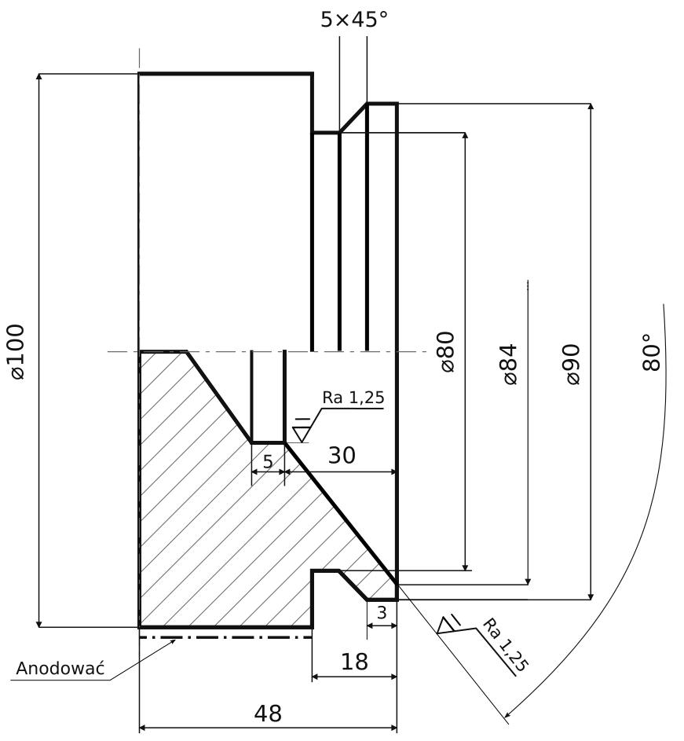{.nostretch width="100%" height="100%"}
::::


```{=html}
<svg class="fragment" data-fragment-index="1"
     xmlns="http://www.w3.org/2000/svg"
     width="1920" height="1080"
     style="position:absolute; left:0; top:0; z-index:1000; pointer-events:none;">

  <defs>
    <marker id="arrow-a" markerWidth="12" markerHeight="12"
            refX="11" refY="6" orient="auto"
            markerUnits="userSpaceOnUse">
      <path d="M1,1 L11,6 L1,11"
            fill="none" stroke="red" stroke-width="2"/>
    </marker>
  </defs>

  <line x1="520" y1="290" x2="1090" y2="510"
        stroke="red" stroke-width="3"
        marker-end="url(#arrow-a)"/>
  <line x1="560" y1="360" x2="1580" y2="810"
        stroke="red" stroke-width="3"
        marker-end="url(#arrow-a)"/>
   <line x1="610" y1="450" x2="1100" y2="850"
        stroke="red" stroke-width="3"
        marker-end="url(#arrow-a)"/>
</svg>
```


## [WPROWADZENIE]{style="display:block; text-align:center;"}

### WARSTWA WIERZCHNIA ELEMENTÓW

„Warstwa wierzchnia to ta część materiału przylegająca do powierzchni wraz z powierzchnią, której własności fizyczne różnią się od reszty materiału nazywanego dalej rdzeniem”

Technologiczna warstwa wierzchnia PN-EN 15305, PN-EN ISO 2639, PN-ISO 14104, PN-EN ISO 21920, ISO 7599 (*stara norma PN-87/M-04250*)


<br>

[**Powierzchnia elementu ≠ Warstwa wierzchnia**]{style="display:block; text-align:center;"}

[**Powierzchnia elementu ≠ Powłoka elementu**]{style="display:block; text-align:center;"}

[**Powierzchnia elementu = granica faz/ośrodków**]{style="display:block; text-align:center;"}

::: {.fragment data-fragment-index="2" style="position:absolute; left:305px; top:0px; width:1310px; height:1080px;"}
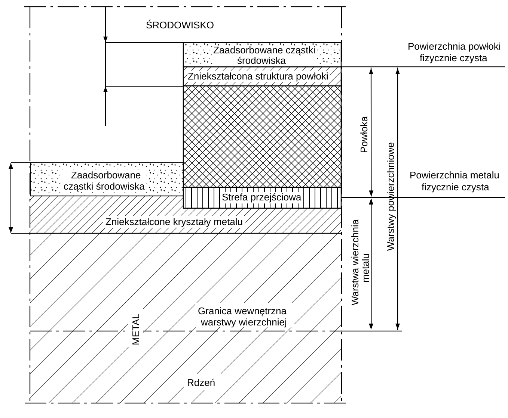{.nostretch width="100%" height="100%"}
:::

::: {.footer}
Burakowski T., Wierzchoń T.: Inżynieria powierzchni metali – podstawy, urządzenia, technologie. WNT, Warszawa 1995.
:::

## [WPROWADZENIE]{style="display:block; text-align:center;"}

### WARSTWA WIERZCHNIA ELEMENTÓW - CHARAKTERYSTYKA

Określony cel (jeden lub wiele, często niepełne).

- antykorozja
- utwardzanie
- umacnianie
- dekoracja
- termiczne
- dielektryczne
- ...

::: {.fragment data-fragment-index="1" style="position:absolute; left:452px; top:279px; width:581px; height:395px;"}
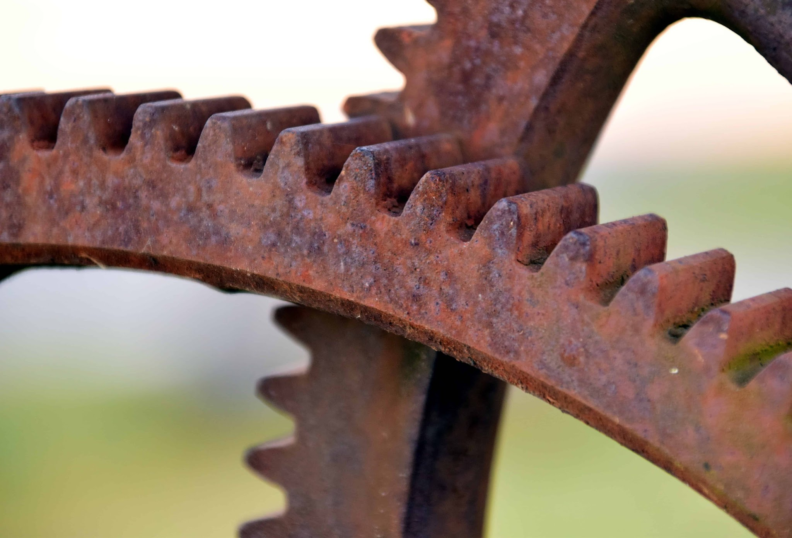{.nostretch width="100%" height="100%"}
:::

::: {.fragment data-fragment-index="2" style="position:absolute; left:574px; top:343px; width:460px; height:458px;"}
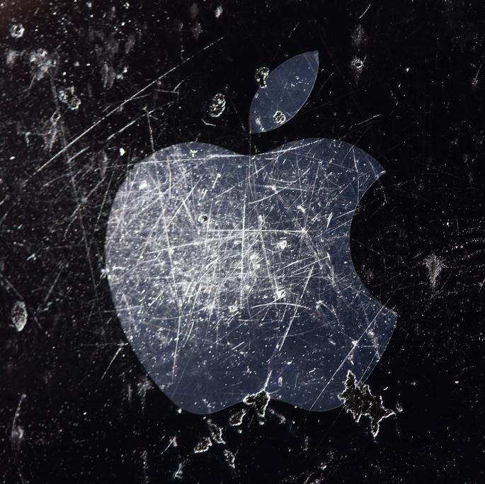{.nostretch width="100%" height="100%"}
:::

::: {.fragment data-fragment-index="3" style="position:absolute; left:687px; top:417px; width:657px; height:478px;"}
{.nostretch width="100%" height="100%"}
:::

::: {.fragment data-fragment-index="4" style="position:absolute; left:804px; top:489px; width:806px; height:444px;"}
{.nostretch width="100%" height="100%"}
:::

::: {.fragment data-fragment-index="5" style="position:absolute; left:1065px; top:326px; width:783px; height:444px;"}
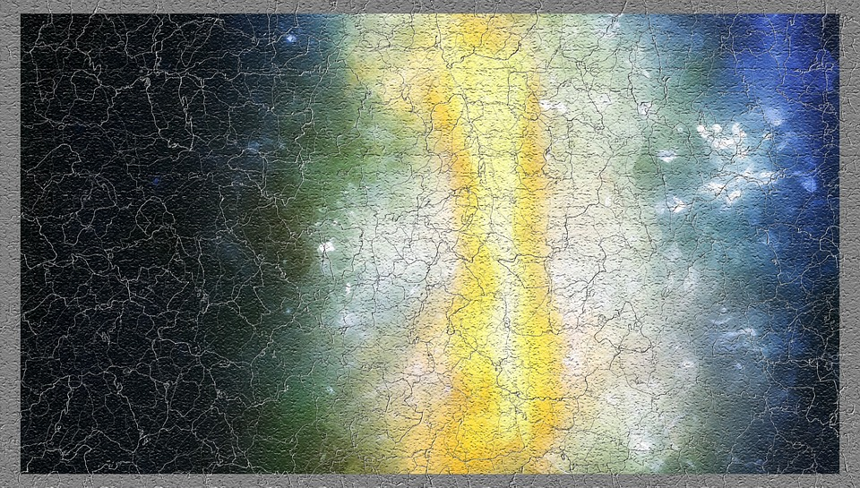{.nostretch width="100%" height="100%"}
:::

---

## [WPROWADZENIE]{style="display:block; text-align:center;"}

### WARSTWA WIERZCHNIA ELEMENTÓW - CHARAKTERYSTYKA

**Właściwości:**

- stereometryczne (chropowatość, falistość, nośność, kierunkowość śladów),
- fizykochemiczne (mechaniczne, chemiczne, cieplne, fizyczne, elektryczne, magnetyczne),
- strukturalne (grubość, struktura, mikrotwardość, naprężenia, wady).

**Stan warstwy wierzchniej:**

chropowatość, falistość, nośność, energia powierzchniowa, napięcie powierzchniowe, emisyjność, odbijalność, pochłanialność (adsorpcja fizyczna), budowa, grubość, twardość, kruchość, naprężenia własne, skład chemiczny, absorpcja chemiczna, adsorpcja chemiczna (chemisorpcja), adsorpcja fizyczna (fizykosorpcja), rozpuszczalność, dyfuzja, kataliza, przewodność, rozszerzalność, adhezja, rezystywność, koercja, przenikalność.

---

## [WPROWADZENIE]{style="display:block; text-align:center;"}

### WARSTWA WIERZCHNIA ELEMENTÓW - OTRZYMYWANIE

- niszczenie lub modyfikacja wcześniejszej warstwy
- nowa powierzchnia fizyczna
- zmiana właściwości istniejącej powierzchni

::: {style="position:absolute; left:137px; top:396px; width:679px; height:521px;"}
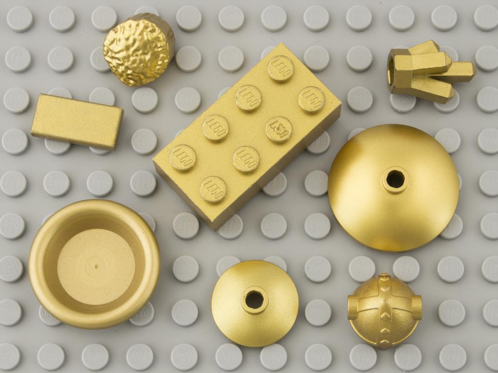{.nostretch width="100%" height="100%"}
:::

::: {style="position:absolute; left:848px; top:396px; width:927px; height:521px;"}
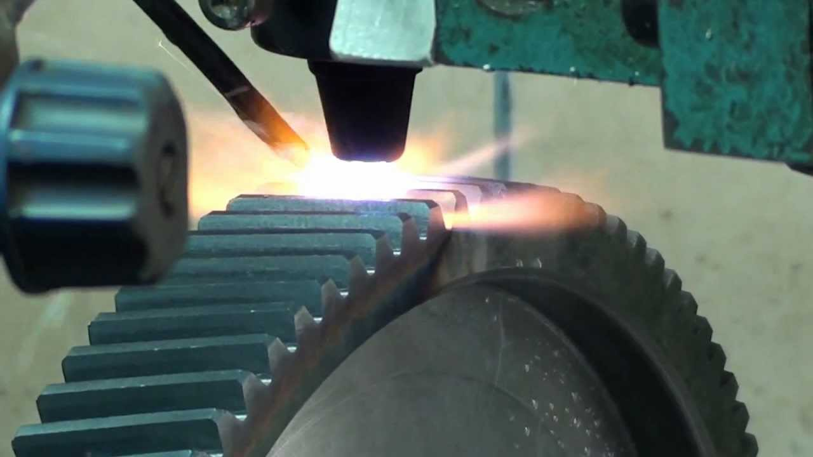{.nostretch width="100%" height="100%"}
:::

---

## [WPROWADZENIE]{style="display:block; text-align:center;"}

### WARSTWA WIERZCHNIA ELEMENTÓW - OTRZYMYWANIE

Norma PN-ISO 1302 „Rysunek techniczny - Oznaczanie struktury geometrycznej powierzchni” zawiera sposoby określania chropowatości na rysunkach technicznych i metody jej uzyskania.

- struktura powierzchni uzyskana w dowolnym procesie obróbki
- struktura powierzchni uzyskana wyłącznie przez zdjęcie materiału – obróbka skrawaniem
- struktura powierzchni uzyskana za pomocą innego procesu niż zdjęcie materiału
- chropowatość powierzchni zawiera się między wartościami a i b
- struktura powierzchni uzyskana ściśle określonym rodzajem obróbki.

Te same zasady dotyczą obróbki cieplnej i cieplno-chemicznej.

::: {style="position:absolute; left:1600px; top:300px; width:140px; "}
{.nostretch width="100%" height="100%"}
:::

---

## [HARTOWANIE POWIERZCHNIOWE]{style="display:block; text-align:center;"}

Szybkie nagrzanie warstwy wierzchniej do temperatury austenityzacji (zwykle ok. 100°C powyżej temperatury przemiany A~C3~), a następnie szybkie chłodzenie przez natrysk wody lub emulsji hartowniczej, w celu uzyskania struktury martenzytycznej na powierzchni i struktury niezahartowanej pod powierzchnią.

**Rodzaje:** płomieniowe, indukcyjne, kąpielowe, laserowe, oporowe, elektrolityczne, ...

::: {style="position:absolute; left:72px; top:436px; width:497px; height:497px;"}
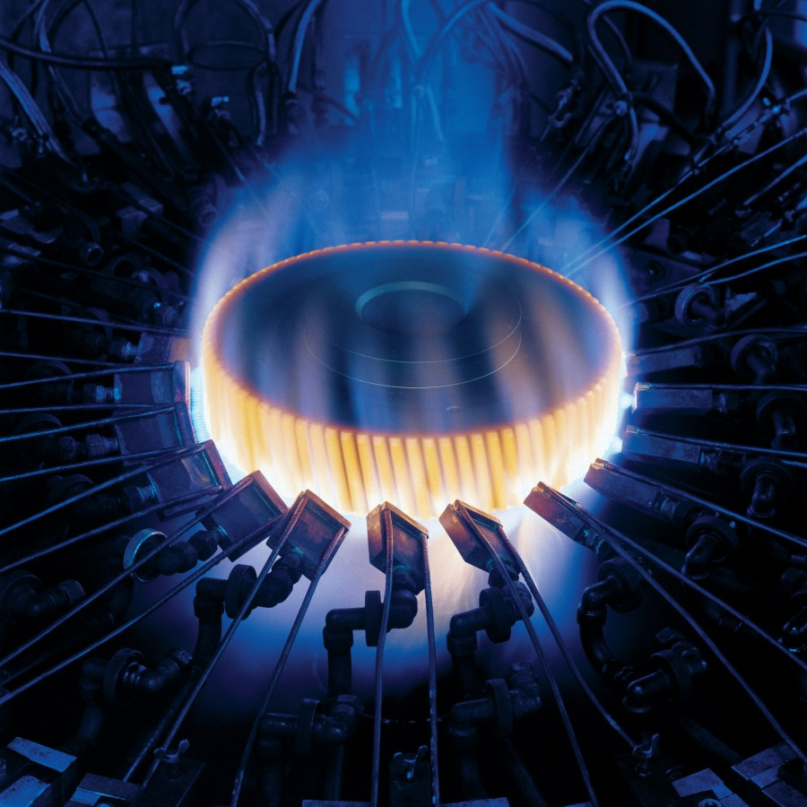{.nostretch width="100%" height="100%"}
:::

::: {style="position:absolute; left:580px; top:436px; width:644px; height:497px;"}
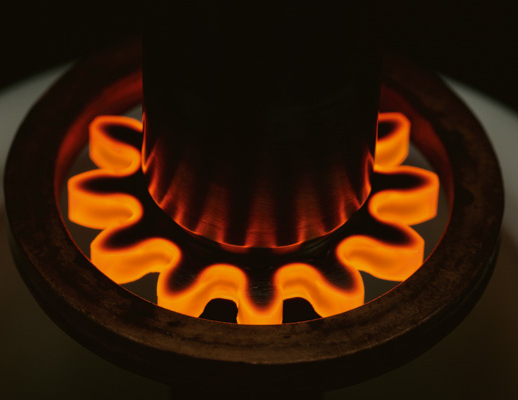{.nostretch width="100%" height="100%"}
:::

::: {style="position:absolute; left:1245px; top:436px; width:588px; height:497px;"}
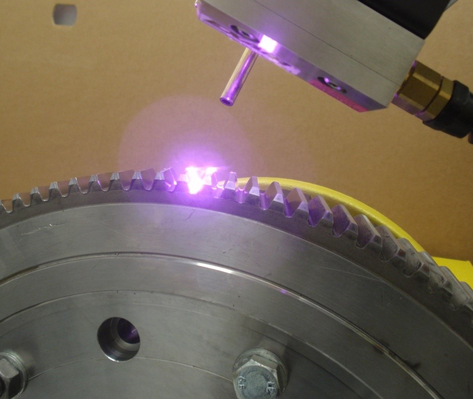{.nostretch width="100%" height="100%"}
:::

::: {.footer}
Gerster, EFD Induction, NTC-TTP
:::

---

## [HARTOWANIE POWIERZCHNIOWE]{style="display:block; text-align:center;"}

### Hartowanie płomieniowe

::: {style="position:absolute; left:230px; top:221px; width:1501px; height:713px;"}
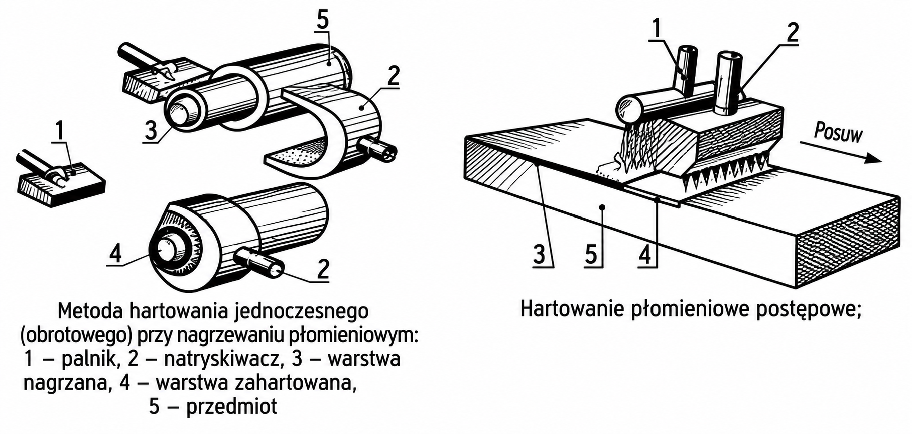{.nostretch width="100%" height="100%"}
:::

---

## [HARTOWANIE POWIERZCHNIOWE]{style="display:block; text-align:center;"}

### Hartowanie płomieniowe

::: {style="position:absolute; left:495px; top:225px; width:945px; height:709px;"}
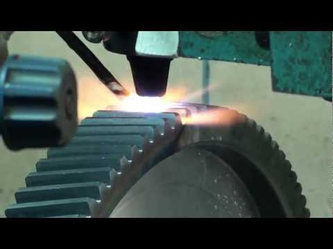{.nostretch width="100%" height="100%"}
:::

---

## [HARTOWANIE POWIERZCHNIOWE]{style="display:block; text-align:center;"}

### Hartowanie indukcyjne

::: {style="position:absolute; left:40px; top:250px; width:1900px; height:497px;"}
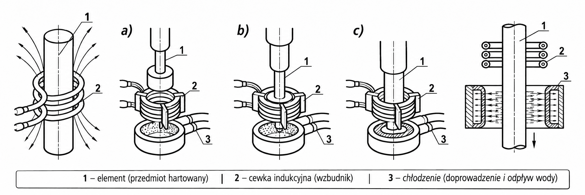{.nostretch width="100%" height="100%"}
:::

---

## [HARTOWANIE POWIERZCHNIOWE]{style="display:block; text-align:center;"}

### Hartowanie indukcyjne

::: {style="position:absolute; left:273px; top:213px; width:1415px; height:720px;"}
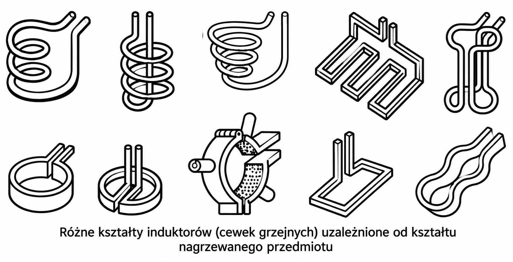{.nostretch width="100%" height="100%"}
:::

---

## [HARTOWANIE POWIERZCHNIOWE]{style="display:block; text-align:center;"}

### Hartowanie indukcyjne

::: {style="position:absolute; left:483px; top:214px; width:960px; height:720px;"}
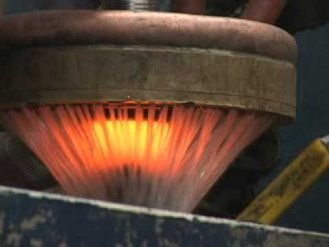{.nostretch width="100%" height="100%"}
:::

---

## [HARTOWANIE POWIERZCHNIOWE]{style="display:block; text-align:center;"}

### Hartowanie indukcyjne

::: {style="position:absolute; left:480px; top:212px; width:960px; height:720px;"}
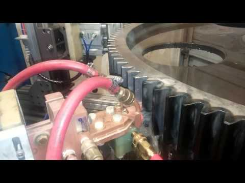{.nostretch width="100%" height="100%"}
:::

## [KONIEC]{style="display:block; text-align:center;"}



## [KONIEC2]{style="display:block; text-align:center;"}