## [OBRÓBKA EROZYJNA GŁADKOŚCIOWA]{style="display:block; text-align:center;"}

### Polerowanie elektrolityczne (elektrochemiczne)

&nbsp;&nbsp;&nbsp;&nbsp; anodowe roztwarzanie metali przy przepływie prądu elektrycznego.

### Polerowanie chemiczne

&nbsp;&nbsp;&nbsp;&nbsp; w roztworach zawierającym silne związki utleniające (bez udziału prądu).

 

[**Polerowanie chemiczne ≊ Polerowanie elektrolityczne**]{style="display:block; text-align:center;"}

[Usuwanie <u>atomów</u> metali z powierzchni]{style="display:block; text-align:center;"}

::: {style="position:absolute; left:326px; top:635px; width:1310px; height:246px;"}
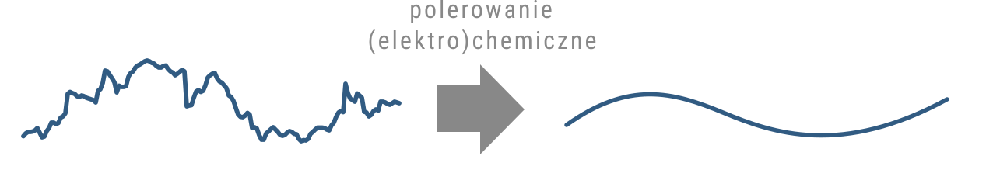{.nostretch width="100%" height="100%"}
:::

## [OBRÓBKA EROZYJNA GŁADKOŚCIOWA]{style="display:block; text-align:center;"}

### Polerowanie elektrolityczne

- zasilanie stałoprądowe o niskim napięciu

- zbiornik procesowy z tworzyw sztucznych lub ołowiu

- katoda z ołowiu, miedzi, stali nierdzewnej, ...

- elektrolity

- H~3~PO~4~, HNO~3~, H~2~SO~4~, HCl, Na~2~Cr~2~O~7~, Na~2~SO~4~, NaCl, ...

::: {style="position:absolute; left:1188px; top:167px; width:637px; height:767px;"}
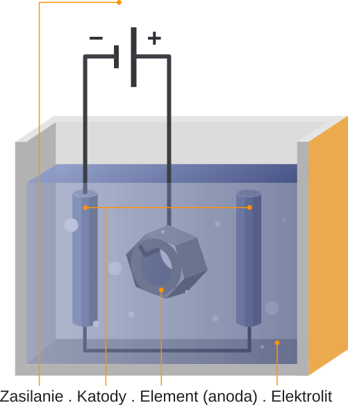{.nostretch width="100%" height="100%"}
:::

## [OBRÓBKA EROZYJNA GŁADKOŚCIOWA]{style="display:block; text-align:center;"}

### Polerowanie elektrolityczne



::: {.footer}
Able Electropolishing Co. https://www.youtube.com/watch?v=0XUS9bRSihM
:::

## [OBRÓBKA EROZYJNA GŁADKOŚCIOWA]{style="display:block; text-align:center;"}

### Polerowanie elektrolityczne (zjawiska)

- anoda: wyzwolenie atomów z sieci krystalicznej
- katoda: osadzanie metali, wydzielanie wodoru
- warstwy obróbkowe:
  - trawiąca chropowatość (gruba)
  - polerująca (cienka)
- selektywne roztwarzanie wierzchołków nierówności
- efekt ostrzowy - koncentracja ładunków na  wierzchołkach, lokalne zwiększenie gęstość prądu

Aby zatrzymać zjawiska chemiczne, należy wypłukać  elementy w wodzie dejonizowanej z alkoholem i wysuszyć.

::: {style="position:absolute; left:1057px; top:151px; width:796px; height:783px;"}
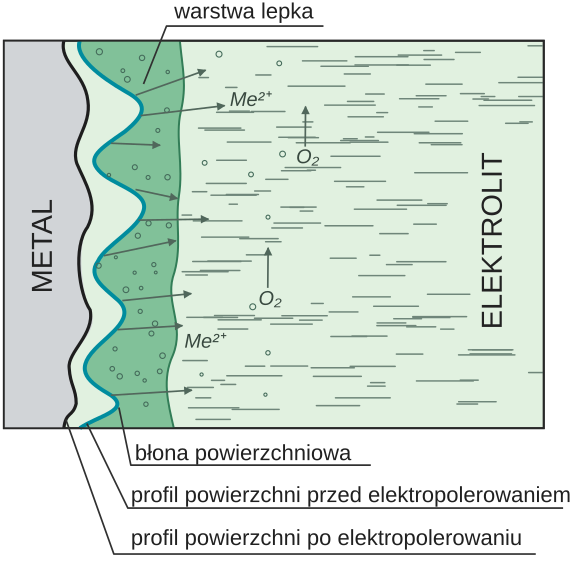{.nostretch width="100%" height="100%"}
:::

## [OBRÓBKA EROZYJNA GŁADKOŚCIOWA]{style="display:block; text-align:center;"}

### Polerowanie elektrolityczne (parametry technologiczne)

:::: {style="position:relative;"}

::: {.fragment data-fragment-index="1" style="position:absolute; left:800px;"}
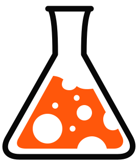{.nostretch height="300px"}
:::

::: {.fragment data-fragment-index="2" style="position:absolute; left:1080px;"}
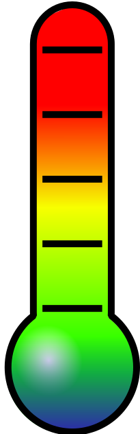{.nostretch height="300px"}
:::

::: {.fragment data-fragment-index="3" style="position:absolute; left:1200px;"}
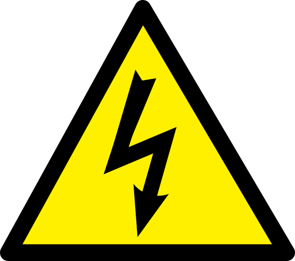{.nostretch height="300px"}
:::

::: {.fragment data-fragment-index="4" style="position:absolute; left:1500px;"}
{.nostretch height="300px"}
:::

- [Skład elektrolitu (wodny roztwór kwasów i soli).]{.fragment data-fragment-index="1"}
- [Temperatura elektrolitu $T$]{.fragment data-fragment-index="2"}
- [Gęstość prądu $I_f$]{.fragment data-fragment-index="3"}
- [Czas trwania procesu $t$]{.fragment data-fragment-index="4"}

::::

::: {.fragment data-fragment-index="5"}

 

Gęstość prądu - stosunek natężenia prądu $I$ do powierzchni $f$ polerowanego elementu

::: {style="position:absolute; left:1400px;"}
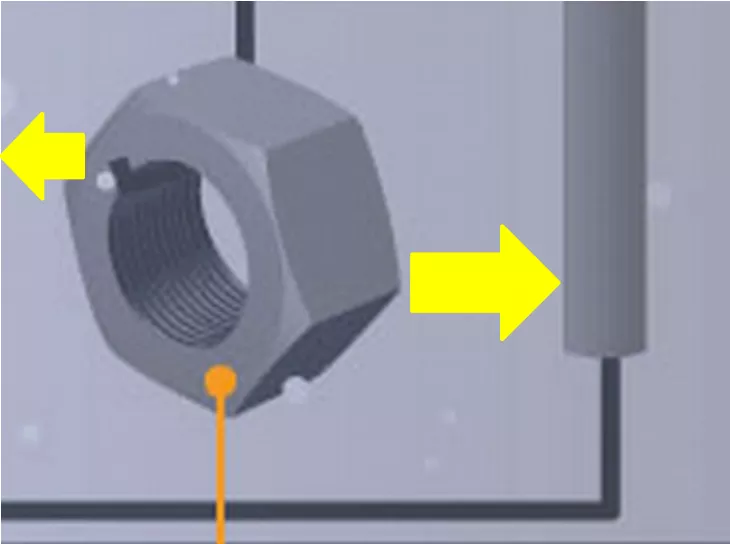{.nostretch height="300px"}
:::

::: {style="width:100%; text-align:center;"}

$$
I_f = \frac{I}{f} \quad \left[\mathrm{A\,dm^{-2}}\right]
$$

:::

Na stabilność i wydajność procesu wpływają wszystkie powyższe parametry,  a nawet kształt i orientacja próbki w stosunku do katody.

:::

## [OBRÓBKA EROZYJNA GŁADKOŚCIOWA]{style="display:block; text-align:center;"}

### Polerowanie elektrolityczne	(parametry technologiczne)

<u>Krzywa polaryzacji</u>

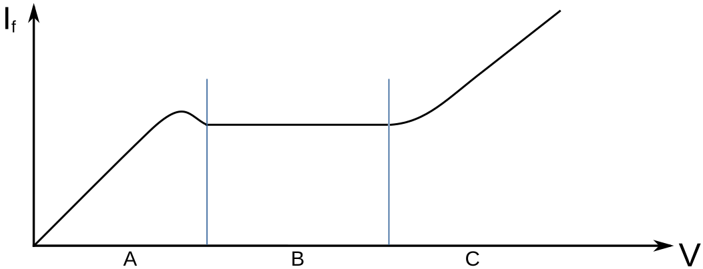{.nostretch width="80%" height="80%" fig-align="center"}

::: {.incremental style="margin-top:-60px;"}
- A: trawienie anody, gromadzenie produktów roztwarzania, wzrost rezystancji i spadek natężenia prądu.
- B: polerowanie, tworzenie błony powierzchniowej (wodorotlenki, tlenki), wzrost rezystancji w czasie.
- C: erozja, intensywne wydzielanie tlenu, odsłonięcie powierzchni metalu.
:::

## [OBRÓBKA EROZYJNA GŁADKOŚCIOWA]{style="display:block; text-align:center;"}

### Polerowanie elektrolityczne (charakterystyka)

- zmniejszenie mikrochropowatości powierzchni
- odsłonięcie struktury rdzenia (krystaliczna i fazowa)
- gratowanie, rozjaśnienie i pasywacja powierzchni

::: {.fragment style="position:absolute; left:71px; width:1800px; height:504px;"}
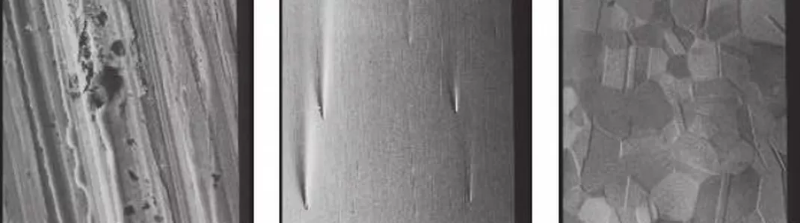{.nostretch width="100%" height="100%"}
:::

::: {.fragment style="position:absolute; left:40px; width:797px; height:504px;"}
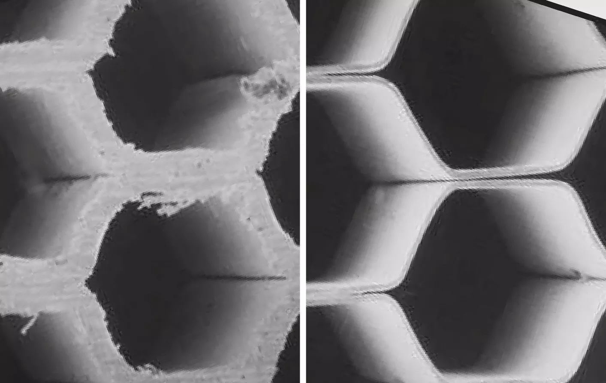{.nostretch width="100%" height="100%"}
:::

::: {.fragment style="position:absolute; left:857px; width:988px; height:400px;"}
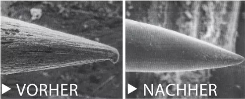{.nostretch width="100%" height="100%"}
:::

::: {.fragment style="position:absolute; left:71px; width:1742px; height:504px;"}
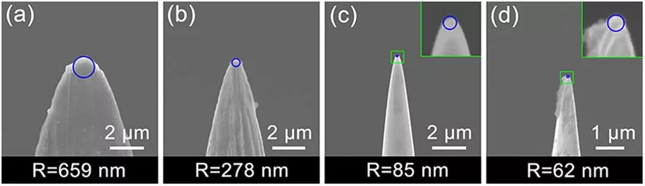{.nostretch width="100%" height="100%"}
:::

::: {.footer}
Poligrat UK Limited, R. Spitzke Oberflächen- und Galvanotechnik,
Gao, Ming, et al. "Tip-induced nanoreactor for silicate." Scientific reports 5 (2015): 14039.
:::

## [OBRÓBKA EROZYJNA GŁADKOŚCIOWA]{style="display:block; text-align:center;"}

### Polerowanie elektrolityczne	(charakterystyka)

<u>Zalety</u>

- brak niepożądanych efektów polerowania mechanicznego
- (naprężenia mechaniczne i cieplne, cząstki wbite w powierzchnię, ślady po obróbce, …)
- w pełni zachowana odporność korozyjna (do 20 razy wyższa niż przy obróbce ściernej)
- możliwość obróbki drobnych elementów o skomplikowanych kształtach
- mechaniczna twardość powierzchni nie ma wpływu na wydajność procesu.

:::: {style="--img-height:350px; display:flex; position:relative; left:50%; transform:translateX(-50%); width:max-content; max-width:none; align-items:center; gap:10px;"}

::: {style="flex:0 0 auto; margin:0;"}
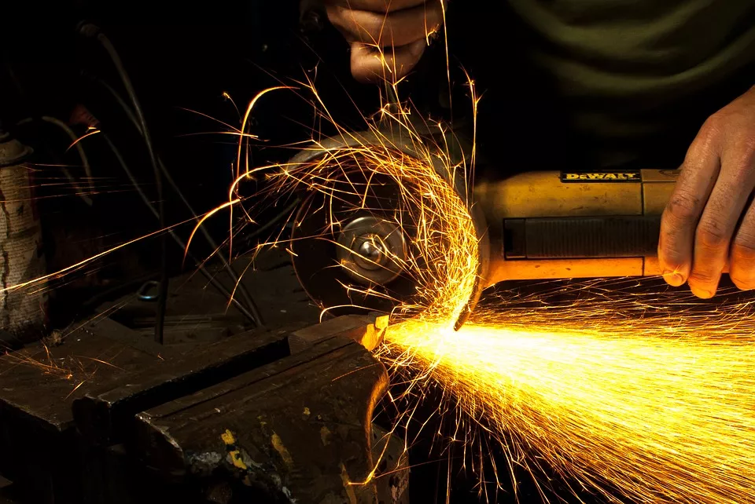{.nostretch style="height:var(--img-height); width:auto; max-width:none; max-height:none; margin:0;"}
:::

::: {style="flex:0 0 auto; margin:0;"}
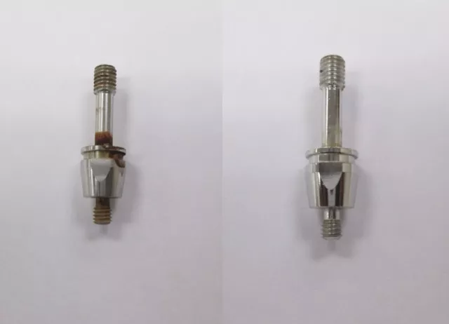{.nostretch style="height:var(--img-height); width:auto; max-width:none; max-height:none; margin:0;"}
:::

::: {style="flex:0 0 auto; margin:0;"}
{.nostretch style="height:var(--img-height); width:auto; max-width:none; max-height:none; margin:0;"}
:::

::: {style="flex:0 0 auto; margin:0;"}
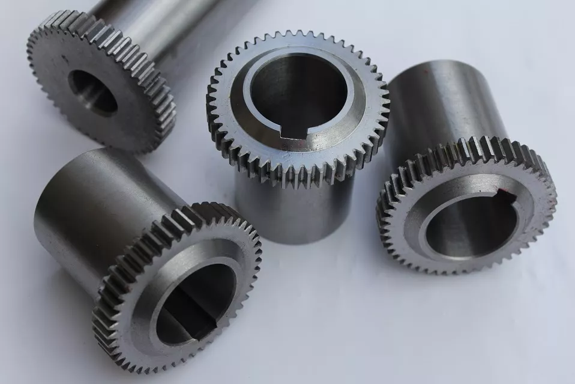{.nostretch style="height:var(--img-height); width:auto; max-width:none; max-height:none; margin:0;"}
:::

::::

::: {.footer}
Able
:::

## [OBRÓBKA EROZYJNA GŁADKOŚCIOWA]{style="display:block; text-align:center;"}

### Polerowanie elektrolityczne	(charakterystyka)

<u>Wady</u>

- proces chemiczny (zagrożenie dla zdrowia, zanieczyszczenia),
- ograniczona kontrola parametrów procesu, które są zmienne w czasie,
- możliwość obróbki jedynie materiałów elektroprzewodzących.

:::: {style="--img-height:450px; display:flex; position:relative; left:50%; transform:translateX(-50%); width:max-content; max-width:none; align-items:center; gap:10px;"}

::: {style="flex:0 0 auto; margin:0;"}
{.nostretch style="height:var(--img-height); width:auto; max-width:none; max-height:none; margin:0;"}
:::

::: {style="flex:0 0 auto; margin:0;"}
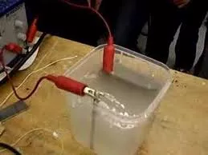{.nostretch style="height:var(--img-height); width:auto; max-width:none; max-height:none; margin:0;"}
:::

::: {style="flex:0 0 auto; margin:0;"}
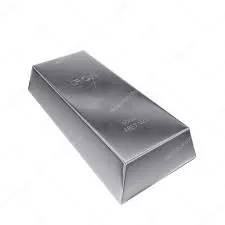{.nostretch style="height:var(--img-height); width:auto; max-width:none; max-height:none; margin:0;"}
:::

::::

## [OBRÓBKA EROZYJNA GŁADKOŚCIOWA]{style="display:block; text-align:center;"}

### Polerowanie elektrolityczne (zastosowanie)

- w końcowej fazie wytwarzania narzędzi
- przygotowanie pod nakładanie powłok
- elektrotechnika, medycyna, aparatura chemiczna, aparatura hydrauliczna, biżuteria

:::: {style="--img-height:500px; display:flex; position:relative; left:50%; transform:translateX(-50%); width:max-content; max-width:none; align-items:center; gap:10px;"}

::: {style="flex:0 0 auto; margin:0;"}
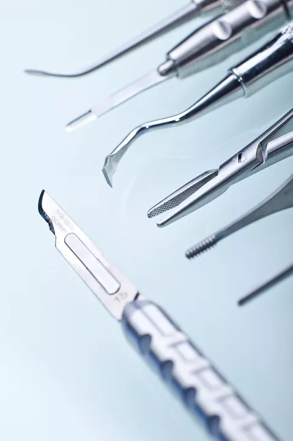{.nostretch style="height:var(--img-height); width:auto; max-width:none; max-height:none; margin:0;"}
:::

::: {style="flex:0 0 auto; margin:0;"}
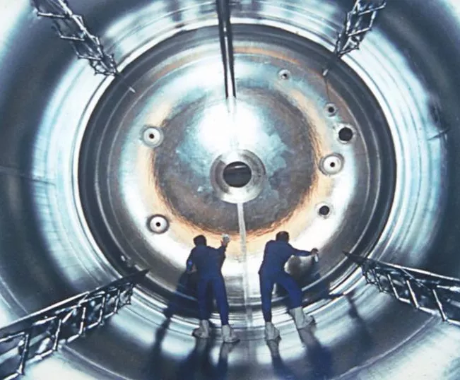{.nostretch style="height:var(--img-height); width:auto; max-width:none; max-height:none; margin:0;"}
:::

::: {style="flex:0 0 auto; margin:0;"}
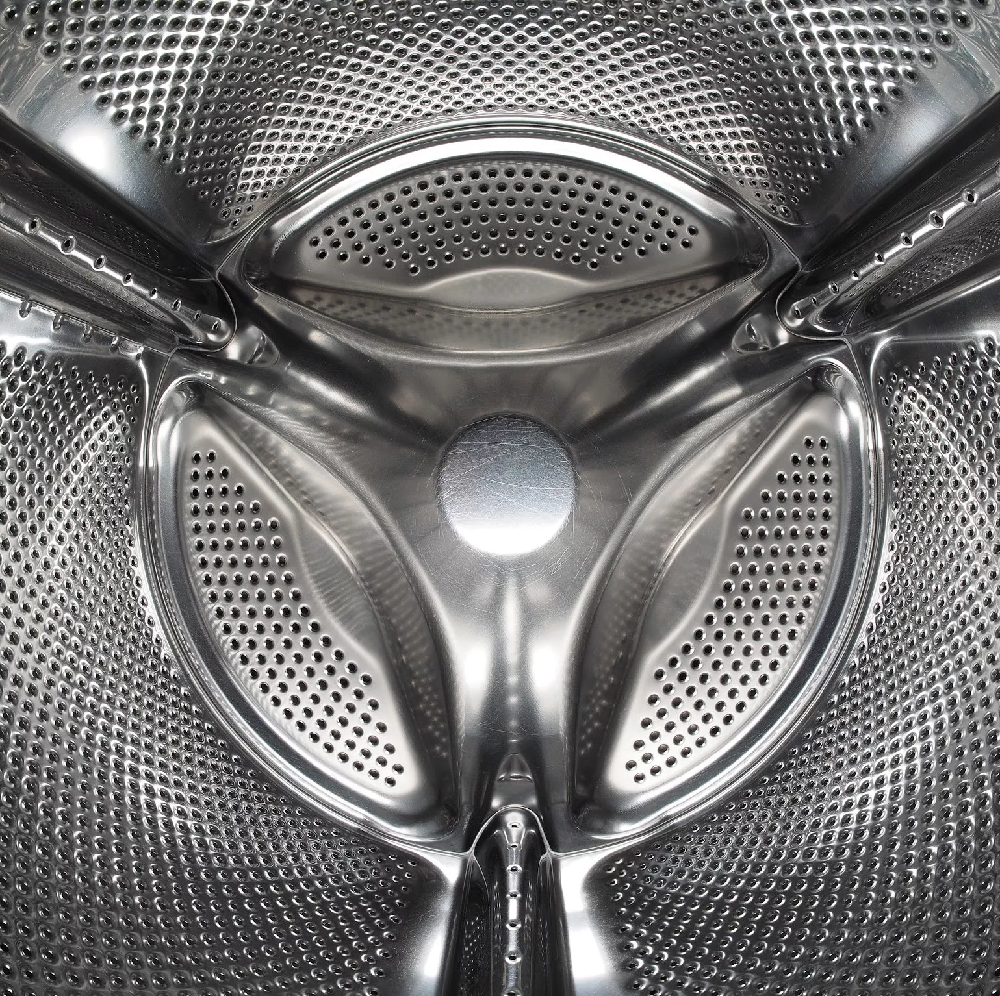{.nostretch style="height:var(--img-height); width:auto; max-width:none; max-height:none; margin:0;"}
:::

::: {style="flex:0 0 auto; margin:0;"}
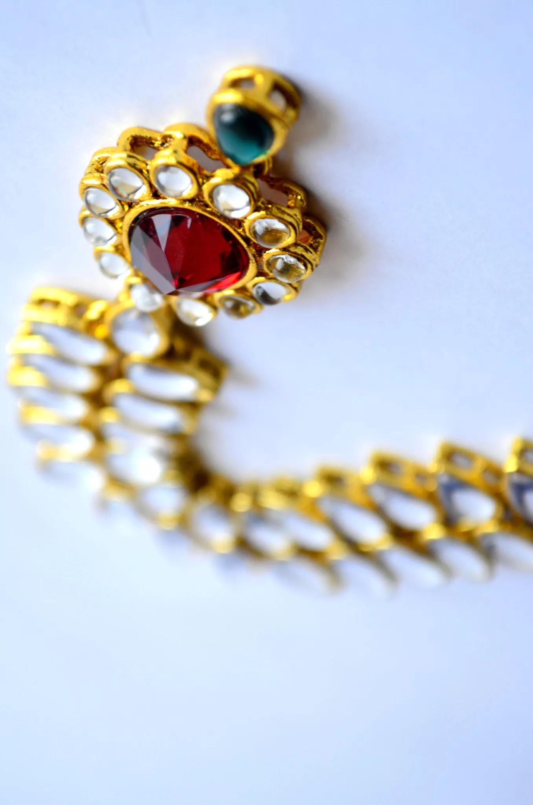{.nostretch style="height:var(--img-height); width:auto; max-width:none; max-height:none; margin:0;"}
:::

::::

::: {.footer}
Poligrat UK Limited, Elektropol-R
:::

## [OBRÓBKA EROZYJNA GŁADKOŚCIOWA]{style="display:block; text-align:center;"}

### Polerowanie elektrolityczne



::: {.footer}
Nitty-Gritty S. R. L. https://www.youtube.com/watch?v=hMV6VufvqdY
:::

## [OBRÓBKA EROZYJNA GŁADKOŚCIOWA]{style="display:block; text-align:center;"}

### Trawienie elektrolityczne

- wygładza zarysowania i ostre krawędzie,
- usuwa z wierzchniej warstwy zabrudzenia, rdzę a przede wszystkim zgorzel po spawaniu,
- usuwa przebarwienia w miejscach spawania, cięcia lub zgrzewania (powodujące korozję),
- przygotowanie powierzchni przed procesami finalnej obróbki (pasywacja, elektropolerowanie).

:::: {style="--img-height:400px; display:flex; position:relative; left:50%; transform:translateX(-50%); width:max-content; max-width:none; align-items:center; gap:10px;"}

::: {style="flex:0 0 auto; margin:0;"}
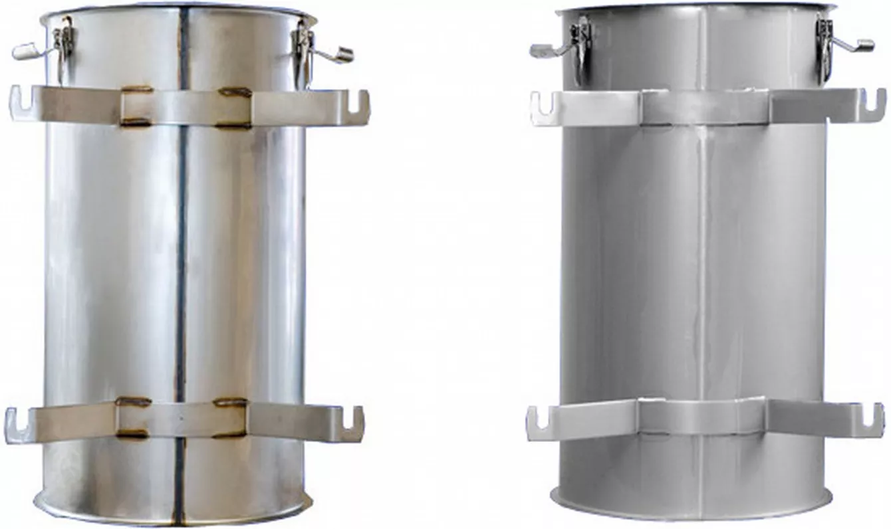{.nostretch style="height:var(--img-height); width:auto; max-width:none; max-height:none; margin:0;"}
:::

::: {.fragment data-fragment-index="1" style="flex:0 0 auto; margin:0;"}
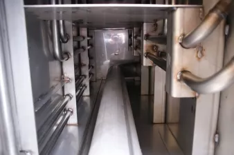{.nostretch style="height:var(--img-height); width:auto; max-width:none; max-height:none; margin:0;"}
:::

::: {.fragment data-fragment-index="1" style="flex:0 0 auto; margin:0;"}
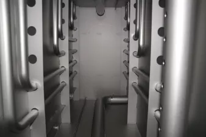{.nostretch style="height:var(--img-height); width:auto; max-width:none; max-height:none; margin:0;"}
:::

::::

::: {.footer}
Elektropol-R, ECM
:::

## [OBRÓBKA EROZYJNA GŁADKOŚCIOWA]{style="display:block; text-align:center;"}

### Trawienie elektrolityczne



::: {.footer}
xrendgen1 https://www.youtube.com/watch?v=QheQYBmEtkM
:::

## [OBRÓBKA EROZYJNA GŁADKOŚCIOWA]{style="display:block; text-align:center;"}

### Trawienie vs polerowanie elektrolityczne

<table style="position:absolute; left:72px; top:285px;
              width:1766px; border:none; border-collapse:collapse;
              margin:0; table-layout:fixed;">
  <tr>
    <td style="width:33.33%; text-align:center; border:none; padding:0;">element oczyszczony</td>
    <td style="width:33.33%; text-align:center; border:none; padding:0;">trawiony</td>
    <td style="width:33.33%; text-align:center; border:none; padding:0;">polerowany</td>
  </tr>
</table>

::: {style="position:absolute; left:72px; top:344px; width:1766px; height:563px;"}
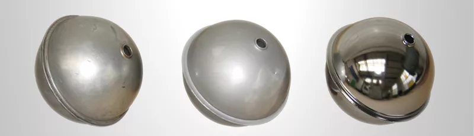{.nostretch width="100%" height="100%"}
:::

::: {.footer}
Elektropol-R
:::

## [OBRÓBKA EROZYJNA GŁADKOŚCIOWA]{style="display:block; text-align:center;"}

### Pasywacja elektrolityczna

- Samoczynna pasywacja stali nierdzewnej zachodzi spontanicznie w obecności tlenu z otoczenia.
- Proces ten może trwać kilka dni zanim warstwa pasywna osiągnie pełną grubość.
- Naturalnie wytworzona warstwa tlenków jest bardzo cienka i podatna na mechaniczne uszkodzenia.
- W niesprzyjających warunkach (wilgotność, zasolenie, czynniki agresywne) uszkodzona warstwa pasywacyjna nie odtworzy się i rozpoczyna się proces korozji.
- Proces (elektro)chemicznej pasywacji prowadzi do dziesięciokrotnego wzrostu grubości ochronnej warstwy tlenków na powierzchni wyrobu.
- Elektropolerowanie wygładza powierzchnię wyrobu, lecz obrobiona powierzchnia ulega też głębokiej anodowej pasywacji, dzięki czemu zostaje w znacznym stopniu zabezpieczona przed korozją.
- W przypadku stali chromoniklowej elektropolerowanie prowadzi do zwiększenia koncentracji atomów Cr na powierzchni (Fe i Ni trawią się szybciej) - powierzchnia ulega utwardzeniu, a dodatkowo na powierzchni wytwarza się warstwa tlenków chromu, znacznie zwiększająca odporność chemiczną.

## [OBRÓBKA EROZYJNA GŁADKOŚCIOWA]{style="display:block; text-align:center;"}

### Pasywacja elektrolityczna

::: {.auto-fade style="--delay:0s; position:absolute; left:72px; top:150px; width:583px; height:438px;"}
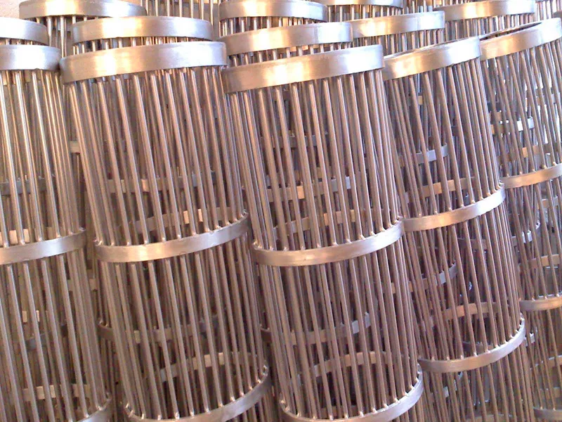{.nostretch width="100%" height="100%"}
:::

::: {.auto-fade style="--delay:2s; position:absolute; left:295px; top:478px; width:606px; height:455px;"}
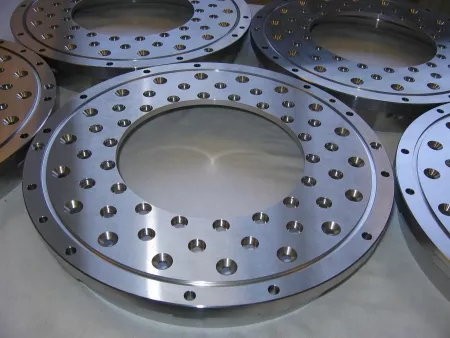{.nostretch width="100%" height="100%"}
:::

::: {.auto-fade style="--delay:4s; position:absolute; left:619px; top:234px; width:583px; height:438px;"}
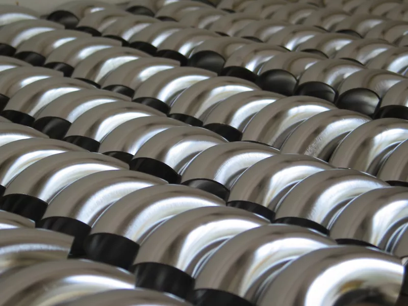{.nostretch width="100%" height="100%"}
:::

::: {.auto-fade style="--delay:6s; position:absolute; left:879px; top:478px; width:512px;"}
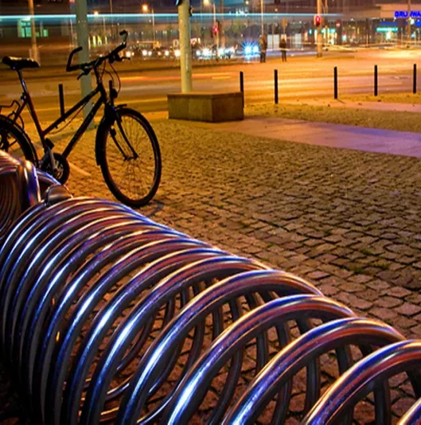{.nostretch width="100%" height="100%"}
:::

::: {.auto-fade style="--delay:8s; position:absolute; left:1173px; top:150px; width:667px; height:699px;"}
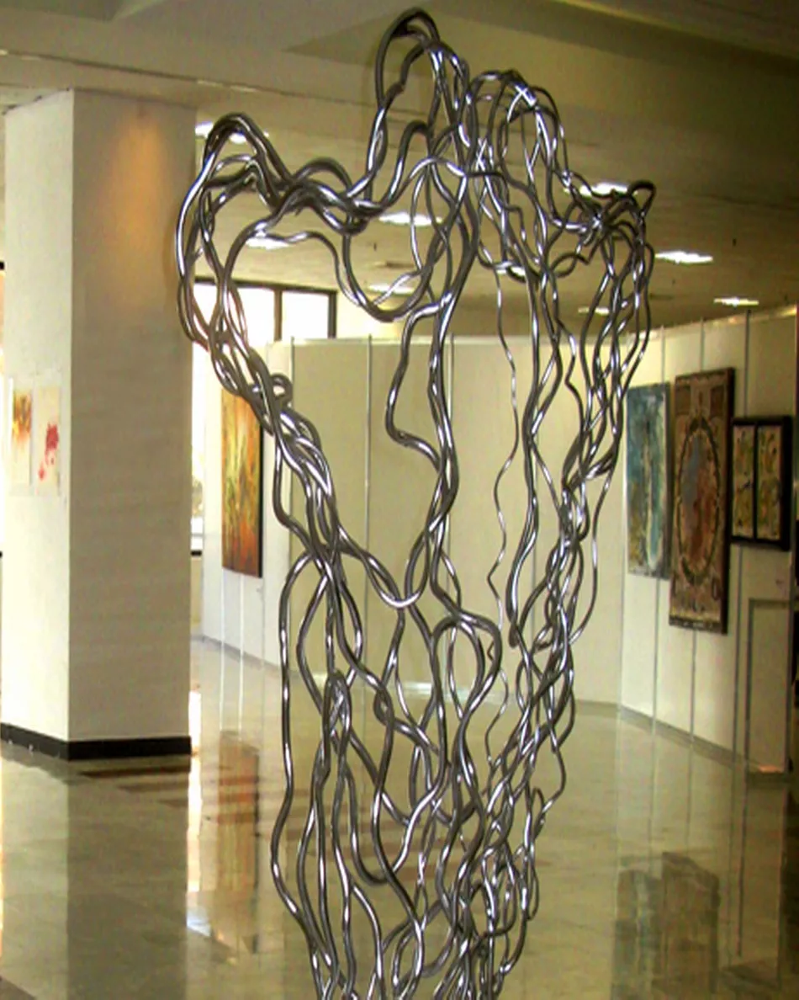{.nostretch width="100%" height="100%"}
:::

::: {.fragment data-fragment-index="1" style="position:absolute; left:300px; top:170px; width:1200px;"}
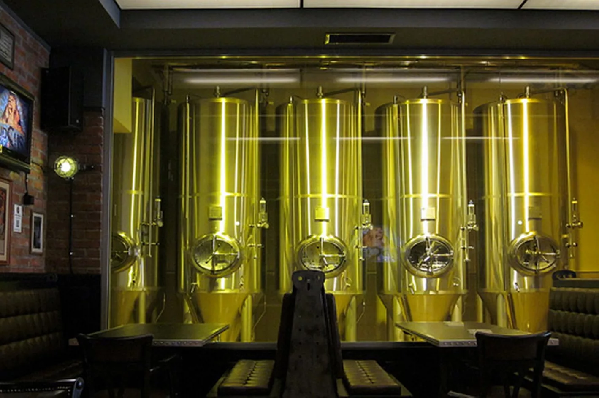{.nostretch width="100%" height="100%"}
:::

:::: {style="--img-height:700px; display:flex; position:relative; left:50%; transform:translateX(-50%); width:max-content; max-width:none; align-items:center; gap:10px;"}

::: {.fragment data-fragment-index="2" style="flex:0 0 auto; margin:0;"}
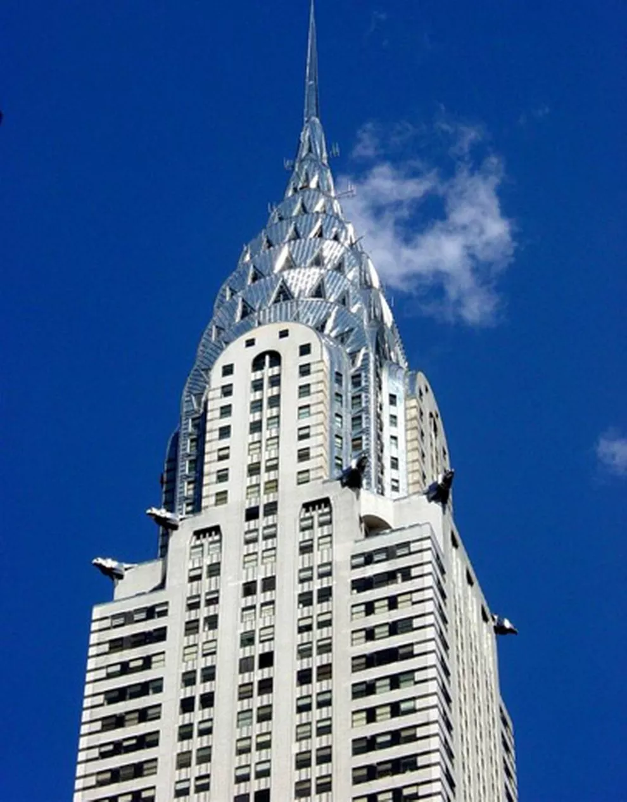{.nostretch style="height:var(--img-height); width:auto; max-width:none; max-height:none; margin:0;"}
:::

::: {.fragment data-fragment-index="3" style="flex:0 0 auto; margin:0;"}
{.nostretch style="height:var(--img-height); width:auto; max-width:none; max-height:none; margin:0;"}
:::

::::

::: {.footer}
Elektropol-R, ECM, Braumax, Pinetrest, Alex Shaw
:::

## [OBRÓBKA EROZYJNA GŁADKOŚCIOWA]{style="display:block; text-align:center;"}

### Polerowanie hybrydowe

- Równoczesne zjawiska obróbki ściernej i elektrochemicznej.
- Efekt synergii: wydajność obróbki większa niż suma efektów technik składowych.
- Honowanie elektrochemiczne
- w roztworze NaCl lub NaNO~3~,
- osełki diamentowe o spoiwie metalowym,
- element obrabiany (anoda), osełki (katoda).

::: {style="position:absolute; left:1340px; top:279px; width:498px; height:654px;"}
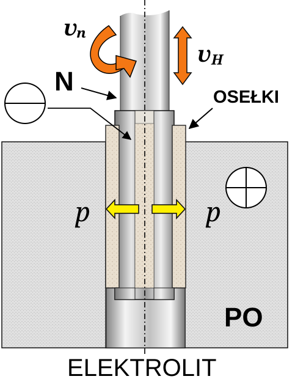{.nostretch width="100%" height="100%"}
:::

## [QUIZ]{style="display:block; text-align:center;"}

::: {.incremental}
- Czym różni się polerowanie ścierne od elektrolitycznego?

- Polerowanie i trawienie elektrochemiczne: proces, parametry, materiały.

- W jakim celu i jakimi metodami prowadzimy hartowanie powierzchniowe?

- Podobieństwa i różnice polerowania i powlekania elektrochemicznego.
:::