## [TECHNOLOGIA POWŁOK]{style="display:block; text-align:center;"}

Powłoka to warstwa materiału <u>wytworzona lub nałożona</u> na powierzchnię elementu w sposób naturalny lub sztuczny. Powłoka jest wykonana <u>z innego materiału niż element</u>. Celem powłoki jest uzyskanie określonych właściwości ochronnych, technicznych lub dekoracyjnych.  

::: {style="position:absolute; left:272px; top:658px; width:367px;"}
{.nostretch width="100%"}
:::

::: {style="position:absolute; left:155px; top:331px; width:413px;"}
{.nostretch width="100%"}
:::

::: {style="position:absolute; left:751px; top:614px; width:426px;"}
{.nostretch width="100%"}
:::

::: {style="position:absolute; left:632px; top:331px; width:367px;"}
{.nostretch width="100%"}
:::

::: {style="position:absolute; left:1111px; top:331px; width:367px;"}
{.nostretch width="100%"}
:::

::: {style="position:absolute; left:1300px; top:686px; width:388px;"}
{.nostretch width="100%"}
:::

::: {style="position:absolute; left:1536px; top:331px; width:205px;"}
{.nostretch width="100%"}
:::


<!-- Slajd 3 -->
## [TECHNOLOGIA POWŁOK]{style="display:block; text-align:center;"}

Korozja to proces stopniowego niszczenia materiałów przez czynniki środowiskowe, zachodzący na powierzchni (i pod nią). Proces ma charakter reakcji (elektro)chemicznych, mikrobiologicznych lub fizycznych (przemiany fazowe, uszkodzenia przez promieniowanie). Rezultatem jest stopniowa zmiana mikrostruktury powierzchni, geometrii elementu oraz jego właściwości użytkowych.  

::: {.columns style="width:100%; align-items:center; gap:29px; margin:20px 0;"}

::: {.column style="width:566px; flex:none;"}
{.nostretch width="100%"}
:::

::: {.column style="width:578px; flex:none;"}
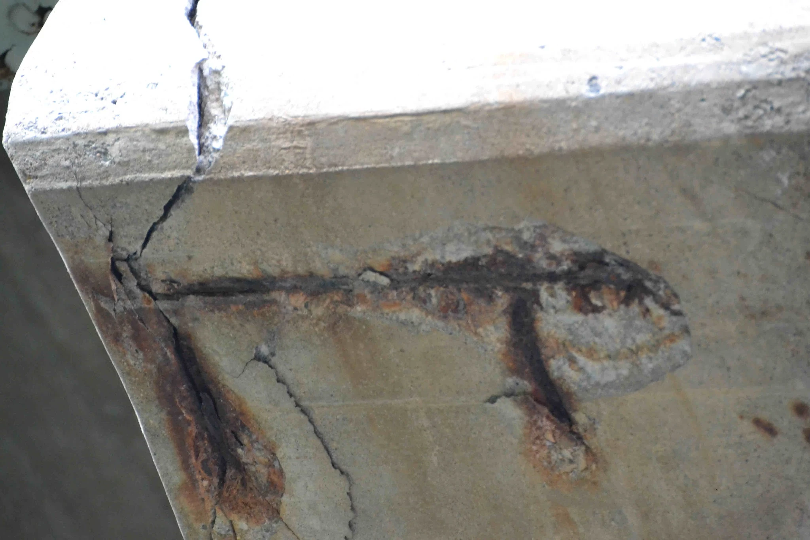{.nostretch width="100%"}
:::

::: {.column style="width:580px; flex:none;"}
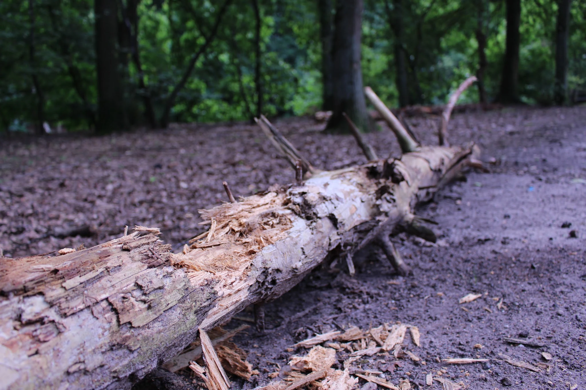{.nostretch width="100%"}
:::

:::

*Stan użytkowania metali jest stanem sztucznym, nietrwałym termodynamicznie. Korozja jest więc naturalną tendencją osiągnięcia równowagi termodynamicznej czyli postaci, w której metale występują w przyrodzie.*

```{=html}
<svg class="fragment" data-fragment-index="1"
     xmlns="http://www.w3.org/2000/svg"
     width="1920" height="1080"
     style="position:absolute; left:0; top:0; z-index:1000; pointer-events:none;">

  <defs>
    <marker id="arrow-a" markerWidth="12" markerHeight="12"
            refX="11" refY="6" orient="auto"
            markerUnits="userSpaceOnUse">
      <path d="M1,1 L11,6 L1,11"
            fill="none" stroke="red" stroke-width="2"/>
    </marker>
  </defs>

  <line x1="810" y1="205" x2="500" y2="500"
        stroke="red" stroke-width="3"
        marker-end="url(#arrow-a)"/>
  <line x1="1500" y1="205" x2="900" y2="550"
        stroke="red" stroke-width="3"
        marker-end="url(#arrow-a)"/>
   <line x1="1200" y1="205" x2="1400" y2="580"
        stroke="red" stroke-width="3"
        marker-end="url(#arrow-a)"/>
</svg>
```


<!-- Slajd 4 -->
## [TECHNOLOGIA POWŁOK]{style="display:block; text-align:center;"}


Prędkość korozji [µm/rok]

| Środowisko: | miejskie | wybrzeże | przemysłowe | pustynia |
|:-----------:|:--------:|:--------:|:-----------:|:--------:|
| Fe          | 30÷90    | 60÷600   | 40÷100      | 2÷3      |
| Zn          | 1÷6      | 4÷28     | 3÷11        | 0÷1      |
| Al          | ~0       | 12       | 1           | b.d.     |


::: {style="position:absolute; left:160px; top:456px; width:624px;"}
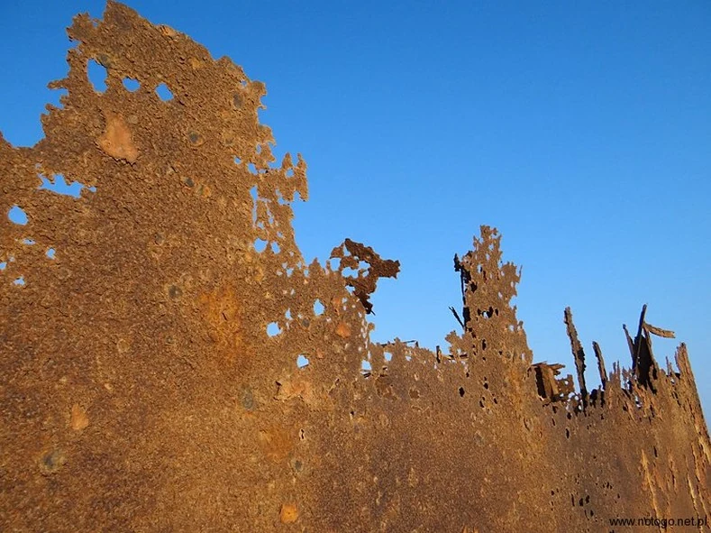{.nostretch width="100%"}
:::

::: {style="position:absolute; left:803px; top:456px; width:960px;"}
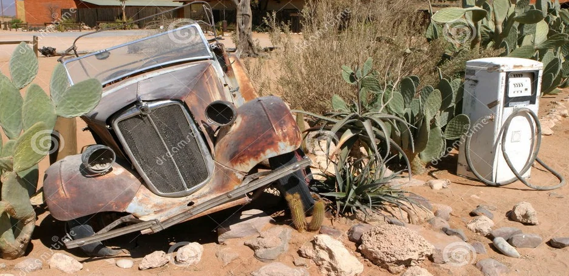{.nostretch width="100%"}
:::


<!-- Slajd 5 -->
## [TECHNIKI WYTWARZANIA POWŁOK]{style="display:block; text-align:center;"}

::: {.lista-zwarta}

**Powłoki metalowe** (metale lub stopy) na metalach lub niemetalach:

- Powłoki galwaniczne (galwanostegia) z metali lub stopów metali - elektrochemiczne.
- Chemiczne (redukcja jonów metali), bezprądowe, na dowolnych tworzywach konstrukcyjnych.
- Zanurzeniowe (ogniowe), w roztopionym metalu (Sn, Zn, Pb, Al i stopy).
- Dyfuzyjne (Cr, Al, Si, Be) głównie do elementów stalowych.
- Metalizacja natryskowa – gazowa, łukowa, plazmowa (Zn, Sn, Pb, stal nierdzewna).
- Platerowane (nawalcowywanie warstwy Al, Cu, Ag, stali kwasoodpornej, także detonacyjnie).
- Natopione (wiązką laserową, elektronów, elektroiskrowe).
- Techniki PVD i CVD.

**Powłoki niemetalowe** (związki metali, ceramika, tworzywa sztuczne) na metalach lub niemetalach:

- Konwersyjne – anodowanie, fosforanowanie, chromianowanie, oksydowanie.
- Emalie szkliste, ceramiczne (nieorganiczne).
- Powłoki malarsko-lakiernicze.
- Powłoki z tworzyw sztucznych (natryskiwanie, fluidyzacja).
- Techniki PVD i CVD.

:::


<!-- Slajd 6 -->
## [TECHNIKI WYTWARZANIA POWŁOK]{style="display:block; text-align:center;"}

### Powłoki galwaniczne 

- Metale lub stopy metali nakładane w oparciu o prawa elektrolizy Faraday’a - <u>galwanostegia</u>.  
- Trwale związane z podłożem, w odróżnieniu od ~~[galwanoplastyki](https://pl.wikipedia.org/wiki/Galwanoplastyka){style="color:inherit; text-decoration:none;"}~~ (oddzielane od wzorca).


::: {.fragment data-fragment-index="2" style="font-size:160%; text-align:center; transform:translateY(-70px);"}

$$
m = k \cdot I \cdot t = k \cdot Q
$$

:::


::: {.fragment data-fragment-index="2" style="display:flex; align-items:center; justify-content:space-between; width:100%; gap:12px; margin:30px 0; transform:translateY(-110px);"}

{.nostretch height="180px"}

<svg width="140" height="95" viewBox="0 0 140 95">
  <path d="M2 25 H92 V3 L138 47.5 L92 92 V70 H2 Z"
        fill="#f0eee5" stroke="#24558a" stroke-width="1.5"/>
</svg>

[ $k \times$ ]{style="font-size:170%; white-space:nowrap;"}

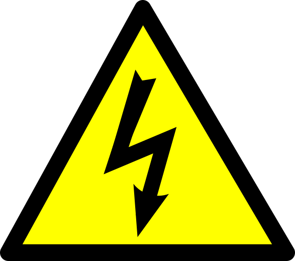{.nostretch height="155px"}

[ $\times$ ]{style="font-size:170%;"}

{.nostretch height="155px"}

<svg width="140" height="95" viewBox="0 0 140 95">
  <path d="M2 25 H92 V3 L138 47.5 L92 92 V70 H2 Z"
        fill="#f0eee5" stroke="#24558a" stroke-width="1.5"/>
</svg>

[ $k \times$ ]{style="font-size:170%; white-space:nowrap;"}

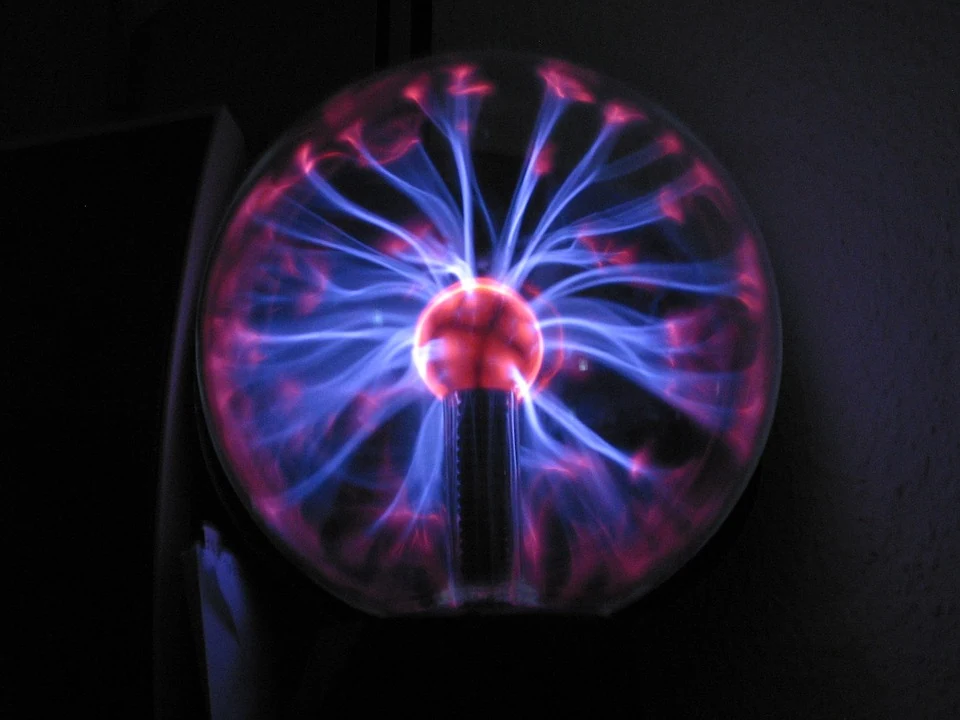{.nostretch height="155px"}

:::

::: {.fragment data-fragment-index="3" style="width:100%; margin:20px 0; transform:translateY(-110px);"}

$k$ – równoważnik elektrochemiczny $[\mathrm{g}\cdot\mathrm{h}^{-1}\cdot\mathrm{A}^{-1}]$

<!-- ILUSTRACJE -->

::: {style="display:flex; align-items:flex-start; justify-content:space-around; width:100%;"}

::: {style="flex:1; text-align:center;"}
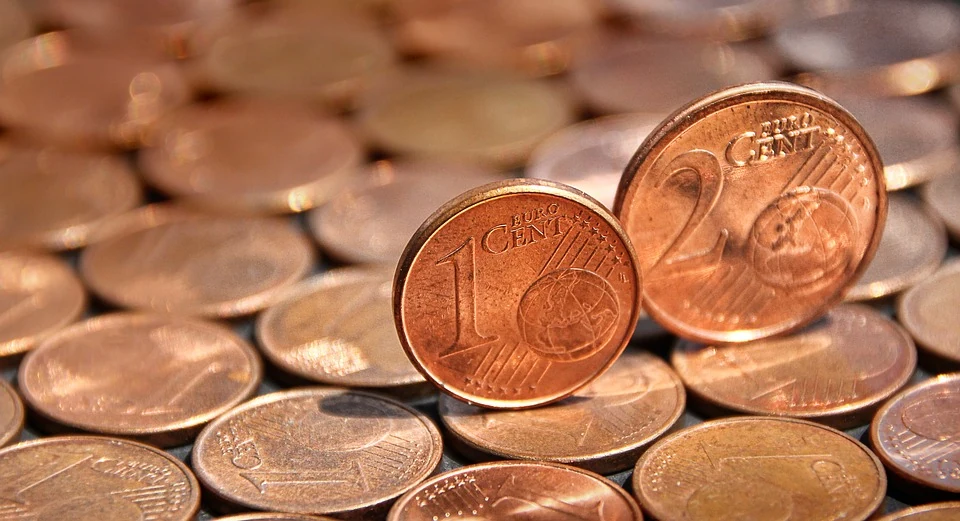{.nostretch height="220px"}
:::

::: {style="flex:1; text-align:center;"}
{.nostretch height="220px"}
:::

::: {style="flex:1; text-align:center;"}
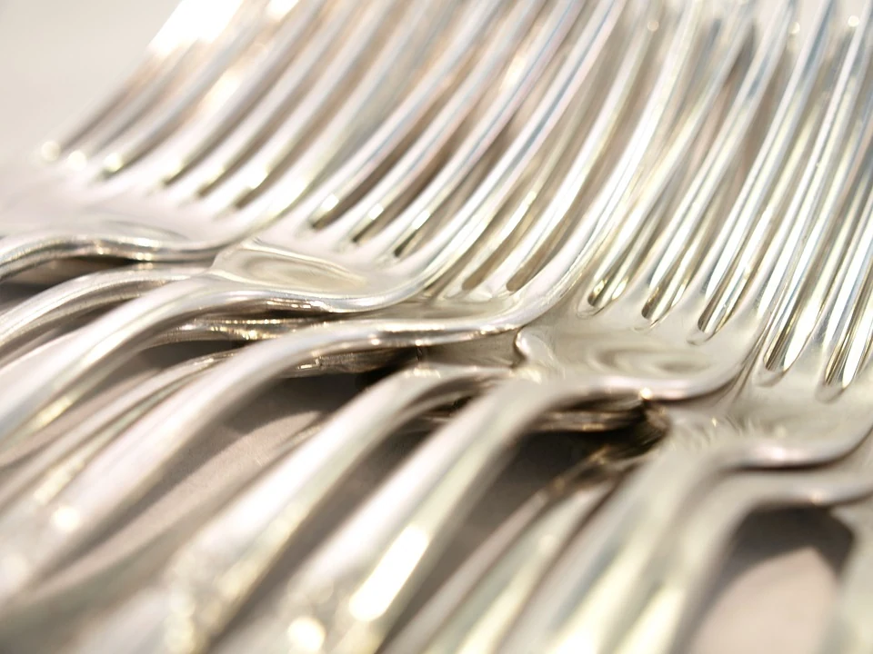{.nostretch height="220px"}
:::

:::


<!-- NAPISY – NIEZALEŻNA WARSTWA -->

::: {style="position:relative; width:100%; height:0; transform:translateY(-220px); pointer-events:none;"}

::: {style="position:absolute; left:0%; top:0; font-size:160%; font-weight:bold;"}
1,2
:::

::: {style="position:absolute; left:38%; top:0; font-size:160%; font-weight:bold;"}
0,3
:::

::: {style="position:absolute; left:68%; top:0; font-size:160%; font-weight:bold;"}
4,0
:::

:::

:::


<!-- Slajd 7 -->
## [TECHNIKI WYTWARZANIA POWŁOK]{style="display:block; text-align:center;"}

### Powłoki galwaniczne (parametry technologiczne)

:::: {style="position:relative;"}

- [Skład elektrolitu]{.fragment data-fragment-index="1"}
- [Temperatura elektrolitu $T$]{.fragment data-fragment-index="2"}
- [Gęstość prądu $I_f$]{.fragment data-fragment-index="3"}
- [Czas trwania procesu $t$]{.fragment data-fragment-index="4"}
- ::: {.fragment data-fragment-index="5"}
  Materiał anody <span style="color:lightgray;">(*lub skład elektrolitu - jony metalu*)</span>
  :::

::::

::: {.fragment data-fragment-index="1" style="position:absolute; left:60px;"}
{.nostretch height="250px"}
:::

::: {.fragment data-fragment-index="2" style="position:absolute; left:300px;"}
{.nostretch height="250px"}
:::

::: {.fragment data-fragment-index="3" style="position:absolute; left:400px;"}
{.nostretch height="250px"}
:::

::: {.fragment data-fragment-index="4" style="position:absolute; left:660px;"}
{.nostretch height="250px"}
:::

::: {.fragment data-fragment-index="5" style="position:absolute; left:950px;"}
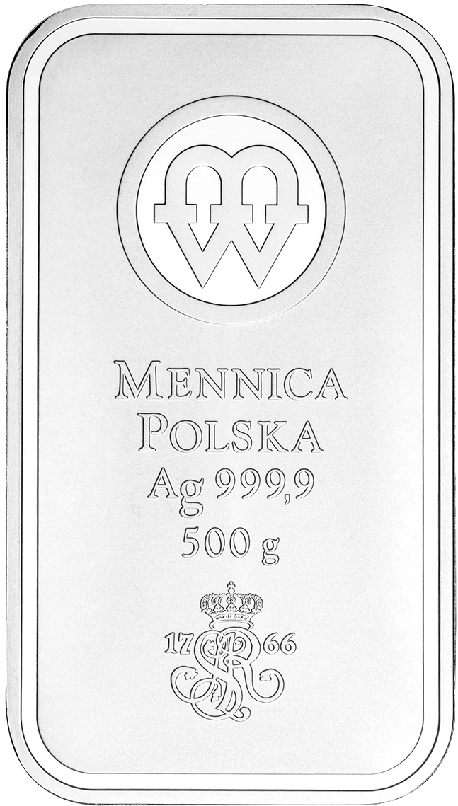{.nostretch height="250px"}
:::

::: {.fragment data-fragment-index="6" style="position:absolute; left:1194px; top:151px; width:647px;"}
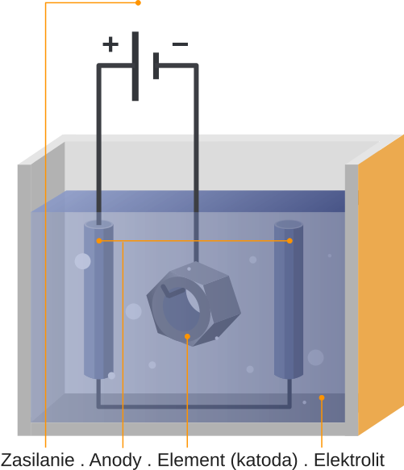{.nostretch width="100%"}
:::


<!-- Slajd 8 -->
## [TECHNIKI WYTWARZANIA POWŁOK]{style="display:block; text-align:center;"}

### Powłoki galwaniczne  (parametry technologiczne)

Wraz ze wzrostem gęstości prądu wzrasta masa osadzanej warstwy - do czasu.

::: {style="position:absolute; left:470px; top:240px; width:1000px;"}
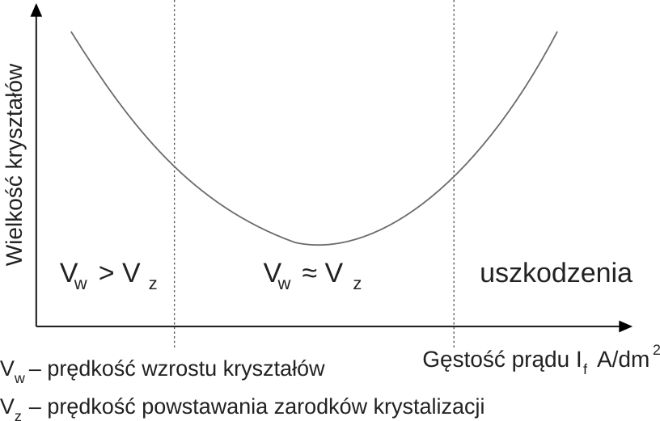{.nostretch width="100%"}
:::

::: {style="position:absolute; left:72px; top:350px; width:390px;"}
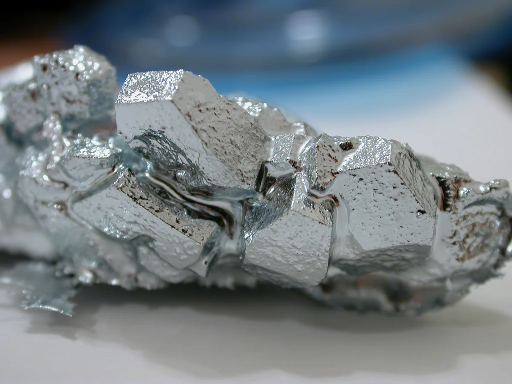{.nostretch width="100%"}
:::

::: {style="position:absolute; left:1454px; top:320px; width:445px;"}
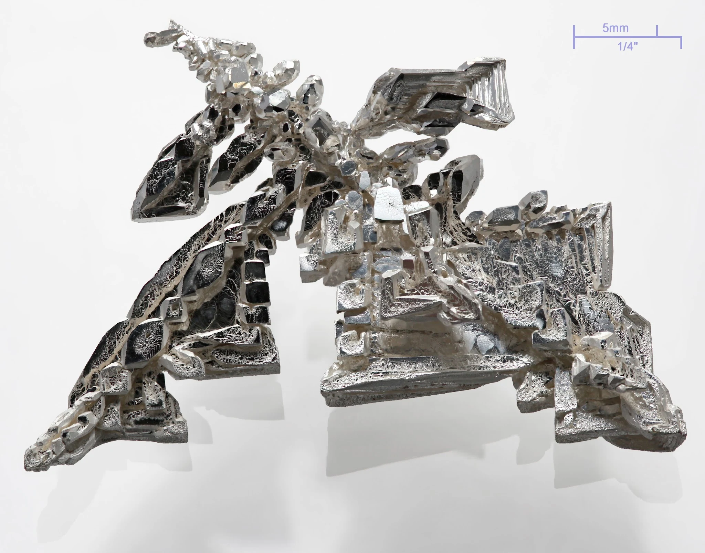{.nostretch width="100%"}
:::


<!-- Slajd 9 -->
## [TECHNIKI WYTWARZANIA POWŁOK]{style="display:block; text-align:center;"}

### Powłoki galwaniczne  (parametry technologiczne)

- Gęstość prądu - wydajność procesu, struktura powłoki.
- Rodzaj i stężenie elektrolitu - pozwala na większe gęstości prądu.
- Temperatura elektrolitu - wzrost ruchliwości jonów i lepsza dyfuzja, zwiększenie średnicy ziaren.
- Czas trwania procesu - grubość powłoki.
- Materiał anody - rodzaj powłoki, jakość materiału powłoki.

### Powłoki galwaniczne (przebieg procesu)  

- Przygotowanie powierzchni: czyszczenie (piaskowanie, szczotkowanie, polerowanie ścierne), odtłuszczanie (rozpuszczalniki, detergenty, chemiczne), trawienie, polerowanie elektrochemiczne.  
- Właściwe nakładanie powłoki jedno lub wielowarstwowej.  
- Kilkustopniowe mycie, suszenie.  
- Obróbka wykończeniowa powłoki (opcjonalnie): pasywacja, dodatkowe zabezpieczenie.  


<!-- Slajd 11 -->
## [TECHNIKI WYTWARZANIA POWŁOK]{style="display:block; text-align:center;"}

### Powłoki galwaniczne

::: {style="position:relative; width:100%;"}

<!-- PIERWSZY FILM – CAŁA SZEROKOŚĆ -->


<!-- DRUGI FILM – NAKŁADANY W GÓRNEJ CZĘŚCI -->
::: {style="position:absolute; left:1300px; top:-70px; width:33%;"}

:::

:::

::: {.footer}

KKY create https://www.youtube.com/watch?v=BZGDxL9pBC4 &emsp; FuseSchool - Global Education https://www.youtube.com/watch?v=OxhCU_jBiOA

:::

<!-- Slajd 12 -->
## [TECHNIKI WYTWARZANIA POWŁOK]{style="display:block; text-align:center;"}

### Powłoki galwaniczne (Miedziowanie)

Kąpiel do miedziowania stali (przykład):

::: {.lista-zwarta}

- NaCN (cyjanek sodowy) 55g/l
- CuCN (cyjanek miedziawy) 40g/l
- NaOH 15g/l
- Winian sodowo-potasowy 40g/l
- Warunki: T = 18÷25°C, I~f~ = 0,5÷1 A/dm^2^, t = kilka minut,
- grubość powłoki h=f(t).
- Anody wykonane z Cu (99,7%)

:::

::: {style="position:absolute; left:724px; top:555px; width:514px;"}
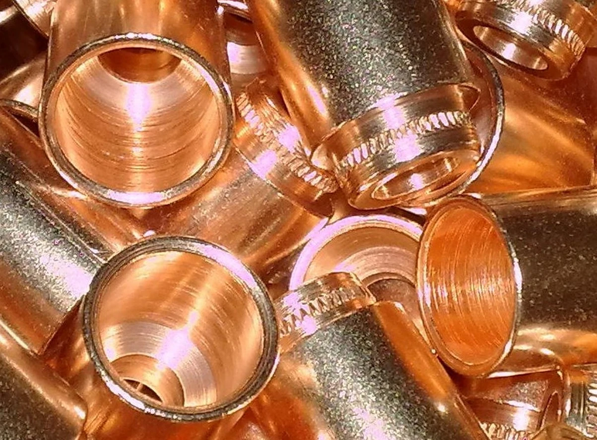{.nostretch width="100%"}
:::

::: {style="position:absolute; left:1262px; top:224px; width:578px;"}
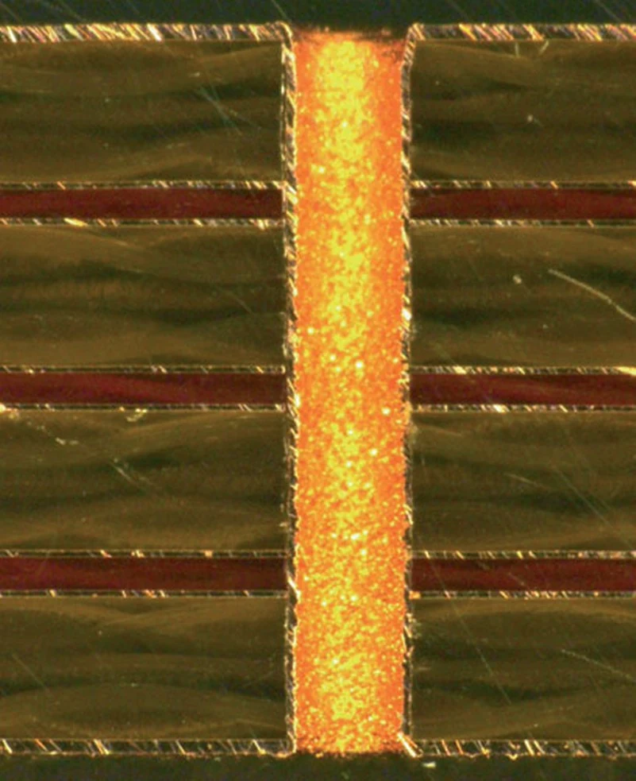{.nostretch width="100%"}
:::

::: {.footer}
PHU Omega, LPKF AG
:::


<!-- Slajd 13 -->
## [TECHNIKI WYTWARZANIA POWŁOK]{style="display:block; text-align:center;"}

### Powłoki galwaniczne (Niklowanie)

- Kąpiel do niklowania z połyskiem (przykład):
- NiSO~4~ (siarczan niklawy) 200-400 g/l
- NiCl~2~ (chlorek niklawy) 5-80 g/l
- H~3~BO~3~ (kwas borowy) 25-40 g/l
- Substancje nabłyszczające (związki organiczne, sole metali ciężkich)
- Warunki: T=45÷55°C, I~f~ = 1÷5 A/dm^2^
- Anody niklowe (nikiel elektrolityczny)
- Czas procesu zależny od oczekiwanej grubości powłoki

::: {style="position:absolute; left:1364px; top:167px; width:474px;"}
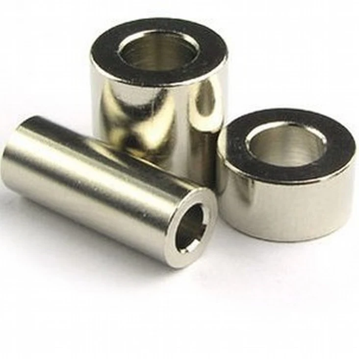{.nostretch width="100%"}
:::

::: {style="position:absolute; left:1193px; top:622px; width:650px;"}
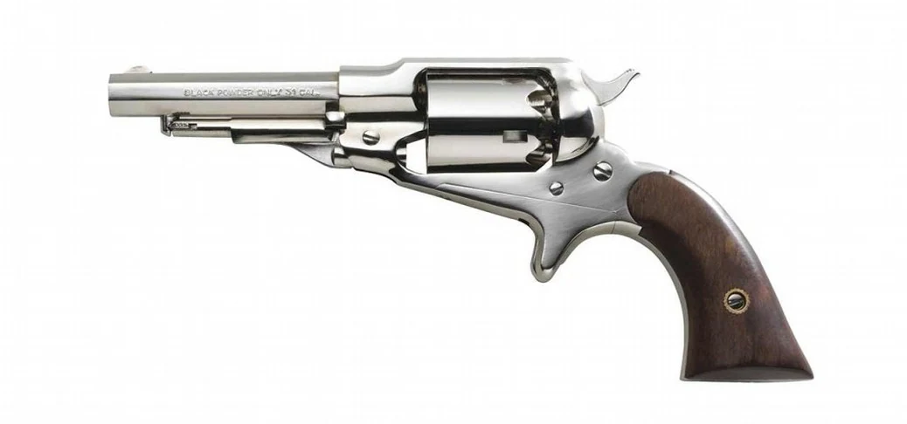{.nostretch width="100%"}
:::

::: {.footer}
Thomasnet, TaylorsFirearms
:::


<!-- Slajd 14 -->
## [TECHNIKI WYTWARZANIA POWŁOK]{style="display:block; text-align:center;"}

### Powłoki galwaniczne (Chromowanie)

- Kąpiel do chromowania dekoracyjnego g ≤ 3μm:
  - CrO~3~ - 400g/l
  - H~2~SO~4~ - 4g/l
- Warunki: T = 45÷55°C, I~f~ = 15÷30 A/dm^2^, t = kilka minut
- Anoda: Pb lub Pb+Sb (6-8%)
- Kąpiel do chromowania technicznego g=12-400μm:
  - CrO~3~ - 150g/l
  - H~2~SO~4~ - 1,5 g/l
- Warunki: T = 53÷54°C, I~f~ = 30÷45 A/dm^2^, t = godziny
- miedziowanie – niklowanie – chromowanie

::: {style="position:absolute; left:1200px; top:100px; width:650px;"}
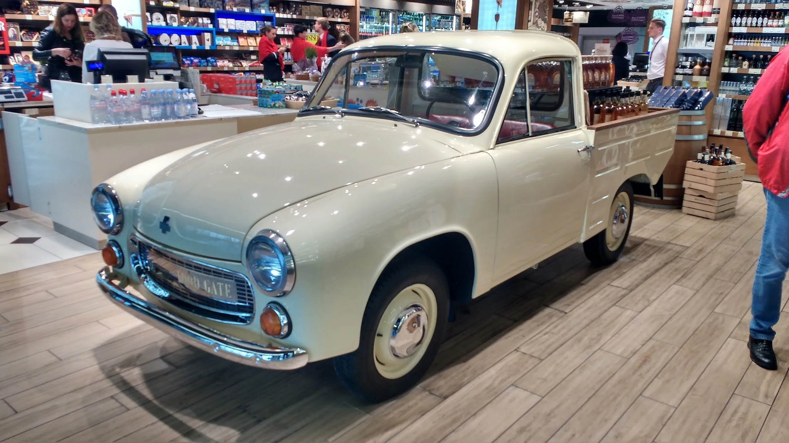{.nostretch width="100%"}
:::

::: {style="position:absolute; left:1200px; top:500px; width:650px;"}
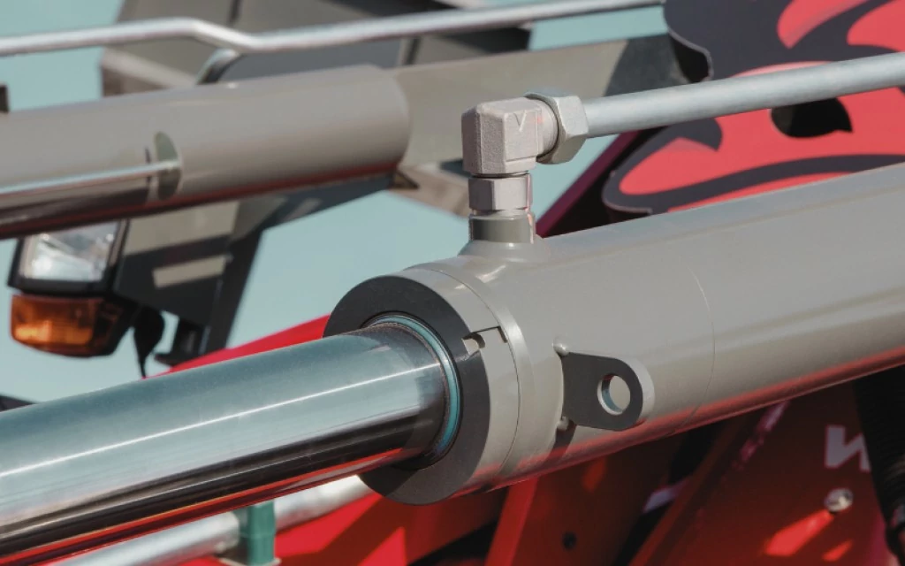{.nostretch width="100%"}
:::

::: {.footer}
HydroFlex
:::

<!-- Slajd 15 -->
## [TECHNIKI WYTWARZANIA POWŁOK]{style="display:block; text-align:center;"}

### Powłoki galwaniczne (Złocenie)

Przykład elektrolitu do złocenia (pozłacania):

- K[Au(CN)~2~] cyjanozłocian potasowy lub cyjanek złotawo-potasowy 10g/l
- C~6~H~8~O~7~ kwas cytrynowy 20g/l
- Dodatki nabłyszczające: Ni (0,25g/l), Co (0,35g/l)
- Warunki: T = 20÷35°C, I~f~ = 0,4÷0,6 A/dm^2^.
- Anody: ze stali kwasoodpornej, czasami ze złota.

::: {style="position:absolute; left:72px; top:625px;"}
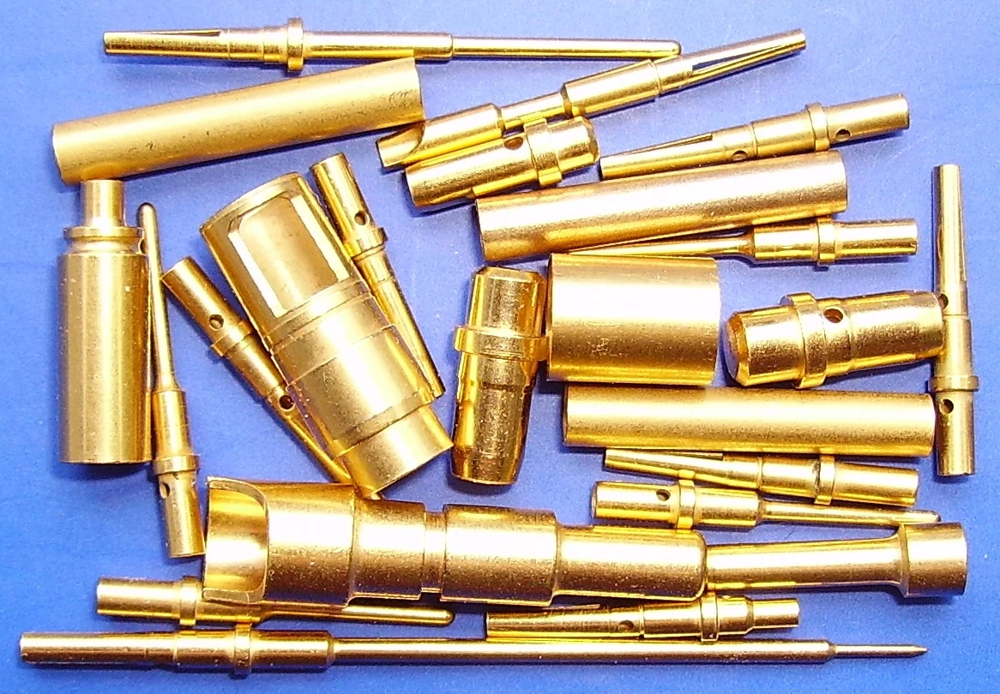{.nostretch height="300px"}
:::

::: {style="position:absolute; left:965px; top:625px;"}
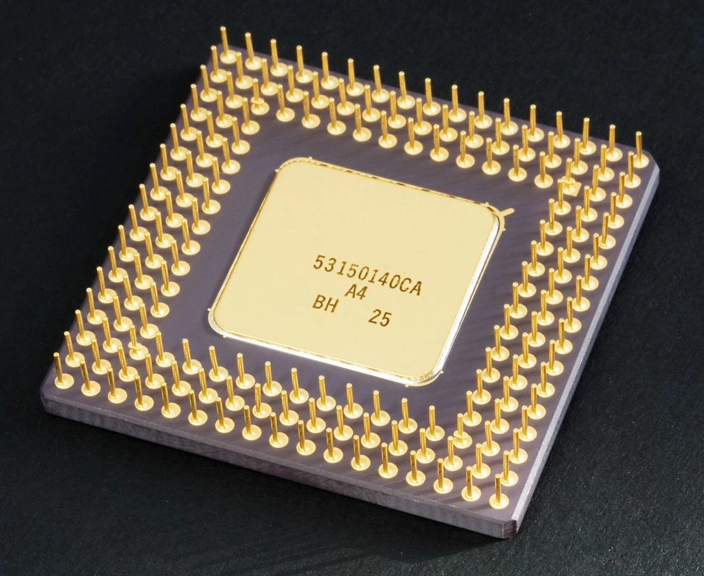{.nostretch height="300px"}
:::

::: {style="position:absolute; left:520px; top:625px; "}
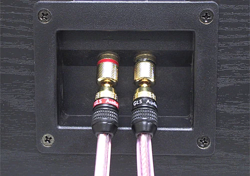{.nostretch height="300px"}
:::

::: {style="position:absolute; left:921px; top:339px; width:466px;"}
{.nostretch width="100%"}
:::

::: {style="position:absolute; left:1408px; top:339px; width:429px;"}
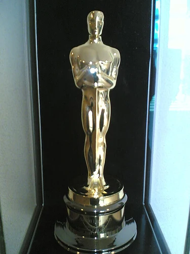{.nostretch width="100%"}
:::


<!-- Slajd 16 -->
## [TECHNIKI WYTWARZANIA POWŁOK]{style="display:block; text-align:center;"}

### Powłoki galwaniczne (złocenie)



::: {.footer}
Gold Plating Services https://www.youtube.com/watch?v=EW0f3PrXdZQ
:::

<!-- Slajd 17 -->
## [TECHNIKI WYTWARZANIA POWŁOK]{style="display:block; text-align:center;"}

### Powłoki galwaniczne (Srebrzenie)

- Umożliwia wytworzenia powłoki o dużej odporności chemicznej i korozyjnej, z doskonałą przewodnością elektryczną i cieplną, także stykową.
- Na podłoża aluminiowe i inne metale.

::: {style="position:absolute; left:184px; top:381px; width:710px;"}
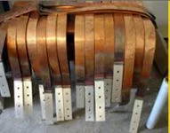{.nostretch width="100%"}
:::

::: {style="position:absolute; left:919px; top:381px; width:745px;"}
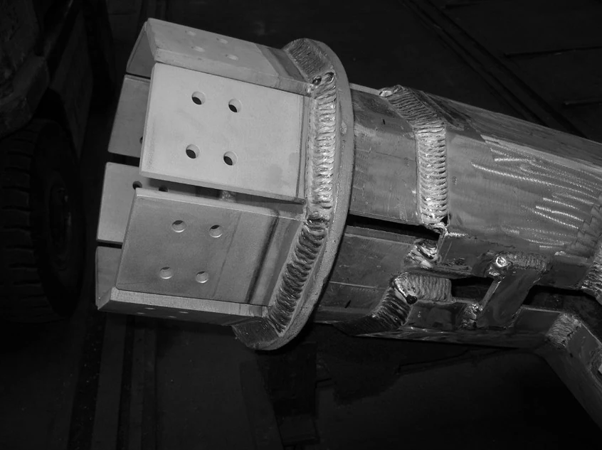{.nostretch width="100%"}
:::

::: {.footer}
Elbit, UPRP
:::


<!-- Slajd 18 -->
## [TECHNIKI WYTWARZANIA POWŁOK]{style="display:block; text-align:center;"}

::: {style="position:absolute; left:221px; top:152px; width:1521px;"}
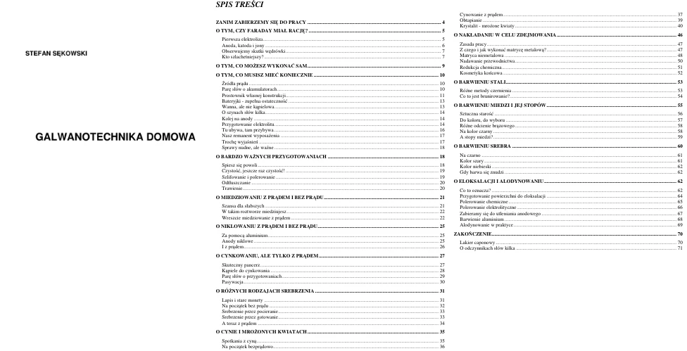{.nostretch width="100%"}
:::

::: {.footer}
https://archive.org/embed/stefansekowski/1 Sękowski Stefan - Galwanotechnika domowa
:::


<!-- Slajd 19 -->
## [TECHNIKI WYTWARZANIA POWŁOK]{style="display:block; text-align:center;"}

### Powłoki galwaniczne (właściwości powłok)  
<u>Korozja elektrochemiczna (galwaniczna)</u>  

- Mikroogniwo na styku metali w środowisku elektrolitycznym  
- Zn jest bardziej elektroujemny od Fe (aktywny chemicznie), chroni Fe elektrochemicznie, sam ulegając korozji. Powłoka zachowuje się jak anoda (roztwarza się) - <u>powłoka anodowa</u>.  
- Ni chroni podłoże tylko mechanicznie, ale w przypadku przerwania powłoki, roztwarzaniu (korozji) ulega Fe - (Ni) powłoka katodowa. Warstwa pośrednia Cu zapewnia odporność (+0,34 V).  

::: {style="position:absolute; left:83px; top:552px; width:1742px;"}
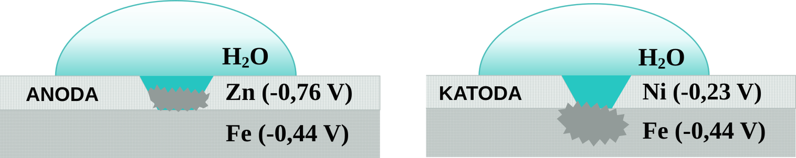{.nostretch width="100%"}
:::


<!-- Slajd 20 -->
## [TECHNIKI WYTWARZANIA POWŁOK]{style="display:block; text-align:center;"}

### Powłoki galwaniczne (właściwości powłok)  
<u>Naprężenia mechaniczne</u> (własne) są przyczyną pękania powłok, odwarstwiania lub powstawania pęcherzy. Kontrolę rodzaju naprężeń prowadzi się pokrywając jednostronnie cienkie blaszki.  
Ni, Co, Rh, Mn, Cr: naprężenia rozciągające (+)  
Zn, Cd, Pb: naprężenia ściskające (-)  
Rodzaj i wartości naprężeń są związane z temperaturą topnienia metalu i różnym typem krystalizacji.  

::: {style="position:absolute; left:176px; top:487px; width:540px;"}
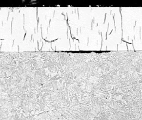{.nostretch width="100%"}
:::

::: {style="position:absolute; left:736px; top:487px; width:611px;"}
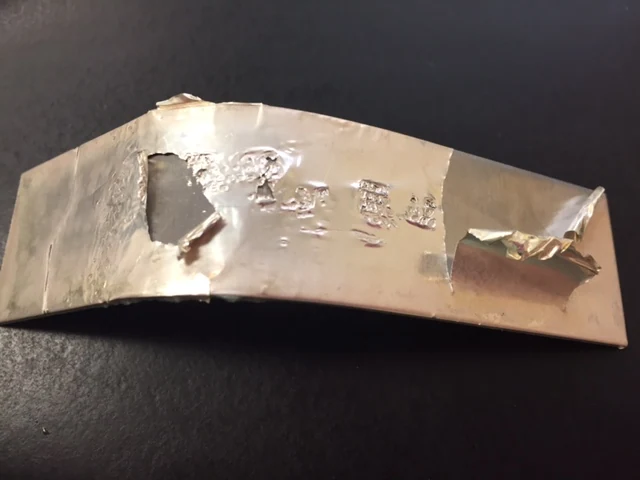{.nostretch width="100%"}
:::

::: {style="position:absolute; left:1371px; top:487px; width:382px;"}
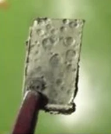{.nostretch width="100%"}
:::

::: {.footer}
AZO Materials, Hudson Plating Works,; Whulanza Y., Mechanical Engineering 6.6 (2015).
:::


<!-- Slajd 21 -->
## [TECHNIKI WYTWARZANIA POWŁOK]{style="display:block; text-align:center;"}

### Powłoki konwersyjne

Powłoki <u>niemetalowe, nieorganiczne</u> (najczęściej tlenki metali lub związki z resztami kwasowymi), utworzone (elektro)chemicznie <u>z udziałem metalu podłoża</u>. Przejście metalu ze stanu wolnego do związku, czyli konwersja (stąd nazwa), w którym jest bardziej stabilny pod względem termodynamicznym.  

<u>Najważniejsze procesy:</u>  

- anodowe utlenianie Al (elektrolityczne)  
- fosforanowanie stali  
- utlenianie stali (oksydowanie)  
- chromianowanie Al, Zn, Cd.  


<!-- Slajd 22 -->
## [TECHNIKI WYTWARZANIA POWŁOK]{style="display:block; text-align:center;"}

### Anodowanie

Wytworzenie warstwy Al~2~O~3~ na powierzchni aluminium lub jego stopu z udziałem prądu elektrycznego.  

- Przedmiot pokrywany: anoda (stąd nazwa).  
- Elektrolit: wodny roztwór kwasu siarkowego.  
- Katoda odporna chemicznie: Pb. 

$$
2\mathrm{Al}^{3+} + 3\mathrm{SO_4}^{2-} + 3\mathrm{H_2O}
\longrightarrow
\mathrm{Al_2O_3} + 3\mathrm{H_2SO_4}
$$

Właściwości:

::: {.lista-zwarta}

- Porowata powłoka nie spełnia funkcji zabezpieczającej przed wpływem czynników zewnętrznych.  
- Można ją nasycać barwnikami organicznymi lub nieorganicznymi (T ≈ 60÷70°C).  
- Uszczelnianie zasklepiające pory: 100°C H~2~O (1h) lub roztwory soli (minuty).  
- Powłoki Al~2~O~3~ są twarde, odporne na ścieranie odporne na korozję, estetyczne, kruche.  
- Parametry technologiczne procesu: U = 10÷20 V, I~f~ = 1,2÷1,5 A/dm^2^ , T = 18÷20°C.  

:::


## [TECHNIKI WYTWARZANIA POWŁOK]{style="display:block; text-align:center;"}

### Anodowanie

::: {style="position:absolute; left:72px; top:278px; width:1015px;"}
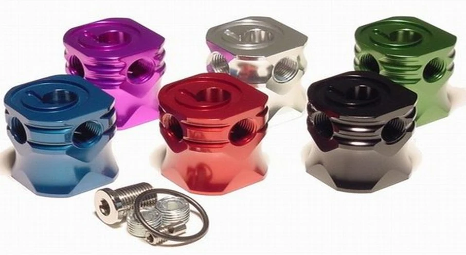{.nostretch width="100%"}
:::

::: {style="position:absolute; left:1116px; top:285px; width:710px;"}
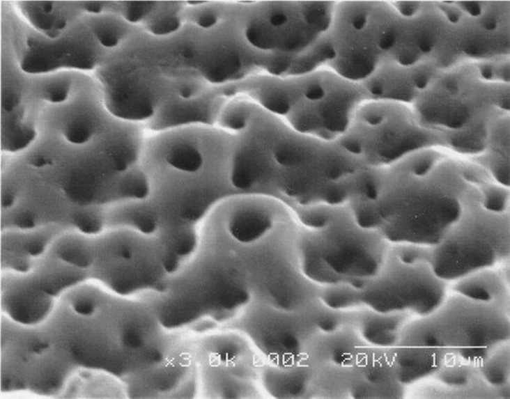{.nostretch width="100%"}
:::

::: {.footer}
Wickwerks
:::


<!-- Slajd 23 -->
## [TECHNIKI WYTWARZANIA POWŁOK]{style="display:block; text-align:center;"}

### Fosforanowanie

- Wytworzenie powłoki FePO~4~ (fosforanu żelazowego) oraz Fe~2~O~3~. (również dla Zn, Al i ich stopów)
- Zanurzeniu elementu w roztworze H~3~PO~4~.
- Budowa amorficzna (g 1÷1,5μm) lub krystaliczna (g 1÷20μm).
- Elastyczne, miękkie i dobrze związane z podłożem.
- Porowata powłoka i nie stanowi zabezpieczenia antykorozyjnego (olejowanie, woskowanie).
- Zastosowanie:
- podkład pod powłoki malarsko lakiernicze,
- powłoki elektroizolacyjne,
- powłoki przeciwcierne
- (blachy do przeróbki plastycznej, narzędzia, wkręty).

::: {style="position:absolute; left:1581px; top:599px; width:245px;"}
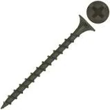{.nostretch width="100%"}
:::

::: {style="position:absolute; left:1126px; top:550px; width:419px;"}
{.nostretch width="100%"}
:::

<small>*Breaking Taps, Low-tech coating is a microscopic marvel* <a href="https://www.youtube.com/watch?v=O0-6g6NJMmE" >https://www.youtube.com/watch?v=O0-6g6NJMmE</a></small>

::: {.footer}
Viega, Castorama
:::


<!-- Slajd 24 -->
## [TECHNIKI WYTWARZANIA POWŁOK]{style="display:block; text-align:center;"}

### Oksydowanie (czernienie)

::: {.lista-zwarta}

- Chemiczne przekształcenie żelaza w najbardziej trwały tlenek Fe~3~O~4~ (magnetyt).
- Proces wytwarzania:
- W stężonych roztworach NaOH, NaNO~3~, NaNO~2~
- Przygotowanie: odtłuszczanie, trawienie
- Utlenianie chemiczne
- Płukanie w ciepłym roztworze detergentów, suszenie, olejowanie lub woskowanie
- Zastosowanie: dekoracyjne, elementy przyrządów optycznych, broń, narzędzia.

:::

:::: {style="--img-height:400px; display:flex; position:relative;left:50%; transform:translateX(-50%); width:max-content; max-width:none; align-items:center; gap:10px;  z-index:-1; margin-bottom:-50px; top:-50px; "}

::: {style="flex:0 0 auto; margin:0;"}
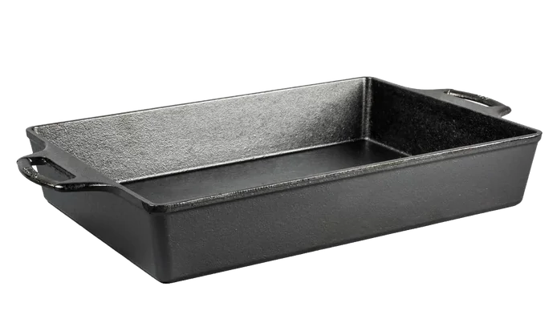{.nostretch style="height:var(--img-height); width:auto; max-width:none; max-height:none; margin:0;"}
:::

::: {style="flex:0 0 auto; margin:0;"}
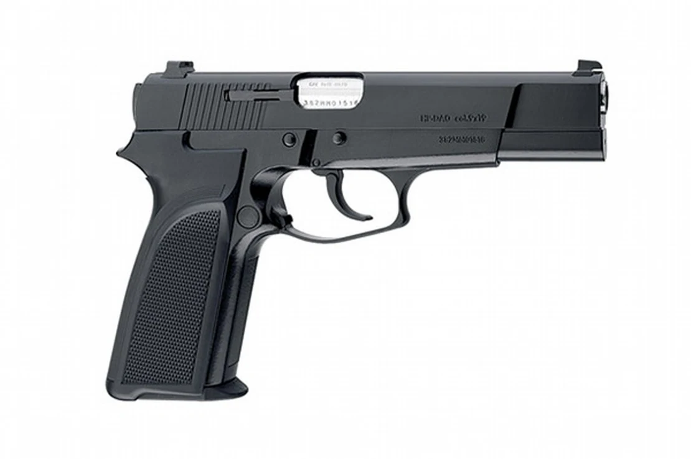{.nostretch style="height:var(--img-height); width:auto; max-width:none; max-height:none; margin:0;"}
:::

::: {style="flex:0 0 auto; margin:0;"}
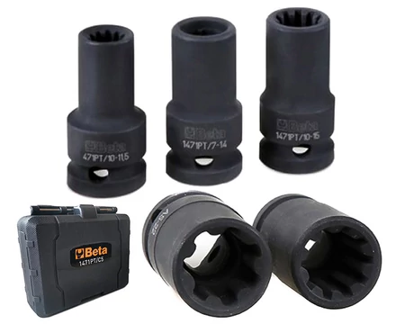{.nostretch style="height:var(--img-height); width:auto; max-width:none; max-height:none; margin:0;"}
:::

::::

::: {.footer}
Lodge, Browning, Beta
:::


<!-- Slajd 25 -->
## [TECHNIKI WYTWARZANIA POWŁOK]{style="display:block; text-align:center;"}

### Chromianowanie

::: {.lista-zwarta}

- Pasywna powłoka tlenków Cr na detalach metalowych.
- Znacznie poprawia odporność na korozję, zachowując wytrzymałość mechaniczną i termiczną.
- Na elementy Zn, Cd, Cu, Ag, Mg, Al i wybrane stopy tych metali.
- Grubość 0,1÷1 μm.
- Przed wysuszeniem (po procesie) jest porowata.
- Roztwory CrO~3~ + Na~2~SO~4~ + H~2~O, temperatura pokojowa, kilka minut.
- Zastosowanie: ochronne i dekoracyjne (barwienie), podkład pod powłoki malarskie.

:::

:::: {style="--img-height:400px; display:flex; position:relative;left:50%; transform:translateX(-50%); width:max-content; max-width:none; align-items:center; gap:10px;  z-index:-1; margin-bottom:-50px; top:-30px; "}

::: {style="flex:0 0 auto; margin:0;"}
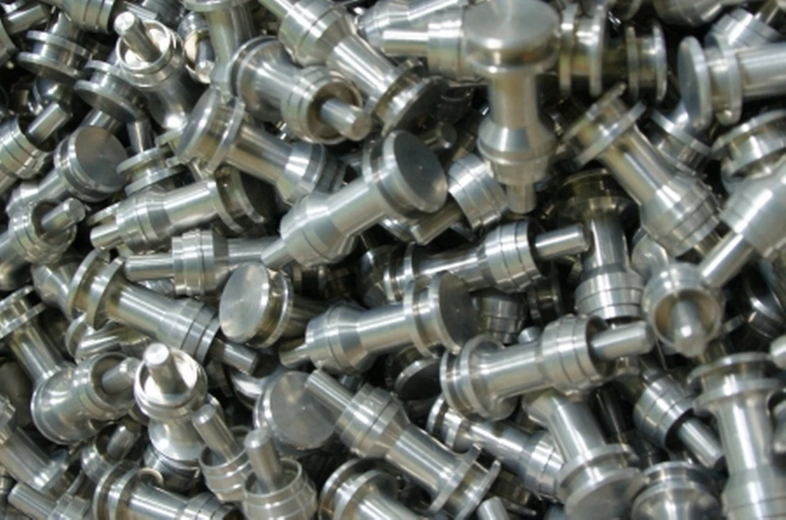{.nostretch style="height:var(--img-height); width:auto; max-width:none; max-height:none; margin:0;"}
:::

::: {style="flex:0 0 auto; margin:0;"}
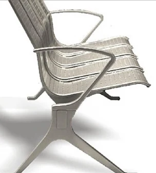{.nostretch style="height:var(--img-height); width:auto; max-width:none; max-height:none; margin:0;"}
:::

::::

::: {.footer}
ECM
:::


<!-- Slajd 26 -->
## [QUIZ]{style="display:block; text-align:center;"}

::: {.incremental}

- Podobieństwa i różnice polerowania i powlekania elektrochemicznego.
- Jakie zjawiska zachodzą w trawieniu i miedziowaniu elektrochemicznym?
- Podczas procesu galwanostegii (lub galwanoplastyki) można prowadzić trawienie elektrochemiczne?
- Czy w chromowaniu technicznym elementów wytwarzamy twardą warstwę tlenku chromu?
- Kiedy i dla jakich materiałów można prowadzić proces utleniania?

:::

