## [TECHNOLOGIA POWŁOK]{style="display:block; text-align:center;"}

Powłoka to warstwa materiału <u>wytworzona lub nałożona</u> na powierzchnię elementu w sposób naturalny lub sztuczny. Powłoka jest wykonana <u>z innego materiału niż element</u>. Celem powłoki jest uzyskanie określonych właściwości ochronnych, technicznych lub dekoracyjnych.  

::: {style="position:absolute; left:272px; top:658px; width:367px;"}
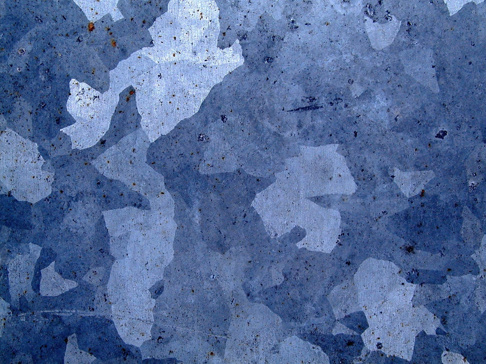{.nostretch width="100%"}
:::

::: {style="position:absolute; left:155px; top:331px; width:413px;"}
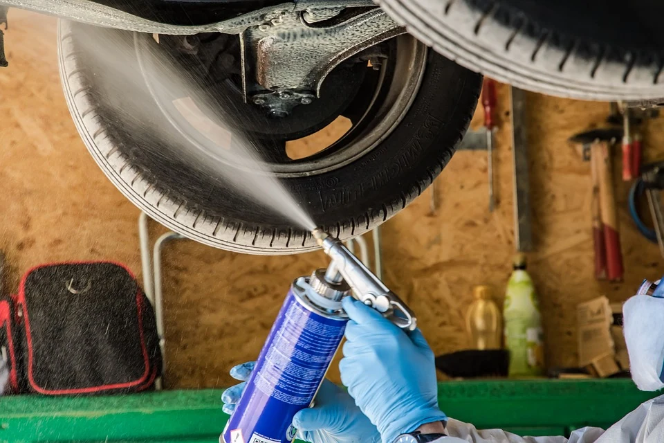{.nostretch width="100%"}
:::

::: {style="position:absolute; left:751px; top:614px; width:426px;"}
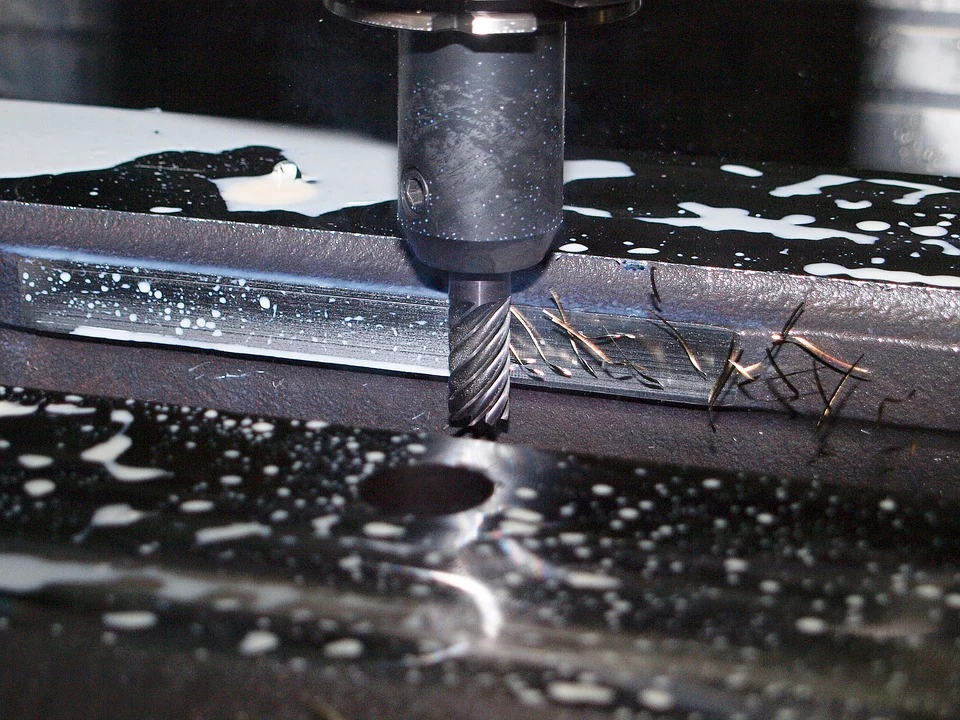{.nostretch width="100%"}
:::

::: {style="position:absolute; left:632px; top:331px; width:367px;"}
{.nostretch width="100%"}
:::

::: {style="position:absolute; left:1111px; top:331px; width:367px;"}
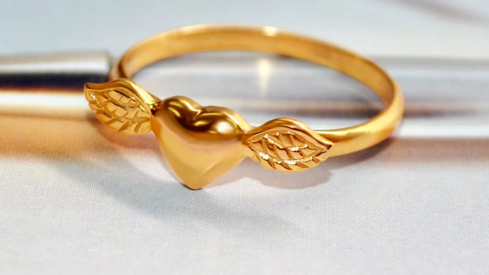{.nostretch width="100%"}
:::

::: {style="position:absolute; left:1300px; top:686px; width:388px;"}
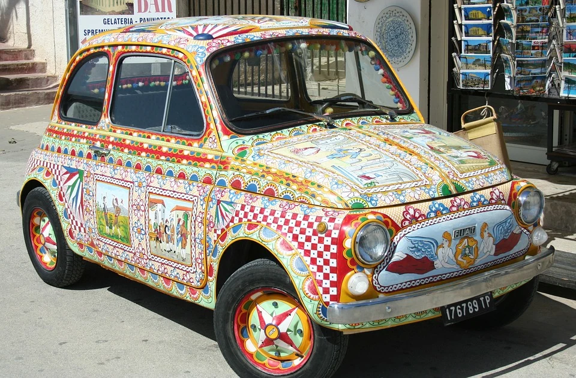{.nostretch width="100%"}
:::

::: {style="position:absolute; left:1536px; top:331px; width:205px;"}
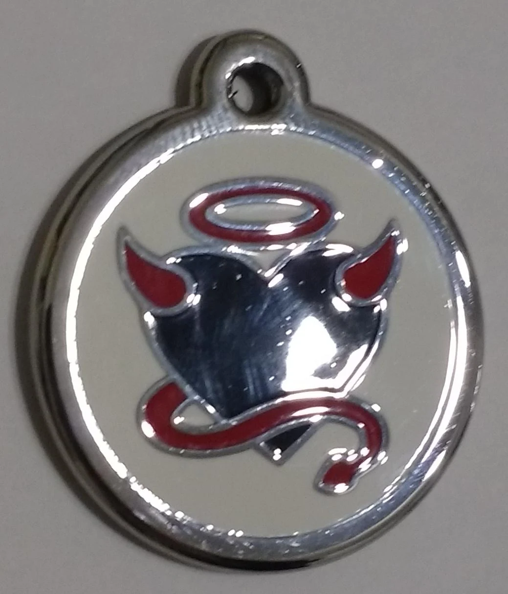{.nostretch width="100%"}
:::

<!-- Slajd 3 -->
## [TECHNOLOGIA POWŁOK]{style="display:block; text-align:center;"}

Korozja to proces stopniowego niszczenia materiałów przez czynniki środowiskowe, zachodzący na powierzchni (i pod nią). Proces ma charakter reakcji (elektro)chemicznych, mikrobiologicznych lub fizycznych (przemiany fazowe, uszkodzenia przez promieniowanie). Rezultatem jest stopniowa zmiana mikrostruktury powierzchni, geometrii elementu oraz jego właściwości użytkowych.  

::: {.columns style="width:100%; align-items:center; gap:29px; margin:20px 0;"}

::: {.column style="width:566px; flex:none;"}
{.nostretch width="100%"}
:::

::: {.column style="width:578px; flex:none;"}
{.nostretch width="100%"}
:::

::: {.column style="width:580px; flex:none;"}
{.nostretch width="100%"}
:::

:::

*Stan użytkowania metali jest stanem sztucznym, nietrwałym termodynamicznie. Korozja jest więc naturalną tendencją osiągnięcia równowagi termodynamicznej czyli postaci, w której metale występują w przyrodzie.*

<!-- Slajd 4 -->
## [TECHNOLOGIA POWŁOK]{style="display:block; text-align:center;"}

Prędkość korozji [µm/rok]  
Środowisko:  miejskie  wybrzeże  przemysłowe  pustynia  
Fe    30÷90  60÷600  40÷100    2÷3  
Zn    1÷6    4÷28    3÷11      0÷1  
Al    ~0    12    1      b.d.  

::: {style="position:absolute; left:160px; top:456px; width:624px;"}
{.nostretch width="100%"}
:::

::: {style="position:absolute; left:803px; top:456px; width:960px;"}
{.nostretch width="100%"}
:::

<!-- Slajd 5 -->
## [TECHNIKI WYTWARZANIA POWŁOK]{style="display:block; text-align:center;"}

- Powłoki metalowe (metale lub stopy) na metalach lub niemetalach:
- Powłoki galwaniczne (galwanostegia) z metali lub stopów metali - elektrochemiczne.
- Chemiczne (redukcja jonów metali), bezprądowe, na dowolnych tworzywach konstrukcyjnych.
- Zanurzeniowe (ogniowe), w roztopionym metalu (Sn, Zn, Pb, Al i stopy).
- Dyfuzyjne (Cr, Al, Si, Be) głównie do elementów stalowych.
- Metalizacja natryskowa – gazowa, łukowa, plazmowa (Zn, Sn, Pb, stal nierdzewna).
- Platerowane (nawalcowywanie warstwy Al, Cu, Ag, stali kwasoodpornej, także detonacyjnie).
- Natopione (wiązką laserową, elektronów, elektroiskrowe).
- Techniki PVD i CVD.
- Powłoki niemetalowe (związki metali, ceramika, tworzywa sztuczne) na metalach lub niemetalach:
- Konwersyjne – anodowanie, fosforanowanie, chromianowanie, oksydowanie.
- Emalie szkliste, ceramiczne (nieorganiczne).
- Powłoki malarsko-lakiernicze.
- Powłoki z tworzyw sztucznych (natryskiwanie, fluidyzacja).
- Techniki PVD i CVD.

<!-- Slajd 6 -->
## [TECHNIKI WYTWARZANIA POWŁOK]{style="display:block; text-align:center;"}

Powłoki galwaniczne  
Metale lub stopy metali nakładane w oparciu o prawa elektrolizy Faraday’a - galwanostegia.  
Trwale związane z podłożem, w odróżnieniu od galwanoplastyki (oddzielane od wzorca).  
m = k ⋅ I ⋅ t = k ⋅ Q  

k ×        ×            k ×  

k - równoważnik elektrochemiczny [g⋅h-1⋅A-1]  
1,2               0,3          4,0  

::: {style="position:absolute; left:128px; top:713px; width:392px;"}
{.nostretch width="100%"}
:::

::: {style="position:absolute; left:749px; top:713px; width:211px;"}
{.nostretch width="100%"}
:::

::: {style="position:absolute; left:1178px; top:713px; width:292px;"}
{.nostretch width="100%"}
:::

::: {style="position:absolute; left:84px; top:398px; width:357px;"}
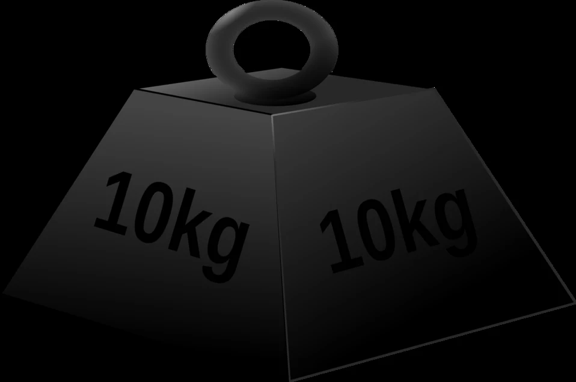{.nostretch width="100%"}
:::

::: {style="position:absolute; left:751px; top:432px; width:211px;"}
{.nostretch width="100%"}
:::

::: {style="position:absolute; left:1016px; top:432px; width:254px;"}
{.nostretch width="100%"}
:::

::: {style="position:absolute; left:1617px; top:439px; width:231px;"}
{.nostretch width="100%"}
:::

<!-- Slajd 7 -->
## [TECHNIKI WYTWARZANIA POWŁOK]{style="display:block; text-align:center;"}

### Powłoki galwaniczne

- (parametry technologiczne)
- Skład elektrolitu
- Temperatura elektrolitu T
- Gęstość prądu If
- Czas trwania procesu t
- Materiał anody

::: {style="position:absolute; left:1194px; top:151px; width:647px;"}
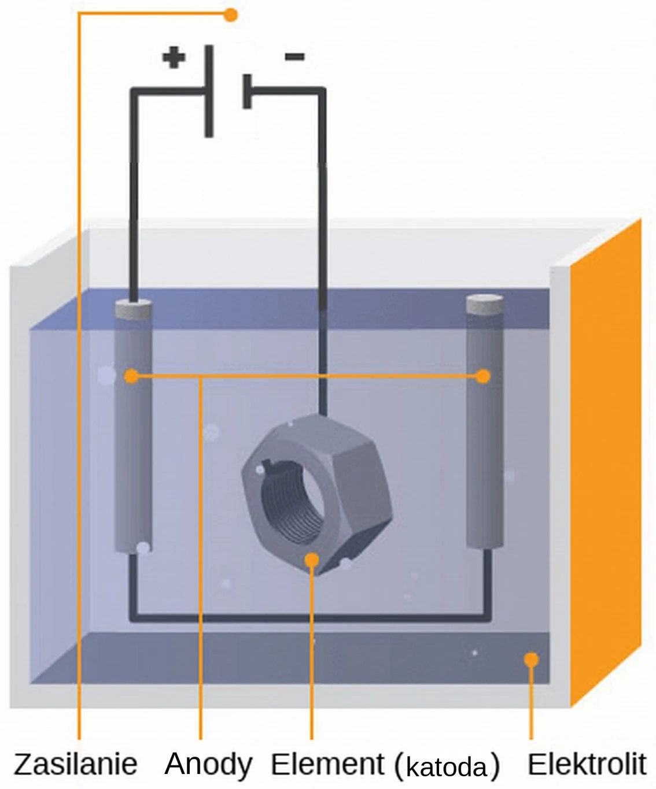{.nostretch width="100%"}
:::

::: {style="position:absolute; left:93px; top:478px; width:267px;"}
{.nostretch width="100%"}
:::

::: {style="position:absolute; left:344px; top:536px; width:189px;"}
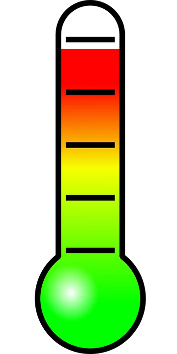{.nostretch width="100%"}
:::

::: {style="position:absolute; left:520px; top:467px; width:267px;"}
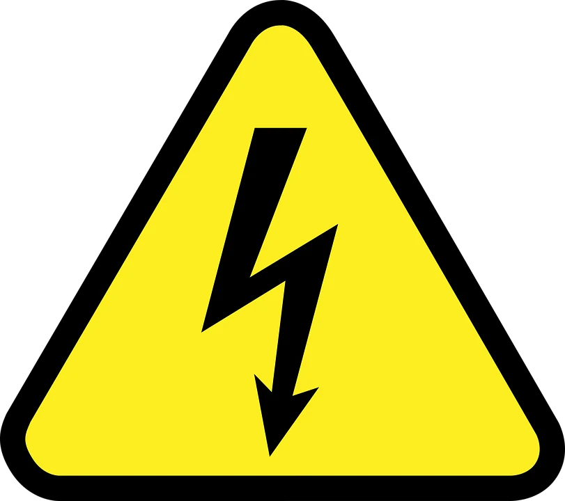{.nostretch width="100%"}
:::

::: {style="position:absolute; left:727px; top:648px; width:353px;"}
{.nostretch width="100%"}
:::

::: {style="position:absolute; left:806px; top:464px; width:353px;"}
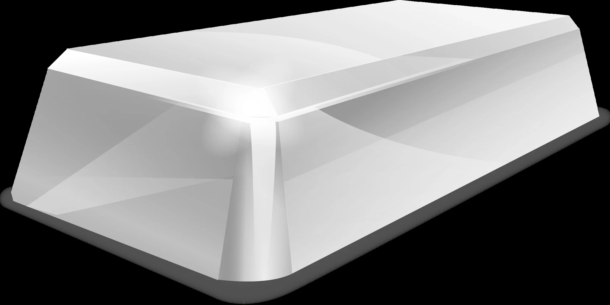{.nostretch width="100%"}
:::

<!-- Slajd 8 -->
## [TECHNIKI WYTWARZANIA POWŁOK]{style="display:block; text-align:center;"}

### Powłoki galwaniczne  (parametry technologiczne)

### Wraz ze wzrostem gęstości prądu wzrasta masa osadzanej warstwy - do czasu.

::: {style="position:absolute; left:354px; top:240px; width:1165px;"}
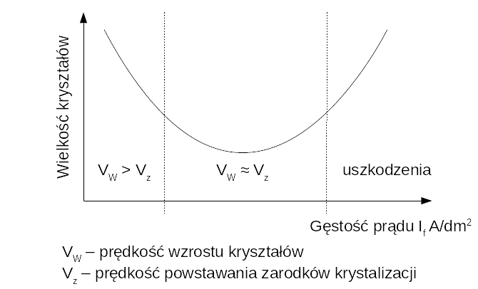{.nostretch width="100%"}
:::

::: {style="position:absolute; left:72px; top:439px; width:390px;"}
{.nostretch width="100%"}
:::

::: {style="position:absolute; left:1454px; top:319px; width:445px;"}
{.nostretch width="100%"}
:::

<!-- Slajd 9 -->
## [TECHNIKI WYTWARZANIA POWŁOK]{style="display:block; text-align:center;"}

### Powłoki galwaniczne  (parametry technologiczne)

- Gęstość prądu - wydajność procesu, struktura powłoki.
- Rodzaj i stężenie elektrolitu - pozwala na większe gęstości prądu.
- Temperatura elektrolitu - wzrost ruchliwości jonów i lepsza dyfuzja, zwiększenie średnicy ziaren.
- Czas trwania procesu - grubość powłoki.
- Materiał anody - rodzaj powłoki, jakość materiału powłoki.

<!-- Slajd 10 -->
## [TECHNIKI WYTWARZANIA POWŁOK]{style="display:block; text-align:center;"}

### Powłoki galwaniczne

(przebieg procesu)  
Przygotowanie powierzchni: czyszczenie (piaskowanie, szczotkowanie, polerowanie ścierne), odtłuszczanie (rozpuszczalniki, detergenty, chemiczne), trawienie, polerowanie elektrochemiczne.  
Właściwe nakładanie powłoki jedno lub wielowarstwowej.  
Kilkustopniowe mycie, suszenie.  
Obróbka wykończeniowa powłoki (opcjonalnie): pasywacja, dodatkowe zabezpieczenie.  

<!-- Slajd 11 -->
## [TECHNIKI WYTWARZANIA POWŁOK]{style="display:block; text-align:center;"}

### Powłoki galwaniczne

::: {style="position:absolute; left:32px; top:256px; width:878px;"}
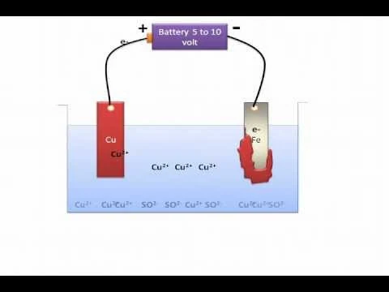{.nostretch width="100%"}
:::

::: {style="position:absolute; left:942px; top:256px; width:878px;"}
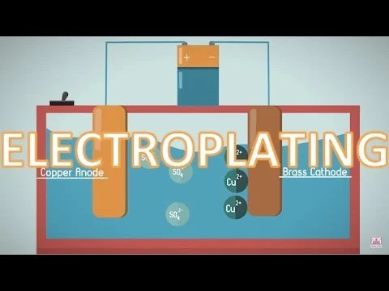{.nostretch width="100%"}
:::

<!-- Slajd 12 -->
## [TECHNIKI WYTWARZANIA POWŁOK]{style="display:block; text-align:center;"}

### Powłoki galwaniczne

### Miedziowanie

- Kąpiel do miedziowania stali (przykład):
- NaCN (cyjanek sodowy) 55g/l
- CuCN (cyjanek miedziawy) 40g/l
- NaOH 15g/l
- Winian sodowo-potasowy 40g/l
- Warunki: T = 18÷25°C, If = 0,5÷1 A/dm2, t = kilka minut,
- grubość powłoki h=f(t).
- Anody wykonane z Cu (99,7%)

::: {style="position:absolute; left:724px; top:555px; width:514px;"}
{.nostretch width="100%"}
:::

::: {style="position:absolute; left:1262px; top:224px; width:578px;"}
{.nostretch width="100%"}
:::

::: {.footer}
PHU Omega, LPKF AG
:::

<!-- Slajd 13 -->
## [TECHNIKI WYTWARZANIA POWŁOK]{style="display:block; text-align:center;"}

### Powłoki galwaniczne

### Niklowanie

- Kąpiel do niklowania z połyskiem (przykład):
- NiSO4 (siarczan niklawy) 200-400 g/l
- NiCl2 (chlorek niklawy) 5-80 g/l
- H3BO3 (kwas borowy) 25-40 g/l
- Substancje nabłyszczające (związki organiczne, sole metali ciężkich).
- Warunki: T=45÷55°C, If = 1÷5 A/dm2.
- Anody niklowe (nikiel elektrolityczny).
- Czas procesu zależny od oczekiwanej grubości powłoki

::: {style="position:absolute; left:1364px; top:167px; width:474px;"}
{.nostretch width="100%"}
:::

::: {style="position:absolute; left:1193px; top:622px; width:650px;"}
{.nostretch width="100%"}
:::

::: {.footer}
Thomasnet, TaylorsFirearms
:::

<!-- Slajd 14 -->
## [TECHNIKI WYTWARZANIA POWŁOK]{style="display:block; text-align:center;"}

### Powłoki galwaniczne

### Chromowanie

- Kąpiel do chromowania dekoracyjnego g ≤ 3μm:
- - CrO3 - 400g/l
- - H2SO4 - 4g/l
- Warunki: T = 45÷55°C, If = 15÷30 A/dm2, t = kilka minut.
- Anoda: Pb lub Pb+Sb (6-8%)
- Kąpiel do chromowania technicznego g=12-400μm:
- - CrO3 - 150g/l
- - H2SO4 - 1,5 g/l
- Warunki: T = 53÷54°C, If = 30÷45A/dm2, t = godziny.
- miedziowanie – niklowanie – chromowanie

::: {style="position:absolute; left:1208px; top:148px; width:641px;"}
{.nostretch width="100%"}
:::

::: {style="position:absolute; left:1280px; top:570px; width:546px;"}
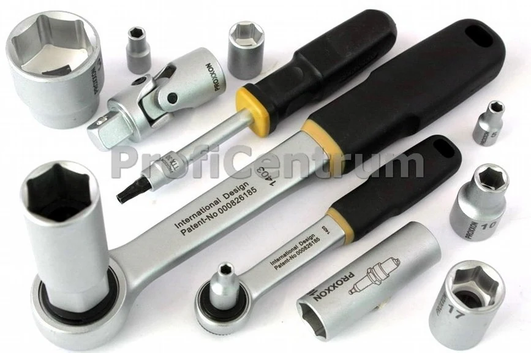{.nostretch width="100%"}
:::

<!-- Slajd 15 -->
## [TECHNIKI WYTWARZANIA POWŁOK]{style="display:block; text-align:center;"}

### Powłoki galwaniczne

### Złocenie

- Przykład elektrolitu do złocenia (pozłacania):
- - K[Au(CN)2] cyjanozłocian potasowy lub cyjanek złotawo-potasowy 10g/l
- - C6H8O7 kwas cytrynowy 20g/l
- - Dodatki nabłyszczające: Ni (0,25g/l), Co (0,35g/l)
- Warunki: T = 20÷35°C, If = 0,4÷0,6A/dm2.
- Anody: ze stali kwasoodpornej, czasami ze złota.

::: {style="position:absolute; left:72px; top:625px; width:366px;"}
{.nostretch width="100%"}
:::

::: {style="position:absolute; left:865px; top:625px; width:347px;"}
{.nostretch width="100%"}
:::

::: {style="position:absolute; left:458px; top:623px; width:366px;"}
{.nostretch width="100%"}
:::

::: {style="position:absolute; left:921px; top:339px; width:466px;"}
{.nostretch width="100%"}
:::

::: {style="position:absolute; left:1408px; top:338px; width:429px;"}
{.nostretch width="100%"}
:::

<!-- Slajd 16 -->
## [TECHNIKI WYTWARZANIA POWŁOK]{style="display:block; text-align:center;"}

### Powłoki galwaniczne          Złocenie

::: {style="position:absolute; left:433px; top:228px; width:951px;"}
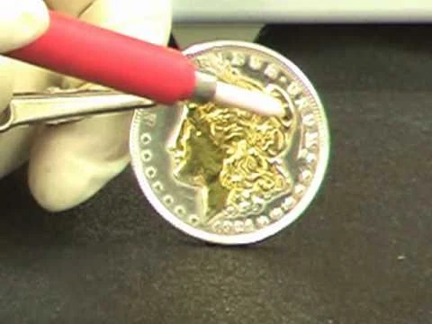{.nostretch width="100%"}
:::

<!-- Slajd 17 -->
## [TECHNIKI WYTWARZANIA POWŁOK]{style="display:block; text-align:center;"}

### Powłoki galwaniczne

### Srebrzenie

- Umożliwia wytworzenia powłoki o dużej odporności chemicznej i korozyjnej, z doskonałą przewodnością elektryczną i cieplną, także stykową.
- Na podłoża aluminiowe i inne metale.

::: {style="position:absolute; left:184px; top:381px; width:710px;"}
{.nostretch width="100%"}
:::

::: {style="position:absolute; left:919px; top:381px; width:745px;"}
{.nostretch width="100%"}
:::

::: {.footer}
Elbit, UPRP
:::

<!-- Slajd 18 -->
## [TECHNIKI WYTWARZANIA POWŁOK]{style="display:block; text-align:center;"}

::: {style="position:absolute; left:221px; top:152px; width:1521px;"}
{.nostretch width="100%"}
:::

::: {.footer}
marcello.iq.pl/pannonia/Galwanizacja.pdf
:::

<!-- Slajd 19 -->
## [TECHNIKI WYTWARZANIA POWŁOK]{style="display:block; text-align:center;"}

### Powłoki galwaniczne

(właściwości powłok)  
Korozja elektrochemiczna (galwaniczna)  
Mikroogniwo na styku metali w środowisku elektrolitycznym  
Zn jest bardziej elektroujemny od Fe (aktywny chemicznie), chroni Fe elektrochemicznie, sam ulegając korozji. Powłoka zachowuje się jak anoda (roztwarza się) - powłoka anodowa.  
Ni chroni podłoże tylko mechanicznie, ale w przypadku przerwania powłoki, roztwarzaniu (korozji) ulega Fe - (Ni) powłoka katodowa. Warstwa pośrednia Cu zapewnia odporność (+0,34 V).  

::: {style="position:absolute; left:83px; top:552px; width:1742px;"}
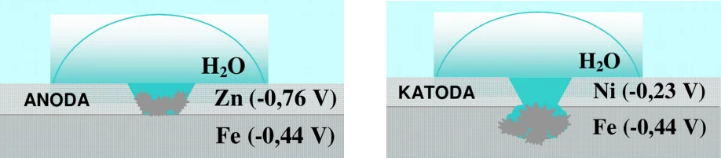{.nostretch width="100%"}
:::

<!-- Slajd 20 -->
## [TECHNIKI WYTWARZANIA POWŁOK]{style="display:block; text-align:center;"}

### Powłoki galwaniczne

(właściwości powłok)  
Naprężenia mechaniczne (własne) są przyczyną pękania powłok, odwarstwiania lub powstawania pęcherzy. Kontrolę rodzaju naprężeń prowadzi się pokrywając jednostronnie cienkie blaszki.  
Ni, Co, Rh, Mn, Cr: naprężenia rozciągające (+)  
Zn, Cd, Pb: naprężenia ściskające (-)  
Rodzaj i wartości naprężeń są związane z temperaturą topnienia metalu i różnym typem krystalizacji.  

::: {style="position:absolute; left:176px; top:487px; width:540px;"}
{.nostretch width="100%"}
:::

::: {style="position:absolute; left:736px; top:487px; width:611px;"}
{.nostretch width="100%"}
:::

::: {style="position:absolute; left:1371px; top:487px; width:382px;"}
{.nostretch width="100%"}
:::

::: {.footer}
AZO Materials, Hudson Plating Works,; Whulanza Y., Mechanical Engineering 6.6 (2015).
:::

<!-- Slajd 21 -->
## [TECHNIKI WYTWARZANIA POWŁOK]{style="display:block; text-align:center;"}

### Powłoki konwersyjne

Powłoki niemetalowe, nieorganiczne (najczęściej tlenki metali lub związki z resztami kwasowymi), utworzone (elektro)chemicznie z udziałem metalu podłoża. Przejście metalu ze stanu wolnego do związku, czyli konwersja (stąd nazwa), w którym jest bardziej stabilny pod względem termodynamicznym.  

Najważniejsze procesy:  
a) anodowe utlenianie Al (elektrolityczne)  
b) fosforanowanie stali  
c) utlenianie stali (oksydowanie)  
d) chromianowanie Al, Zn, Cd.  

<!-- Slajd 22 -->
## [TECHNIKI WYTWARZANIA POWŁOK]{style="display:block; text-align:center;"}

### Anodowanie

Wytworzenie warstwy Al2O3 na powierzchni aluminium lub jego stopu z udziałem prądu elektrycznego.  
Przedmiot pokrywany: anoda (stąd nazwa).  
Elektrolit: wodny roztwór kwasu siarkowego.  
Katoda odporna chemicznie: Pb.  
2Al3(+) + 3SO42(-) + 3H2O → Al2O3 + 3H2SO4  
Właściwości:  
Porowata powłoka nie spełnia funkcji zabezpieczającej przed wpływem czynników zewnętrznych.  
Można ją nasycać barwnikami organicznymi lub nieorganicznymi (T ≈ 60÷70°C).  
Uszczelnianie zasklepiające pory: 100°C H2O (1h) lub roztwory soli (minuty).  
Powłoki Al2O3 są twarde, odporne na ścieranie odporne na korozję, estetyczne, kruche.  
Parametry technologiczne procesu: U = 10÷20 V, If = 1,2÷1,5 A/dm2 , T = 18÷20°C.  

### Powłoki konwersyjne

::: {style="position:absolute; left:72px; top:278px; width:1015px;"}
{.nostretch width="100%"}
:::

::: {style="position:absolute; left:1116px; top:285px; width:710px;"}
{.nostretch width="100%"}
:::

::: {.footer}
Wickwerks
:::

<!-- Slajd 23 -->
## [TECHNIKI WYTWARZANIA POWŁOK]{style="display:block; text-align:center;"}

### Fosforanowanie

- Wytworzenie powłoki FePO4 (fosforanu żelazowego) oraz Fe2O3. (również dla Zn, Al i ich stopów)
- Zanurzeniu elementu w roztworze H3PO4.
- Budowa amorficzna (g 1÷1,5μm) lub krystaliczna (g 1÷20μm).
- Elastyczne, miękkie i dobrze związane z podłożem.
- Porowata powłoka i nie stanowi zabezpieczenia antykorozyjnego (olejowanie, woskowanie).
- Zastosowanie:
- podkład pod powłoki malarsko lakiernicze,
- powłoki elektroizolacyjne,
- powłoki przeciwcierne
- (blachy do przeróbki plastycznej, narzędzia, wkręty).

### Powłoki konwersyjne

::: {style="position:absolute; left:1581px; top:599px; width:245px;"}
{.nostretch width="100%"}
:::

::: {style="position:absolute; left:1126px; top:501px; width:419px;"}
{.nostretch width="100%"}
:::

::: {.footer}
Viega, Castorama
:::

<!-- Slajd 24 -->
## [TECHNIKI WYTWARZANIA POWŁOK]{style="display:block; text-align:center;"}

### Oksydowanie (czernienie)

- Chemiczne przekształcenie żelaza w najbardziej trwały tlenek Fe3O4 (magnetyt).
- Proces wytwarzania:
- W stężonych roztworach NaOH, NaNO3, NaNO2.
- Przygotowanie: odtłuszczanie, trawienie
- Utlenianie chemiczne
- Płukanie w ciepłym roztworze detergentów, suszenie, olejowanie lub woskowanie.
- Zastosowanie: dekoracyjne, elementy przyrządów optycznych, broń.

### Powłoki konwersyjne

::: {style="position:absolute; left:200px; top:589px; width:535px;"}
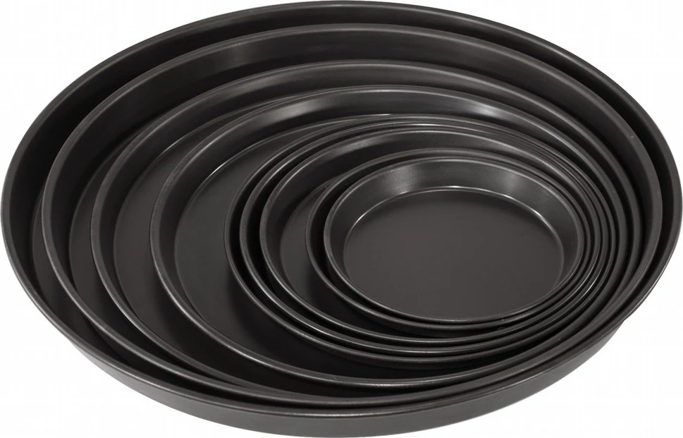{.nostretch width="100%"}
:::

::: {style="position:absolute; left:761px; top:590px; width:535px;"}
{.nostretch width="100%"}
:::

::: {style="position:absolute; left:1296px; top:589px; width:356px;"}
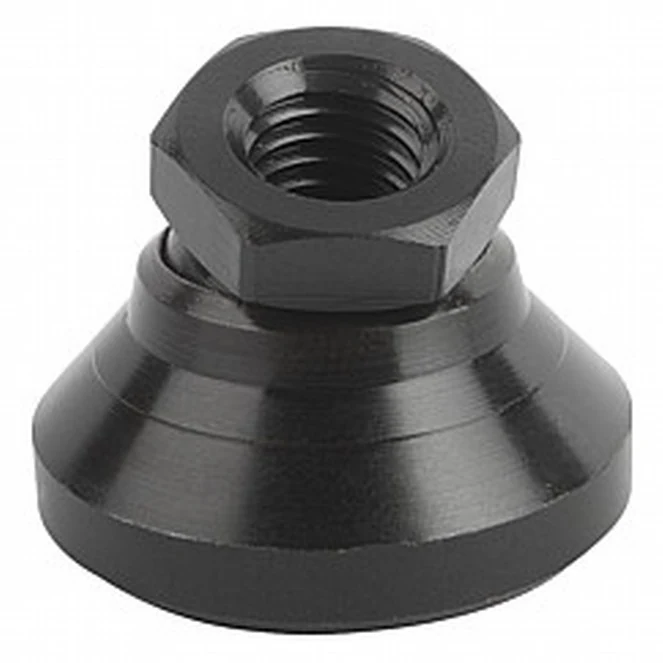{.nostretch width="100%"}
:::

::: {.footer}
ExBake, Browning, Kipp
:::

<!-- Slajd 25 -->
## [TECHNIKI WYTWARZANIA POWŁOK]{style="display:block; text-align:center;"}

### Chromianowanie

- Pasywna powłoka tlenków Cr na detalach metalowych.
- Znacznie poprawia odporność na korozję, zachowując wytrzymałość mechaniczną i termiczną.
- Na elementy Zn, Cd, Cu, Ag, Mg, Al i wybrane stopy tych metali.
- Grubość 0,1÷1 μm.
- Przed wysuszeniem (po procesie) jest porowata.
- Roztwory CrO3 + Na2SO4 + H2O, temperatura pokojowa, kilka minut.
- Zastosowanie: ochronne i dekoracyjne (barwienie), podkład pod powłoki malarskie.

### Powłoki konwersyjne

::: {style="position:absolute; left:448px; top:591px; width:600px;"}
{.nostretch width="100%"}
:::

::: {style="position:absolute; left:1072px; top:591px; width:357px;"}
{.nostretch width="100%"}
:::

::: {.footer}
ECM
:::

<!-- Slajd 26 -->
## [QUIZ]{style="display:block; text-align:center;"}

- Podobieństwa i różnice polerowania i powlekania elektrochemicznego.
- Jakie zjawiska zachodzą w trawieniu i miedziowaniu elektrochemicznym?
- Podczas procesu galwanostegii (lub galwanoplastyki) można prowadzić trawienie elektrochemiczne?
- Czy w chromowaniu technicznym elementów wytwarzamy twardą warstwę tlenku chromu?
- Kiedy i dla jakich materiałów można prowadzić proces utleniania?

::: {.footer}
mars@mchtr.pw.edu.pl
:::

<!-- Slajd 27 -->
## [DODATEK]{style="display:block; text-align:center;"}

- Projekt systemu kontroli dozowania antybiotyków w kroplach do oczu
- rejestracja dozowania kropli
- (otwarcie, przechylenie, …)
- okres kuracji - miesiąc
- przechowywanie w lodówce
- wiek pacjentów 20-80
- termin realizacji 2020
- budżet minimalny ale jakiś jest

::: {style="position:absolute; left:999px; top:335px; width:397px;"}
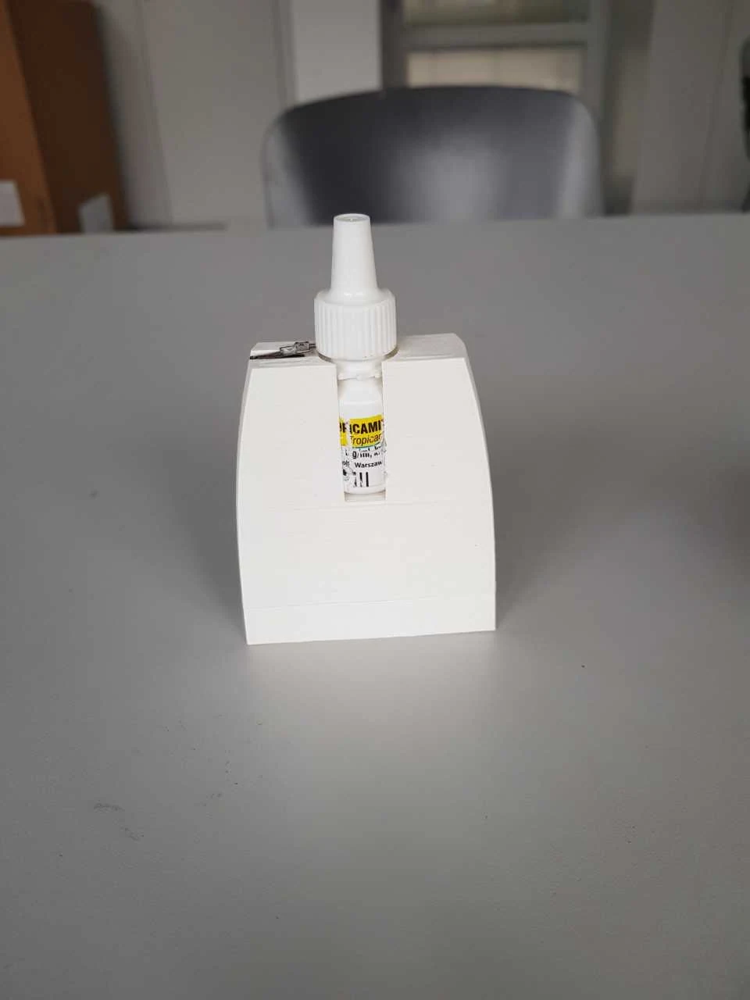{.nostretch width="100%"}
:::

::: {style="position:absolute; left:1416px; top:335px; width:424px;"}
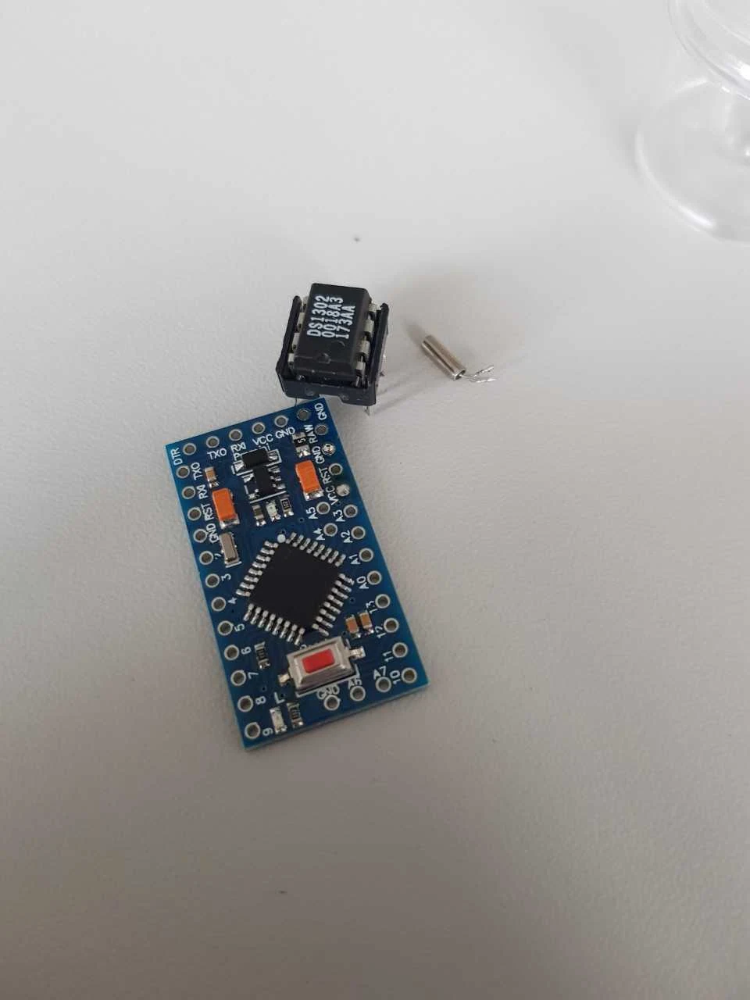{.nostretch width="100%"}
:::

::: {style="position:absolute; left:831px; top:477px; width:148px;"}
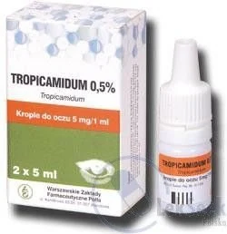{.nostretch width="100%"}
:::

