## [TECHNOLOGIA POWŁOK]{style="display:block; text-align:center;"}

Powłoka to warstwa materiału <u>wytworzona lub nałożona</u> na powierzchnię elementu w sposób naturalny lub sztuczny. Powłoka jest wykonana <u>z innego materiału niż element</u>. Celem powłoki jest uzyskanie określonych właściwości ochronnych, technicznych lub dekoracyjnych.  

::: {style="position:absolute; left:272px; top:658px; width:367px;"}
{.nostretch width="100%"}
:::

::: {style="position:absolute; left:155px; top:331px; width:413px;"}
{.nostretch width="100%"}
:::

::: {style="position:absolute; left:751px; top:614px; width:426px;"}
{.nostretch width="100%"}
:::

::: {style="position:absolute; left:632px; top:331px; width:367px;"}
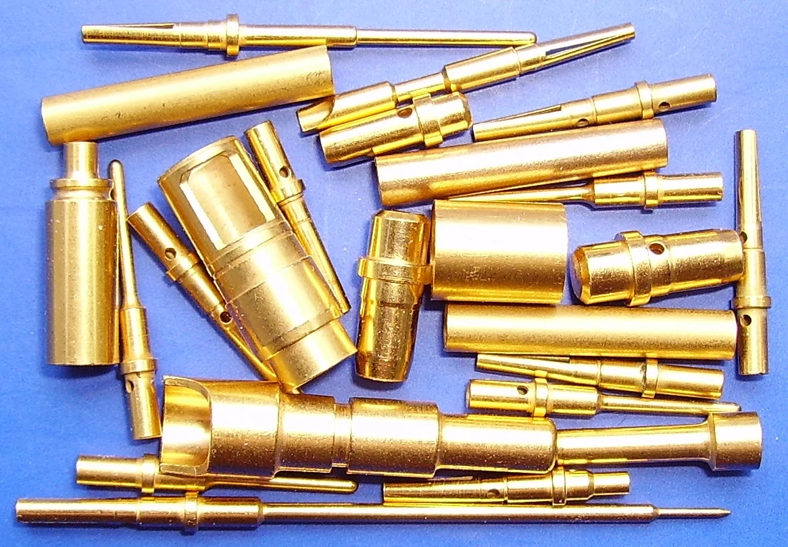{.nostretch width="100%"}
:::

::: {style="position:absolute; left:1111px; top:331px; width:367px;"}
{.nostretch width="100%"}
:::

::: {style="position:absolute; left:1300px; top:686px; width:388px;"}
{.nostretch width="100%"}
:::

::: {style="position:absolute; left:1536px; top:331px; width:205px;"}
{.nostretch width="100%"}
:::

<!-- Slajd 3 -->
## [TECHNIKI WYTWARZANIA POWŁOK]{style="display:block; text-align:center;"}

Powlekanie zanurzeniowe (ogniowe)  
metale lub stopy na podłożach metalowych (lub niemetalach)  
temperatura topnienia powłoki < temperatura topnienia podłoża  
Sn (232°C), Pb (327°C), Zn (419°C) i Al (660°C)  [Fe 1540°C, Cu 1083°C]  
grubość powłoki 30 - 150 μm  
Przykłady zastosowań  
Zn – zabezpieczenie przed korozją drutów, blach, rur itp.  
Sn – ścieżki PCB (HASL), lutowanie na fali, zabezpieczenia antykorozyjne w przemyśle spożywczym.  
Al – zabezpieczenie elementów pracujących w agresywnych gazach w wysokiej temperaturze.  
Pb – zabezpieczenie antykorozyjne elementów przed agresywnymi chemikaliami, np. H2SO4.  

<!-- Slajd 4 -->
## [TECHNIKI WYTWARZANIA POWŁOK]{style="display:block; text-align:center;"}

(proces)  
obróbka wstępna: usuwanie zanieczyszczeń, odtłuszczanie, trawienie i płukanie,  
zanurzenie w topniku (topnikowanie): oczyszczenie z tlenków i zapobieganie ponownemu utlenianiu, ułatwienie zwilżenia powierzchni przez ciekły metal,  
nakładanie powłoki metalowej: zanurzenie lub przeciąganie elementów przez stopiony metal, kontrola zwilżalności pokrywanego metalu (topnik) oraz stanu powlekanej powierzchni, regulacja grubości powłoki przez zgarnianie lub zdmuchiwanie nadmiaru ciekłego metalu,  
obróbka końcowa (wyrównanie grubości, wygładzenie, poprawa właściwości i wyglądu – o. cieplna).  

Powlekanie zanurzeniowe  

2 – walec kierujący blachę, 3 – topnik,  
4 – stopiona cyna, 1 – olej chłodzący.  

::: {style="position:absolute; left:187px; top:224px; width:669px;"}
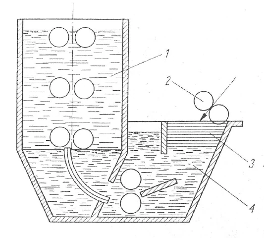{.nostretch width="100%"}
:::

::: {style="position:absolute; left:892px; top:224px; width:904px;"}
{.nostretch width="100%"}
:::

::: {style="position:absolute; left:287px; top:224px; width:1388px;"}
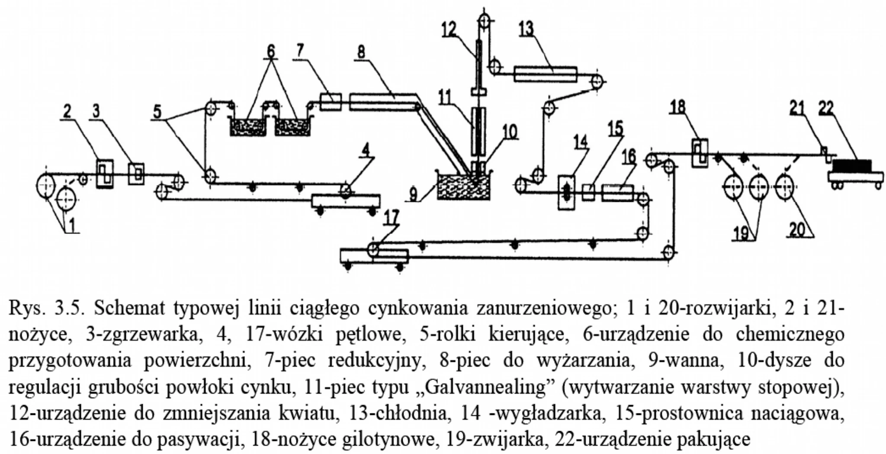{.nostretch width="100%"}
:::

::: {.footer}
Nepean
:::

<!-- Slajd 5 -->
## [TECHNIKI WYTWARZANIA POWŁOK]{style="display:block; text-align:center;"}

### Powlekanie zanurzeniowe

### (proces i charakterystyka)

- 1 – faza gamma Γ  2 – faza delta δ
- 3 – faza dzeta ζ    4 – cynk.

::: {style="position:absolute; left:72px; top:240px; width:684px;"}
{.nostretch width="100%"}
:::

::: {style="position:absolute; left:953px; top:240px; width:888px;"}
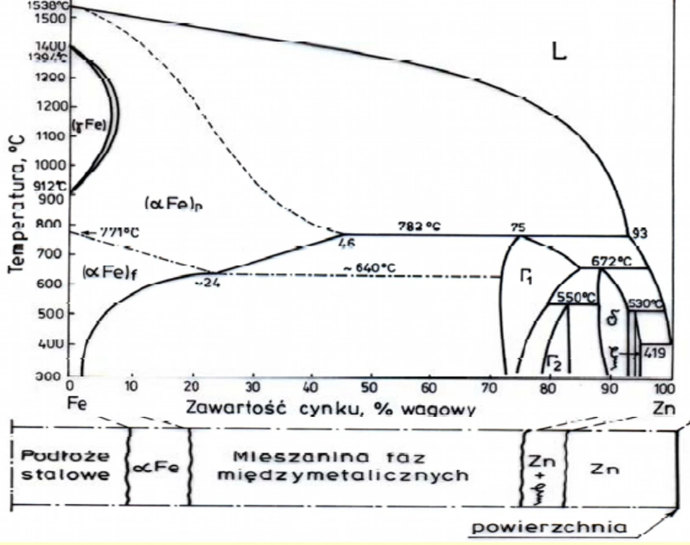{.nostretch width="100%"}
:::

::: {style="position:absolute; left:362px; top:333px; width:566px;"}
{.nostretch width="100%"}
:::

<!-- Slajd 6 -->
## [TECHNIKI WYTWARZANIA POWŁOK]{style="display:block; text-align:center;"}

### Powlekanie zanurzeniowe (proces)



::: {.footer}

Factories in Poland https://www.youtube.com/watch?v=6OLz1t4bPPA&t=83s (do samodzielnego oglądania zalecane włączenie dźwięku)

:::

<!-- Slajd 7 -->
## [TECHNIKI WYTWARZANIA POWŁOK]{style="display:block; text-align:center;"}

### Powlekanie zanurzeniowe (proces)



::: {.footer}

Epec Engineered Technologies https://www.youtube.com/watch?v=KUP9Flhn_5o

:::

<!-- Slajd 8 -->
## [TECHNIKI WYTWARZANIA POWŁOK]{style="display:block; text-align:center;"}

- Powlekanie natryskowe
- stopienie metalu powłoki w płomieniu gazu, w łuku elektrycznym, w plazmie, …,
- rozpylenie pneumatyczne i nadanie dużej energii kinetycznej,
- wywarcie nacisku umożliwiające dobrą przyczepność powłoki do podłoża,
- warstwy Zn, Al, Ni-Cr na podłożach metalowych lub ceramicznych.

::: {style="position:absolute; left:40px; top:475px; width:926px;"}
{.nostretch width="100%"}
:::

::: {style="position:absolute; left:987px; top:475px; width:890px;"}
{.nostretch width="100%"}
:::

::: {.footer}
Castolin, Mostostal
:::

<!-- Slajd 9 -->
## [TECHNIKI WYTWARZANIA POWŁOK]{style="display:block; text-align:center;"}

- (proces)
- podawanie materiału w stanie stałym lub ciekłym (proszek, drut, taśma) do strefy topienia,
- ciągłe topienie i rozpylanie metalu sprężonym gazem (powietrze, gazy spalinowe): t ~ 10-3 s,
- lot stopionych cząstek kulistych z dyszy w kierunku powierzchni (utlenienie powierzchniowe),
- tworzenie powłoki: zetknięcie cząstek z powierzchnią aż do ostygnięcia powłoki.

### Powlekanie natryskowe

- Rodzaje powlekania natryskowego metali:
- - płomieniowe\*
- - detonacyjne\*
- - naddźwiękowe (też detonacyjne)
- - elektryczne łukowe
- - plazmowe
- - laserowe

::: {style="position:absolute; left:1313px; top:167px; width:525px;"}
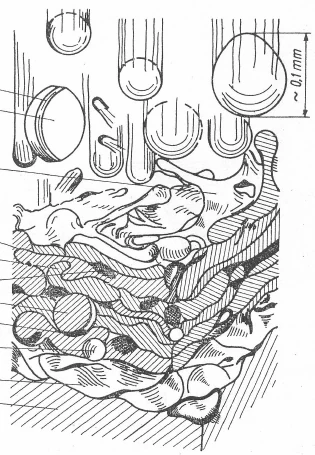{.nostretch width="100%"}
:::

::: {style="position:absolute; left:72px; top:435px; width:779px;"}
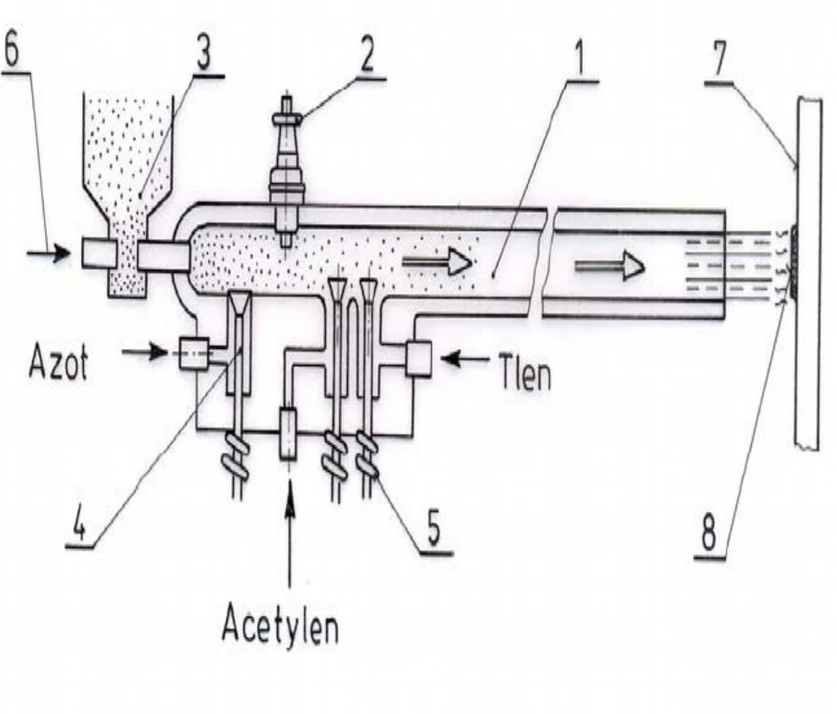{.nostretch width="100%"}
:::

::: {style="position:absolute; left:856px; top:483px; width:998px;"}
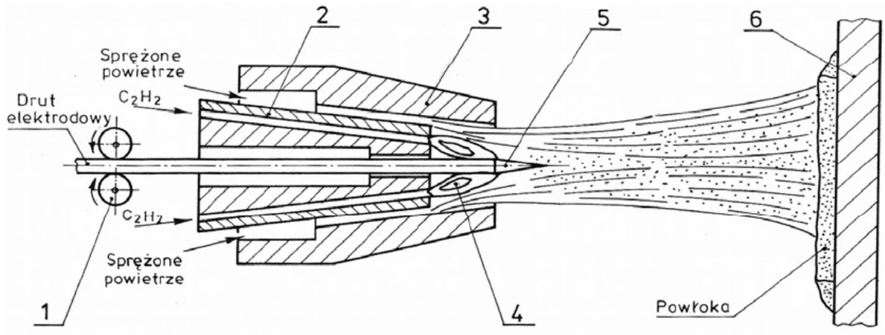{.nostretch width="100%"}
:::

<!-- Slajd 10 -->
## [TECHNIKI WYTWARZANIA POWŁOK]{style="display:block; text-align:center;"}

### Powlekanie natryskowe (proces)

<!-- LEWY FILM -->

::: {style="position:absolute; left:-90px; top:200px; width:1200px;"}

:::

<!-- PRAWY FILM -->

::: {style="position:absolute; left:860px; top:200px; width:1200px;"}

:::

::: {.footer}

marekd70 https://www.youtube.com/watch?v=o_9bIGInAPw &emsp; Plasma Nowa https://www.youtube.com/watch?v=4xfmsXHYtrg&t=52s

:::

<!-- Slajd 12 -->
## [TECHNIKI WYTWARZANIA POWŁOK]{style="display:block; text-align:center;"}

### Powlekanie natryskowe (proces)



::: {.footer}

PNC s.c. https://www.youtube.com/watch?v=pjSi7nSfMkc&t=24s

:::

<!-- Slajd 13 -->
## [TECHNIKI WYTWARZANIA POWŁOK]{style="display:block; text-align:center;"}

### Platerowanie

pokrycie metalu podłoża innym metalem lub stopem przez wytworzenie nacisku na metal pokrywający np. przez walcowanie, detonację - wiązania międzyatomowe.  
grubość powłoki zależy od grubości zastosowanego materiału i wynosi od 0,25÷3 mm,  
platerowanie na zimno: walcowanie, tłoczenie, przeciąganie, platerowanie wybuchem,  
platerowanie na gorąco: walcowanie, przeciąganie, wylewanie, natapianie, napawanie, spiekanie.  

::: {style="position:absolute; left:202px; top:490px; width:713px;"}
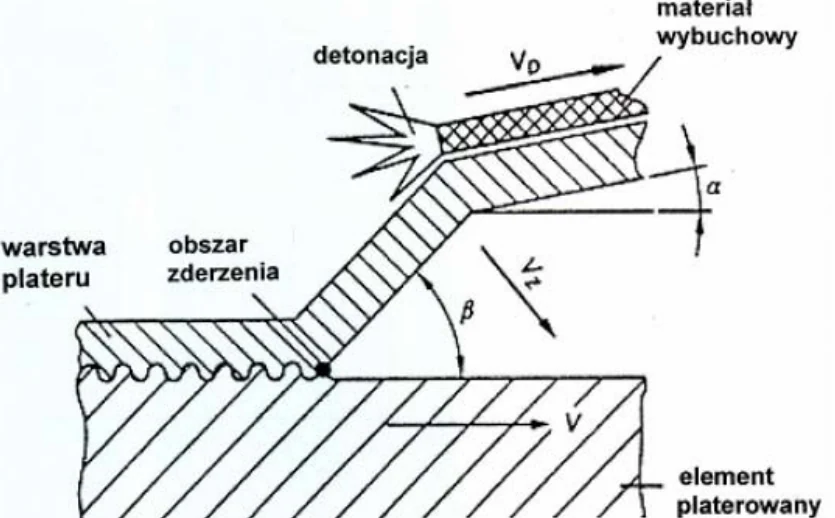{.nostretch width="100%"}
:::

::: {style="position:absolute; left:959px; top:490px; width:750px;"}
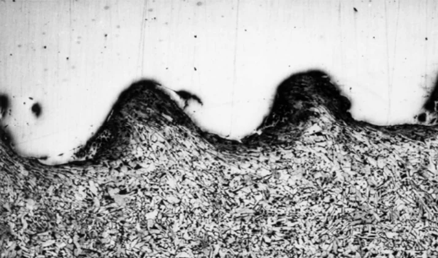{.nostretch width="100%"}
:::

<!-- Slajd 14 -->
## [TECHNIKI WYTWARZANIA POWŁOK]{style="display:block; text-align:center;"}

### Platerowanie



::: {.footer}

GrafEngin https://www.youtube.com/watch?v=ciCxNgROtm4&t=16s

:::

<!-- Slajd 15 -->
## [TECHNIKI WYTWARZANIA POWŁOK]{style="display:block; text-align:center;"}

### Powłoki naparowywane

Chemiczne osadzanie z fazy gazowej CVD (Chemical Vapor Deposition)  
Prekursor powłoki jest wprowadzany do całej objętości komory reaktora, a kontrola przepływu, stężenia, temperatury procesu i ciśnienia, zapewnia nam kontrolę nad składem powłoki. Cząstki prekursora w bliskości warstwy wierzchniej osadzają się na niej w wyniku reakcji chemicznych.  
Fizyczne osadzanie z fazy gazowej PVD (Physical Vapor Deposition)  
Atomy lub cząsteczki powłoki są dostarczane na powierzchnię w postaci par lub kinetycznie, w komorze reaktora będącej pod obniżonym ciśnieniem. Powłoka powstaje na powierzchni w wyniku zjawisk fizycznych.  
naparowywanie próżniowe,  
rozpylanie katodowe, rozpylanie magnetronowe (sputtering),  
epitaksja z wiązek molekularnych.  

<!-- Slajd 16 -->
## [TECHNIKI WYTWARZANIA POWŁOK]{style="display:block; text-align:center;"}

- Chemiczne osadzanie z fazy gazowej CVD (Chemical Vapor Deposition)
- wysoka temperatura podłoża zapewnia dobrą przyczepność i utworzenie litej warstwy (900÷1200°C)
- do pokrywania narzędzi z węglików spiekanych (warstwy TiN )
- warstwy diamentowe i diamentopodobne
- grafen epitaksjalny
- elementy mikroelektroniczne oraz optoelektroniczne
- pokrycia materiałów ceramicznych.

### Powłoki naparowywane

::: {style="position:absolute; left:238px; top:299px; width:1486px;"}
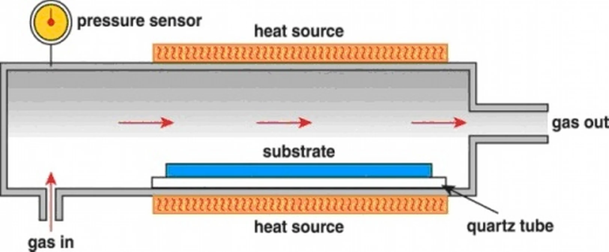{.nostretch width="100%"}
:::

<!-- Slajd 17 -->
## [TECHNIKI WYTWARZANIA POWŁOK]{style="display:block; text-align:center;"}

### Warstwy diamentowe i diamentopodobne (CVD)

warstwy diamentowe (Diamond Film) i diamentopodobne (Diamond Like Carbon)  
nie posiadają struktury krystalicznej diamentu: struktura krystaliczna (DF) bądź amorficzna (DLC)  
wykazują podobieństwo wielu cech do diamentu  
amorficzne warstwy DLC są idealnie gładkie, twarde, odporne chemicznie, bardzo dobre przewodzą ciepło, są pozbawione wad związanych z granicami ziaren, charakteryzują się doskonałą adhezją do wielu gładkich podłoży  
mogą być wytwarzane w procesach niskotemperaturowych (temperatura podłoża < 300°C)  

### Powłoki naparowywane

::: {style="position:absolute; left:198px; top:273px; width:886px;"}
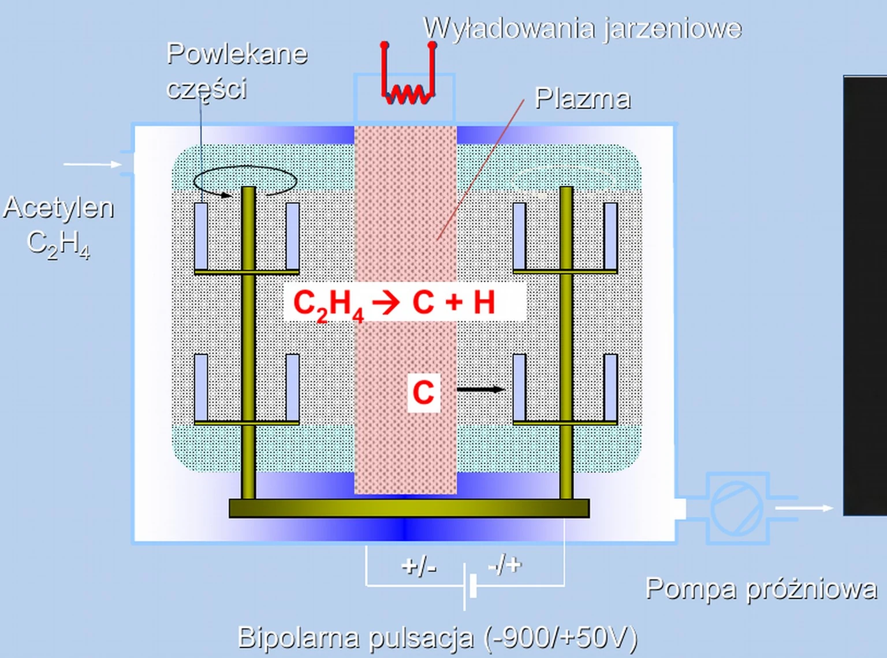{.nostretch width="100%"}
:::

::: {style="position:absolute; left:1116px; top:273px; width:633px;"}
{.nostretch width="100%"}
:::

::: {style="position:absolute; left:535px; top:273px; width:866px;"}
{.nostretch width="100%"}
:::

::: {.footer}
Balzers, Mitsubishi
:::

<!-- Slajd 18 -->
## [TECHNIKI WYTWARZANIA POWŁOK]{style="display:block; text-align:center;"}

- Fizyczne osadzanie z fazy gazowej PVD (Physical Vapor Deposition)
- Naparowanie próżniowe
- Na pokrywanej powierzchni następuje kondensacja materiału, podgrzanego do temperatury parowania.
- Al 119°C (1000Pa), 660°C/2450°C
- Cu 127°C (1000Pa), 1083°C/2595°C
- Cr 92°C (1000Pa), 1875°C/2665°C
- Au 117°C (1000Pa), 1063°C/2970°C

### Powłoki naparowywane

### 2) klosz, 4) uchwyt elementów, 5) elementy pokrywane,

- 6) zasilanie elektryczne grzejnika, 7) grzejnik (łódka),
- 8) ruchoma przesłona, 9) przewód pompy próżniowej,

::: {style="position:absolute; left:1055px; top:278px; width:783px;"}
{.nostretch width="100%"}
:::

<!-- Slajd 19 -->
## [TECHNIKI WYTWARZANIA POWŁOK]{style="display:block; text-align:center;"}

Rozpylanie katodowe  
Zjawisko parowania bądź wytrącania cząstek metalu katody pod wpływem bombardowania jonowego w rozrzedzonej atmosferze gazu szlachetnego (jarzeniowe).  
Rozpylanie magnetronowe  
Jony gazu obojętnego przyspieszane w polu magnetycznym.  

Powłoki naparowywane  
Fizyczne osadzanie z fazy gazowej PVD (Physical Vapor Deposition)  

2) klosz, 4) tarcza (target), 5) katoda,  
7) anoda (element), 10) zasilanie katody,  
12) zasilanie anody, 13) przewód pompy próżniowej  

::: {style="position:absolute; left:921px; top:277px; width:917px;"}
{.nostretch width="100%"}
:::

::: {style="position:absolute; left:300px; top:274px; width:580px;"}
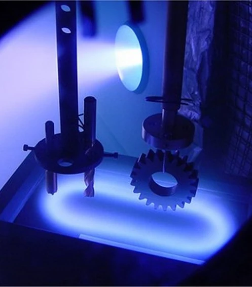{.nostretch width="100%"}
:::

::: {style="position:absolute; left:895px; top:274px; width:735px;"}
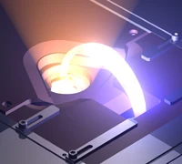{.nostretch width="100%"}
:::

::: {.footer}
CEI, Ferro Tech
:::

<!-- Slajd 20 -->
## [TECHNIKI WYTWARZANIA POWŁOK]{style="display:block; text-align:center;"}

Epitaksja z wiązek molekularnych MBE (Molecular Beam Epitaxy)  
osadzanie cienkich powłok (nanometry)  
ściśle określony skład chemiczny i precyzyjny rozkład profilu koncentracji domieszki  
doprowadzenie składników warstwy oddzielnymi wiązkami molekularnymi  
w ultrawysokiej próżni (UHV) przy ciśnieniu rzędu 10Pa.  

Powłoki naparowywane  
Fizyczne osadzanie z fazy gazowej PVD (Physical Vapor Deposition)  

::: {style="position:absolute; left:426px; top:334px; width:966px;"}
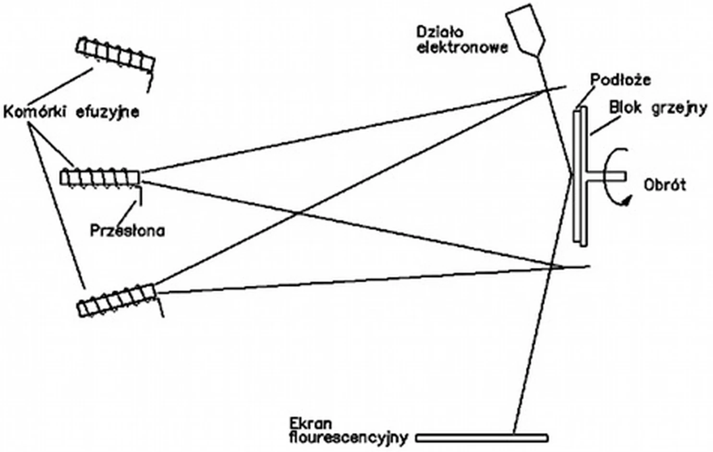{.nostretch width="100%"}
:::

::: {.footer}
Laboratoria.net
:::

<!-- Slajd 21 -->
## [TECHNIKI WYTWARZANIA POWŁOK]{style="display:block; text-align:center;"}

(zastosowanie)  
w optyce: przeciwodblaskowe (MgF2; CaF2) i odblaskowe (Al, Cr, Au), filtry,  
w elektronice: przewodzące, (Al), rezystywne (Ni, Cr), dielektryczne (SiO2), magnetyczne (FeNiCo),  
warstwy ścierne narzędzi (TiN, TiCN),  

### Powłoki naparowywane

::: {style="position:absolute; left:72px; top:378px; width:377px;"}
{.nostretch width="100%"}
:::

::: {style="position:absolute; left:264px; top:719px; width:709px;"}
{.nostretch width="100%"}
:::

::: {style="position:absolute; left:469px; top:375px; width:521px;"}
{.nostretch width="100%"}
:::

::: {style="position:absolute; left:1136px; top:719px; width:700px;"}
{.nostretch width="100%"}
:::

::: {style="position:absolute; left:1126px; top:378px; width:714px;"}
{.nostretch width="100%"}
:::

::: {.footer}
Vacaero, Templeman Opticians, UTexas
:::

<!-- Slajd 22 -->
## [TECHNIKI WYTWARZANIA POWŁOK]{style="display:block; text-align:center;"}

### Nasycanie dyfuzyjne

nasycanie warstwy wierzchniej metali pierwiastkami obcymi  
w ośrodkach stałych, ciekłych lub gazowych  
zmiany składu chemicznego, struktury i właściwości  
Przykłady procesów: aluminiowanie, chromowanie, tytanowanie, wanadowanie, cynkowanie, nawęglanie, azotowanie, borowanie, chromoaluminiowanie, chromokrzemowanie, borochromowanie, węglotytanowanie, węgloazotowanie, węgloazototytanowanie  
Nasycanie dyfuzyjne w ośrodku ciekłym jest podobne do pokrywania zanurzeniowego – dłuższy czas umożliwia jonom dyfuzję na większą głębokość.  
Stężenie jonów do 50 % w warstwie o grubości poniżej 1 mm. Im bliżej powierzchni tym stężenie jest większe, aż do pełnego pokrycia metalem powłoki w przypadku stosowania ośrodków ciekłych.  

<!-- Slajd 23 -->
## [TECHNIKI WYTWARZANIA POWŁOK]{style="display:block; text-align:center;"}

(przykłady)  
Aluminiowanie  
stałe: proszek Al, Al2O3, żelazoglin, kaolin; 850÷1050°C; azot, wodór; t = 1÷10 h (rozmiar elementów)  
ciekłe: 92÷94 % Al i 6÷8 % Fe; 750÷800°C; t = 0,5÷1h,  
gazowe: proszek Al, Al2O3, chlorek amonu; 900÷1050°C; azot, wodór; t = 2 h.  
Chromowanie  
stałe: żelazochrom lub chrom, chlorek amonowy, piasek kwarcowy, kaolin; 950°C,  
ciekłe: chlorek chromu, chlorek sodu i żelazochrom; 950÷1000°C,  
gazowe: chlorek chromu; 950÷1000°C.  
Chromoaluminiowanie  
stałe: aluminium, żelazochrom; argon, azot lub wodór; 950÷1000°C; 5÷10 h,  
gazowe: halogenki chromu i glinu; argon, azot lub wodór; 950÷1000°C; 5÷10 h.  
Azotowanie: gazowe (amoniak, 10÷130 h, 550°C); twardość, odporności na korozję; azotki metali (Fe4N).  
Nawęglanie: dla stali niskowęglowej (<0,25%), zwiększenie twardość zachowując elastyczny rdzeń. Zawartość węgla do 1÷1,3% (0,5÷2 mm); proszkowe, gazowe, ciekłe, 950°C, 10 h, konieczne hartowanie.  

### Nasycanie dyfuzyjne

::: {style="position:absolute; left:400px; top:224px; width:1055px;"}
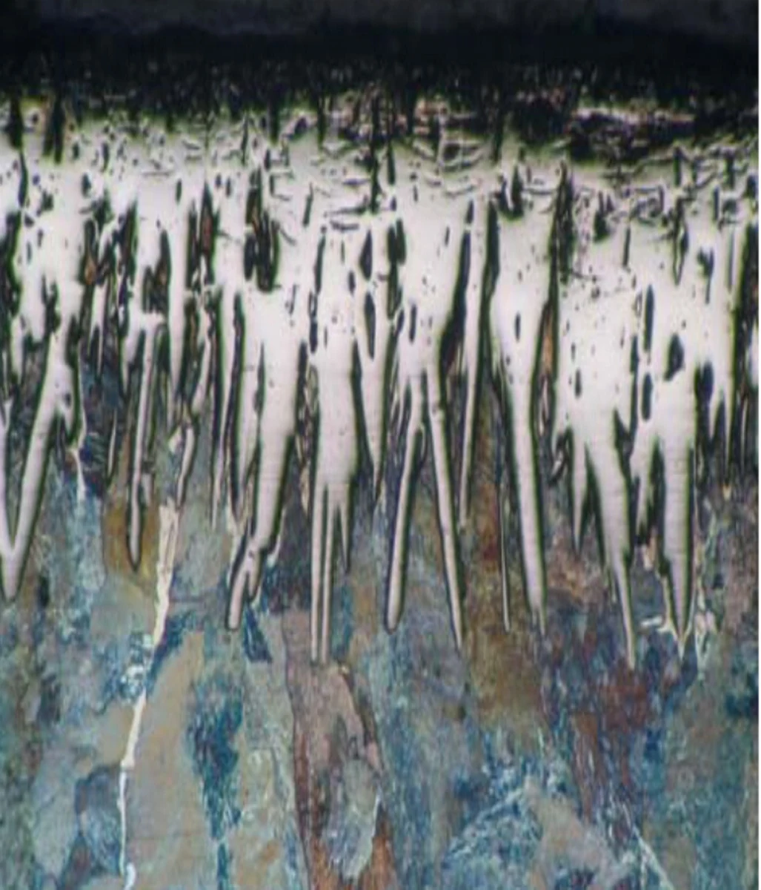{.nostretch width="100%"}
:::

<!-- Slajd 24 -->
## [QUIZ]{style="display:block; text-align:center;"}

- Jak przeprowadza się powlekanie zanurzeniowe (ogniowe) elementów metalowych?
- Jak przeprowadza się powlekanie natryskowe stopionymi proszkami metali?
- W jaki sposób prowadzi się nasycanie dyfuzyjne?
- W jakim celu obniża się ciśnienie atmosferyczne w procesach naparowania?
- W jaki sposób wytwarza się warstwy węglowe, diamentowe, diamentopodobne i grafen na metalach?

