## [TECHNOLOGIA POWŁOK]{style="display:block; text-align:center;"}

Powłoka to warstwa materiału <u>wytworzona lub nałożona</u> na powierzchnię elementu w sposób naturalny lub sztuczny. Powłoka jest wykonana <u>z innego materiału niż element</u>. Celem powłoki jest uzyskanie określonych właściwości ochronnych, technicznych lub dekoracyjnych.  

::: {style="position:absolute; left:272px; top:658px; width:367px;"}
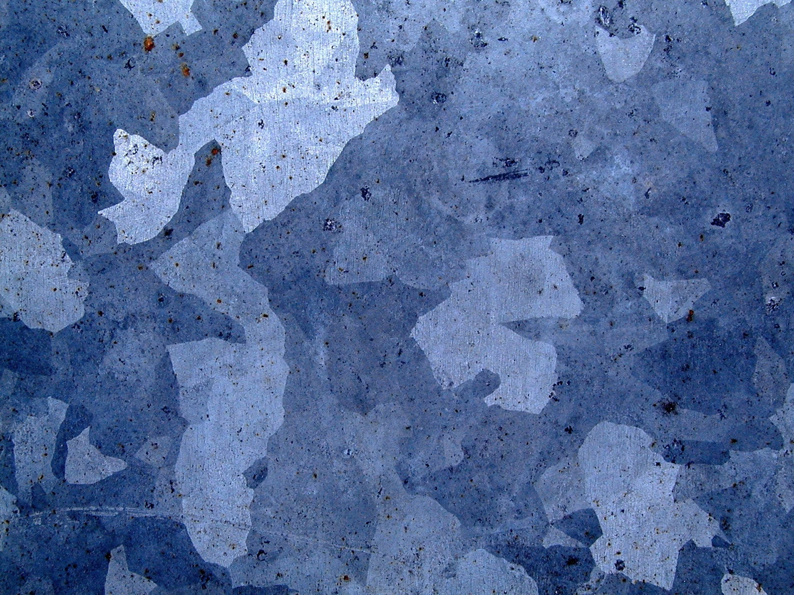{.nostretch width="100%"}
:::

::: {style="position:absolute; left:155px; top:331px; width:413px;"}
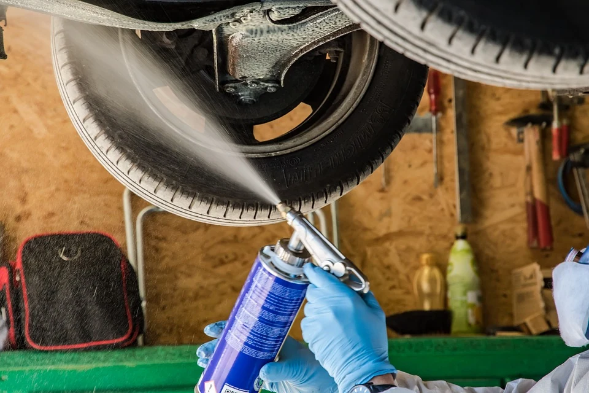{.nostretch width="100%"}
:::

::: {style="position:absolute; left:751px; top:614px; width:426px;"}
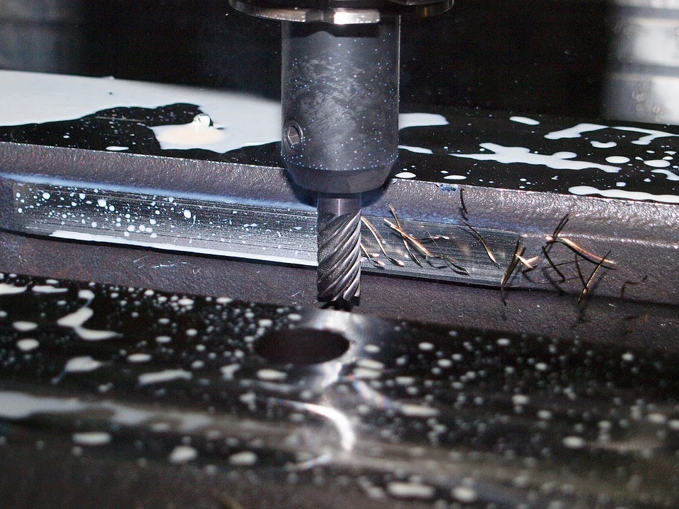{.nostretch width="100%"}
:::

::: {style="position:absolute; left:632px; top:331px; width:367px;"}
{.nostretch width="100%"}
:::

::: {style="position:absolute; left:1111px; top:331px; width:367px;"}
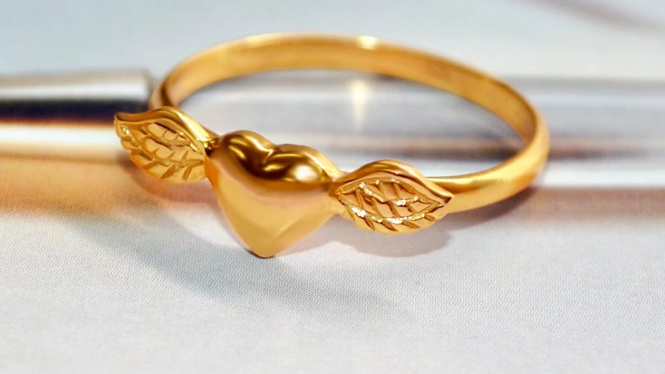{.nostretch width="100%"}
:::

::: {style="position:absolute; left:1300px; top:686px; width:388px;"}
{.nostretch width="100%"}
:::

::: {style="position:absolute; left:1536px; top:331px; width:205px;"}
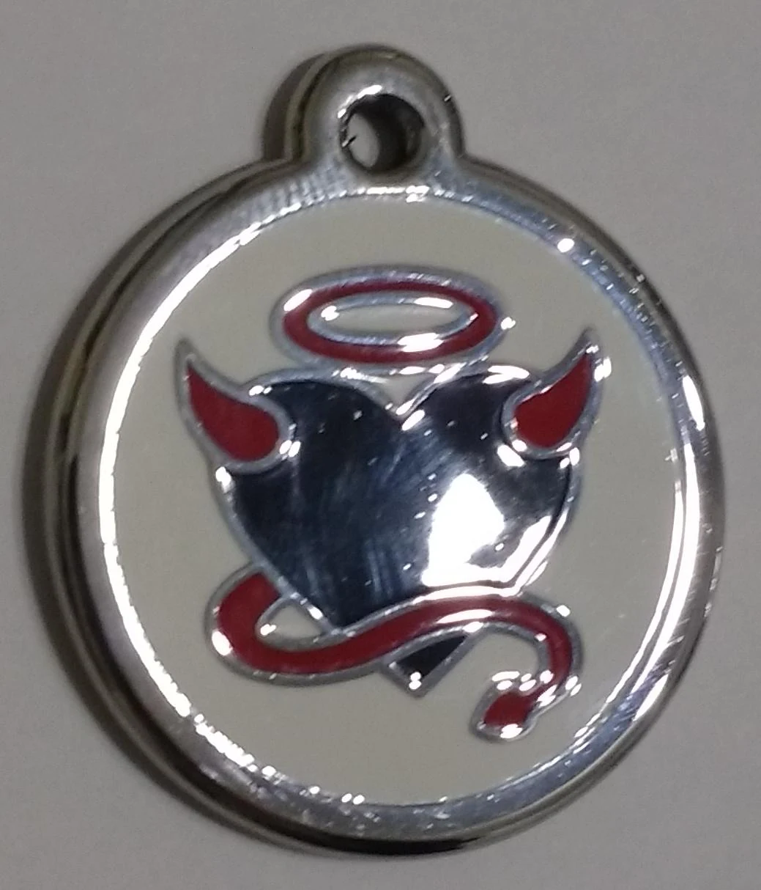{.nostretch width="100%"}
:::

<!-- Slajd 3 -->
## [TECHNIKI WYTWARZANIA POWŁOK]{style="display:block; text-align:center;"}

### Powlekanie zanurzeniowe (ogniowe)

- metale lub stopy na podłożach metalowych (lub niemetalach)  
- temperatura topnienia powłoki < temperatura topnienia podłoża  
   - Sn (232°C), Pb (327°C), Zn (419°C) i Al (660°C)  [Fe 1540°C, Cu 1083°C]  
grubość powłoki 30 - 150 μm

Przykłady zastosowań:

- Zn – zabezpieczenie przed korozją drutów, blach, rur itp.  
- Sn – ścieżki PCB (HASL), lutowanie na fali, zabezpieczenia antykorozyjne w przemyśle spożywczym.  
- Al – zabezpieczenie elementów pracujących w agresywnych gazach w wysokiej temperaturze.  
- Pb – zabezpieczenie antykorozyjne elementów przed agresywnymi chemikaliami, np. H~2~SO~4~.  

<!-- Slajd 4 -->
## [TECHNIKI WYTWARZANIA POWŁOK]{style="display:block; text-align:center;"}

### Powlekanie zanurzeniowe (proces)  

- obróbka wstępna: usuwanie zanieczyszczeń, odtłuszczanie, trawienie i płukanie,  
- zanurzenie w topniku (topnikowanie): oczyszczenie z tlenków i zapobieganie ponownemu utlenianiu, ułatwienie zwilżenia powierzchni przez ciekły metal,  
- nakładanie powłoki metalowej: zanurzenie lub przeciąganie elementów przez stopiony metal, kontrola zwilżalności pokrywanego metalu (topnik) oraz stanu powlekanej powierzchni, regulacja grubości powłoki przez
- zgarnianie lub zdmuchiwanie nadmiaru ciekłego metalu,  
- obróbka końcowa (wyrównanie grubości, wygładzenie, poprawa właściwości i wyglądu – o. cieplna).  

## [TECHNIKI WYTWARZANIA POWŁOK]{style="display:block; text-align:center;"}

### Powlekanie zanurzeniowe (proces)  

:::: {style="--img-height:650px; display:flex; position:relative; left:50%; transform:translateX(-50%); width:max-content; max-width:none; align-items:center; gap:70px;"}

::: {style="flex:0 0 auto; margin:0;"}
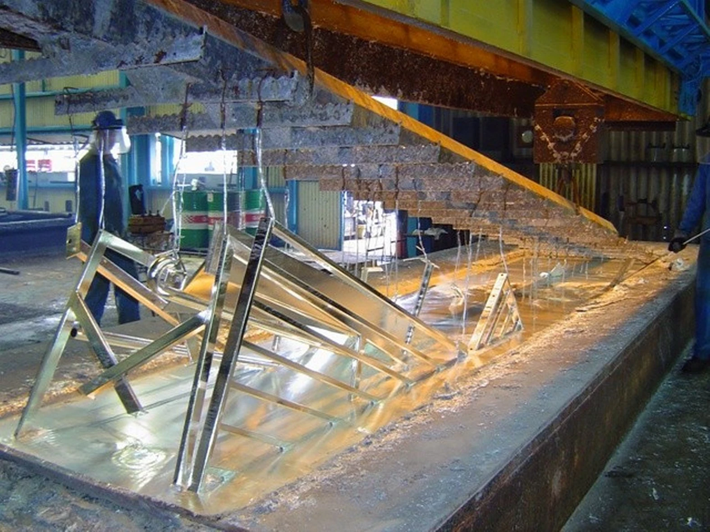{.nostretch style="height:var(--img-height); width:auto; max-width:none; max-height:none; margin:0;"}
:::

::: {style="flex:0 0 auto; margin:0;"}
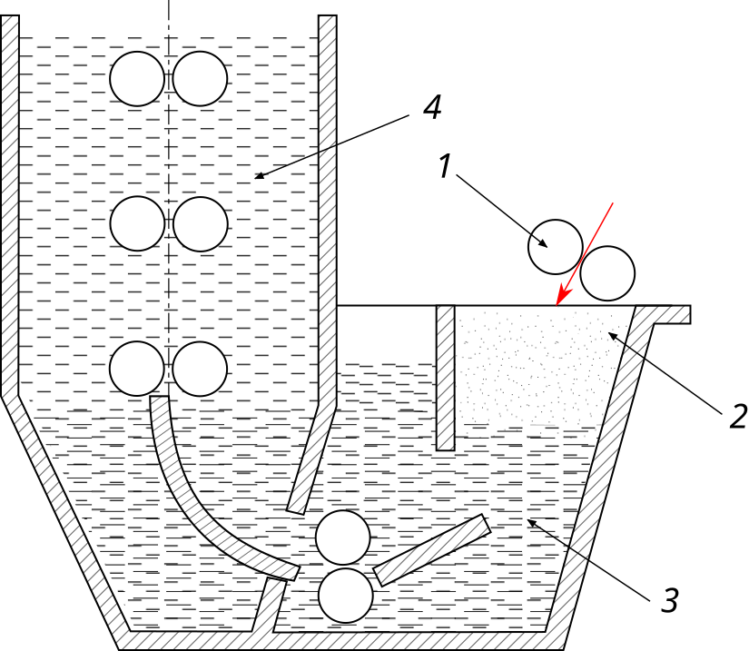{.nostretch style="height:var(--img-height); width:auto; max-width:none; max-height:none; margin:0;"}
:::

::::

::: {style="text-align:right;  width:100%;"}
1 – walec kierujący blachę, 2 – topnik,  
3 – stopiona cyna, 4 – olej chłodzący
:::

::: {.footer}
Nepean
:::

## [TECHNIKI WYTWARZANIA POWŁOK]{style="display:block; text-align:center;"}

### Powlekanie zanurzeniowe (proces)  

::: {style="position:relative; left:40px; top:-20px; width:1700px;"}
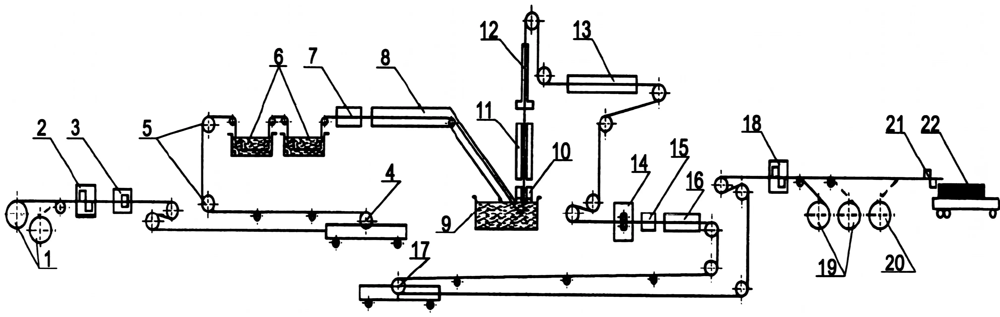{.nostretch width="100%"}
:::

Schemat typowej linii ciągłego cynkowania zanurzeniowego: 1 i 20-rozwijarki, 2 i 21-nożyce, 3-zgrzewarka, 4, 17-wózki pętlowe, 5-rolki kierujące, 6-urządzenie do chemicznego przygotowania powierzchni, 7-piec redukcyjny, 8-piec do wyżarzania, 9-wanna, 10-dysze do regulacji grubości powłoki cynku, 11-piec typu „Galvannealing” (wytwarzanie warstwy stopowej), 12-urządzenie do zmniejszania kwiatu, 13-chłodnia, 14 -wygładzarka, 15-prostownica naciągowa, 16-urządzenie do pasywacji, 18-nożyce gilotynowe, 19-zwijarka, 22-urządzenie pakujące

<!-- Slajd 5 -->
## [TECHNIKI WYTWARZANIA POWŁOK]{style="display:block; text-align:center;"}

### Powlekanie zanurzeniowe (proces i charakterystyka)

:::: {style="--img-height:640px; display:flex; position:relative; left:50%; transform:translateX(-50%); width:max-content; max-width:none; align-items:center; gap:10px;"}

::: {style="flex:0 0 auto; margin:0;"}
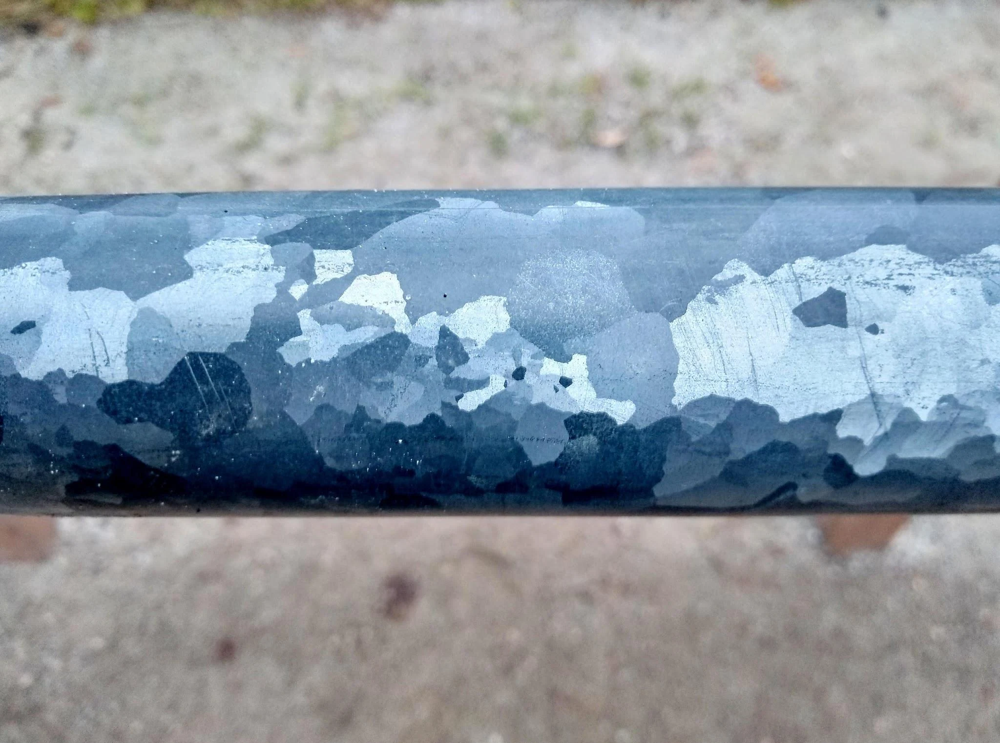{.nostretch style="height:var(--img-height); width:auto; max-width:none; max-height:none; margin:0;"}
:::

::: {style="flex:0 0 auto; margin:0;"}
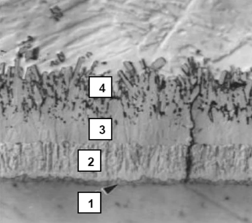{.nostretch style="height:var(--img-height); width:auto; max-width:none; max-height:none; margin:0;"}
:::

::: {style="flex:0 0 auto; margin:0;"}
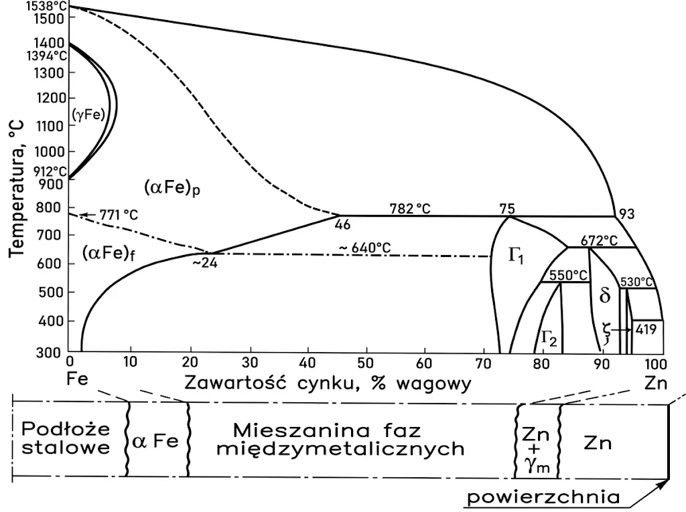{.nostretch style="height:var(--img-height); width:auto; max-width:none; max-height:none; margin:0;"}
:::

::::

1 – faza gamma Γ &emsp; 2 – faza delta δ &emsp; 3 – faza dzeta ζ &emsp; 4 – cynk

<!-- Slajd 6 -->
## [TECHNIKI WYTWARZANIA POWŁOK]{style="display:block; text-align:center;"}

### Powlekanie zanurzeniowe (proces)



::: {.footer}

Factories in Poland https://www.youtube.com/watch?v=6OLz1t4bPPA&t=83s (do samodzielnego oglądania zalecane włączenie dźwięku)

:::

<!-- Slajd 7 -->
## [TECHNIKI WYTWARZANIA POWŁOK]{style="display:block; text-align:center;"}

### Powlekanie zanurzeniowe (proces)



::: {.footer}

Epec Engineered Technologies https://www.youtube.com/watch?v=KUP9Flhn_5o

:::

<!-- Slajd 8 -->
## [TECHNIKI WYTWARZANIA POWŁOK]{style="display:block; text-align:center;"}

### Powlekanie natryskowe

- stopienie metalu powłoki w płomieniu gazu, w łuku elektrycznym, w plazmie, …,
- rozpylenie pneumatyczne i nadanie dużej energii kinetycznej,
- wywarcie nacisku umożliwiające dobrą przyczepność powłoki do podłoża,
- warstwy Zn, Al, Ni-Cr na podłożach metalowych lub ceramicznych.

::: {style="position:absolute; left:40px; top:475px; width:926px;"}
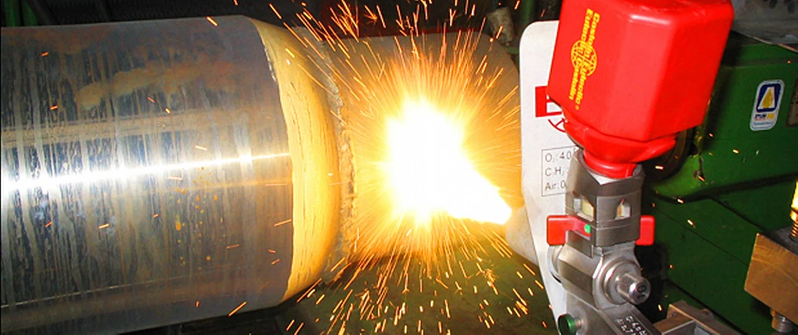{.nostretch width="100%"}
:::

::: {style="position:absolute; left:987px; top:475px; width:890px;"}
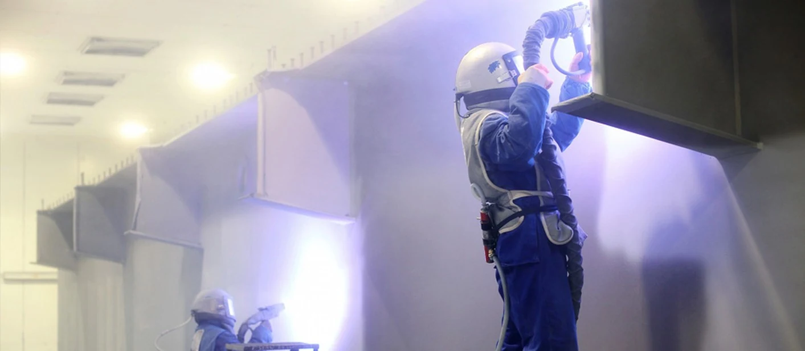{.nostretch width="100%"}
:::

::: {.footer}
Castolin, Mostostal
:::

<!-- Slajd 9 -->
## [TECHNIKI WYTWARZANIA POWŁOK]{style="display:block; text-align:center;"}

### Powlekanie natryskowe (proces)

- podawanie materiału w stanie stałym (proszek, drut, taśma) do strefy topienia,
- ciągłe topienie i rozpylanie metalu sprężonym gazem (powietrze, gazy spalinowe): t ~ 10^-3^ s,
- lot stopionych cząstek kulistych z dyszy w kierunku powierzchni (utlenienie powierzchniowe),
- tworzenie powłoki: zetknięcie cząstek z powierzchnią aż do ostygnięcia powłoki.

Rodzaje powlekania natryskowego metali:

- płomieniowe\*
- detonacyjne\*
- naddźwiękowe (też detonacyjne)
- elektryczne łukowe
- plazmowe
- laserowe

## [TECHNIKI WYTWARZANIA POWŁOK]{style="display:block; text-align:center;"}

### Powlekanie natryskowe (proces)

::: {style="display:flex; gap:100px; align-items:flex-start; width:1600px; margin-inline:auto;"}

::: {style="flex:3; min-width:0;"}

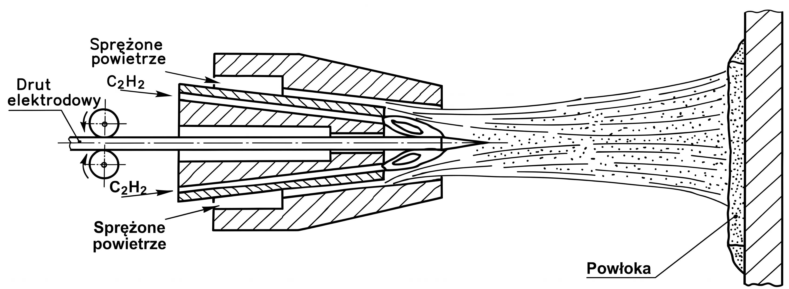{.nostretch width="100%" style="display:block; margin:0;"}

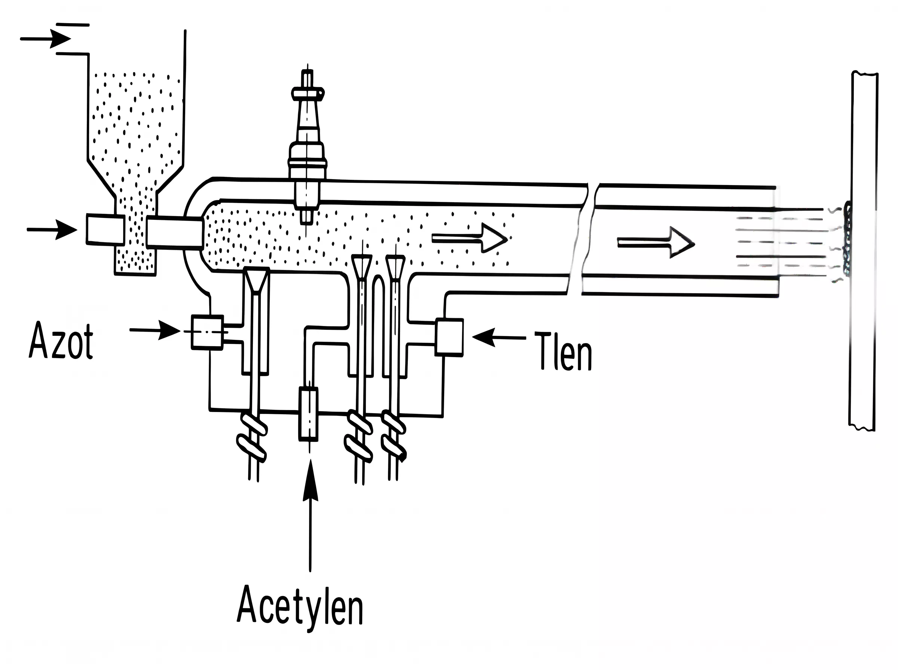{.nostretch width="100%" style="display:block; margin:0;"}
:::

::: {style="flex:2; min-width:0;"}
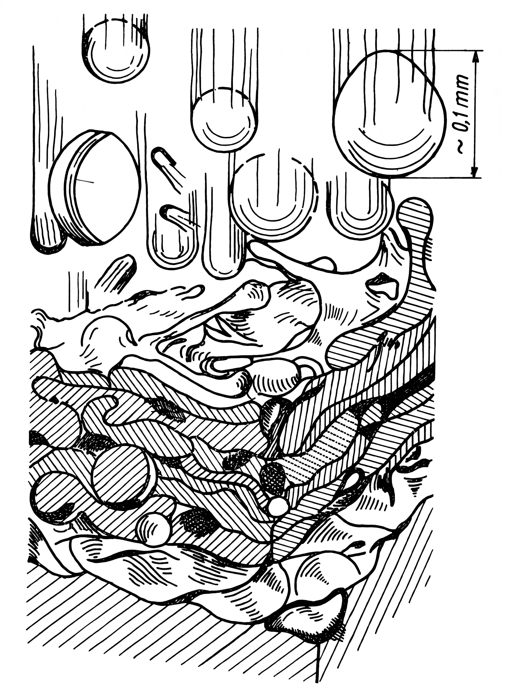{.nostretch width="100%"}
:::

:::

<!-- Slajd 10 -->
## [TECHNIKI WYTWARZANIA POWŁOK]{style="display:block; text-align:center;"}

### Powlekanie natryskowe (proces)

<!-- LEWY FILM -->

::: {style="position:absolute; left:-90px; top:200px; width:1200px;"}

:::

<!-- PRAWY FILM -->

::: {style="position:absolute; left:860px; top:200px; width:1200px;"}

:::

::: {.footer}

marekd70 https://www.youtube.com/watch?v=o_9bIGInAPw &emsp; Plasma Nowa https://www.youtube.com/watch?v=4xfmsXHYtrg&t=52s

:::

<!-- Slajd 12 -->
## [TECHNIKI WYTWARZANIA POWŁOK]{style="display:block; text-align:center;"}

### Powlekanie natryskowe (proces)

::: {style="position:absolute; left:-90px; top:200px; width:1200px;"}

:::

<!-- PRAWY FILM -->

::: {style="position:absolute; left:860px; top:200px; width:1200px;"}

:::

::: {.footer}

PNC s.c. https://www.youtube.com/watch?v=pjSi7nSfMkc&t=24s  &emsp; VIRT https://www.youtube.com/watch?v=LhN2PUJw_fo

:::

<!-- Slajd 13 -->
## [TECHNIKI WYTWARZANIA POWŁOK]{style="display:block; text-align:center;"}

### Platerowanie (*cladding*)

Trwałe łączenie materiału podłoża (metalu lub polimeru) z warstwą powłokową (folią lub arkuszem metalu/stopu) bez użycia prądu elektrycznego. Połączenie powstaje przez wywarcie silnego nacisku (np. walcowanie, detonacja) i utworzenie trwałych wiązań międzyatomowych (metalurgicznych lub adhezyjnych).

- Grubość powłoki: Zależy od grubości użytego materiału i wynosi zazwyczaj od 0,25 do 3 mm (znacznie więcej niż w galwanotechnice).
- Platerowanie na zimno: Walcowanie, tłoczenie, przeciąganie, platerowanie wybuchem oraz bębnowe platerowanie kuleczkowe.
- Platerowanie na gorąco: Walcowanie, przeciąganie, wylewanie, natapianie, napawanie, spiekanie (zgrzewanie dyfuzyjne) oraz laminowanie termiczne (np. folie metalowe na podłożach polimerowych).
- Główne zalety: Możliwość łączenia niekompatybilnych materiałów (np. stal–tytan, miedź–polimer), brak kruchości wodorowej oraz wysoka odporność powłok.

## [TECHNIKI WYTWARZANIA POWŁOK]{style="display:block; text-align:center;"}

### Platerowanie

::: {style="display:flex; gap:10px; align-items:flex-start; width:1900px; margin-inline:auto;"}

::: {style="flex:1; min-width:0;"}



::: {style="width:700px; "}
 
:::

:::

::: {style="flex:1; min-width:0;"}



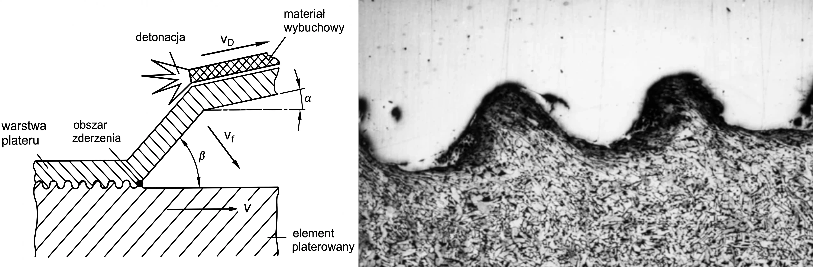{.nostretch width="100%" style="display:block; margin:0 0 0 -100px;"}
:::

:::

::: {.footer}

<small>GrafEngin https://www.youtube.com/watch?v=ciCxNgROtm4&t=16s  &emsp;  NobelClad https://www.youtube.com/watch?v=u9_bqafUJfA&t=28s  &emsp;  ADTW Study https://www.youtube.com/watch?v=d87dd5T2yYg&t</small>

:::

<!-- Slajd 15 -->
## [TECHNIKI WYTWARZANIA POWŁOK]{style="display:block; text-align:center;"}

### Powłoki naparowywane

<u>Chemiczne osadzanie z fazy gazowej CVD (Chemical Vapor Deposition)</u>

Prekursor powłoki jest wprowadzany do całej objętości komory reaktora, a kontrola przepływu, stężenia, temperatury procesu i ciśnienia, zapewnia nam kontrolę nad składem powłoki. Cząstki prekursora w bliskości warstwy wierzchniej osadzają się na niej w wyniku reakcji chemicznych.

&nbsp;

<u>Fizyczne osadzanie z fazy gazowej PVD (Physical Vapor Deposition)</u>  

Atomy lub cząsteczki powłoki są dostarczane na powierzchnię w postaci par lub kinetycznie, w komorze reaktora będącej pod obniżonym ciśnieniem. Powłoka powstaje na powierzchni w wyniku zjawisk fizycznych.

- naparowywanie próżniowe,  
- rozpylanie katodowe, rozpylanie magnetronowe (sputtering),  
- epitaksja z wiązek molekularnych.  

<!-- Slajd 16 -->
## [TECHNIKI WYTWARZANIA POWŁOK]{style="display:block; text-align:center;"}

### Powłoki naparowywane

<u>Chemiczne osadzanie z fazy gazowej CVD (Chemical Vapor Deposition)</u>

- wysoka temperatura podłoża zapewnia dobrą przyczepność i utworzenie litej warstwy (900÷1200°C)
- do pokrywania narzędzi z węglików spiekanych (warstwy TiN )
- warstwy diamentowe i diamentopodobne
- grafen epitaksjalny
- elementy mikroelektroniczne oraz optoelektroniczne
- pokrycia materiałów ceramicznych.

## [TECHNIKI WYTWARZANIA POWŁOK]{style="display:block; text-align:center;"}

### Powłoki naparowywane

<u>Chemiczne osadzanie z fazy gazowej CVD (Chemical Vapor Deposition)</u>

::: {style="position:absolute; left:238px; top:299px; width:1486px;"}
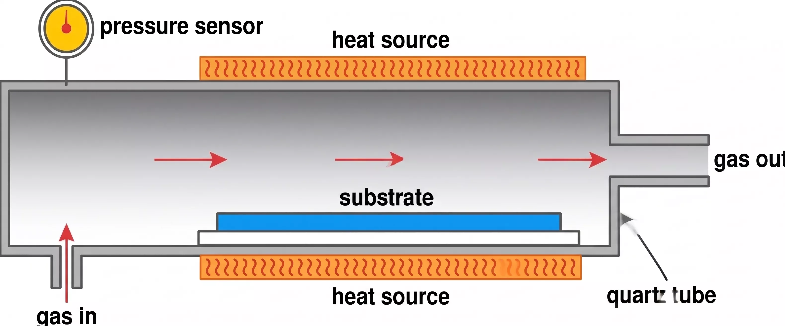{.nostretch width="100%"}
:::

<!-- Slajd 17 -->
## [TECHNIKI WYTWARZANIA POWŁOK]{style="display:block; text-align:center;"}

### Powłoki naparowywane

<u>Warstwy diamentowe (Diamond Film) i diamentopodobne (Diamond Like Carbon)</u>

- nie posiadają struktury krystalicznej diamentu: struktura krystaliczna (DF) bądź amorficzna (DLC)  
- wykazują podobieństwo wielu cech do diamentu  
- amorficzne warstwy DLC są idealnie gładkie, twarde, odporne chemicznie, bardzo dobre przewodzą ciepło, są pozbawione wad związanych z granicami ziaren, charakteryzują się doskonałą adhezją do wielu gładkich podłoży  
- mogą być wytwarzane w procesach niskotemperaturowych (temperatura podłoża < 300°C)  

## [TECHNIKI WYTWARZANIA POWŁOK]{style="display:block; text-align:center;"}

### Powłoki naparowywane

<u>Warstwy diamentowe (Diamond Film) i diamentopodobne (Diamond Like Carbon)</u>

:::: {style="--img-height:540px; display:flex; position:relative; align-items:center; justify-content:center; gap:10px;"}

::: {style="flex:0 0 auto; margin:0;"}
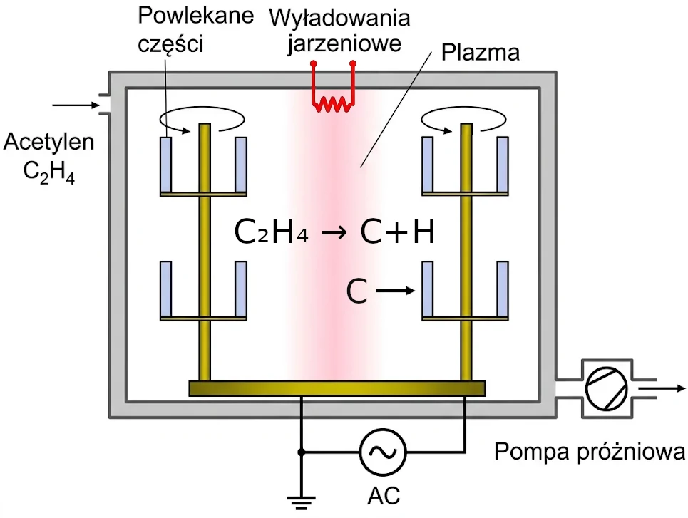{.nostretch style="height:var(--img-height); width:auto; max-width:none; max-height:none; margin:0;"}
:::

::: {style="flex:0 0 auto; margin:0;"}
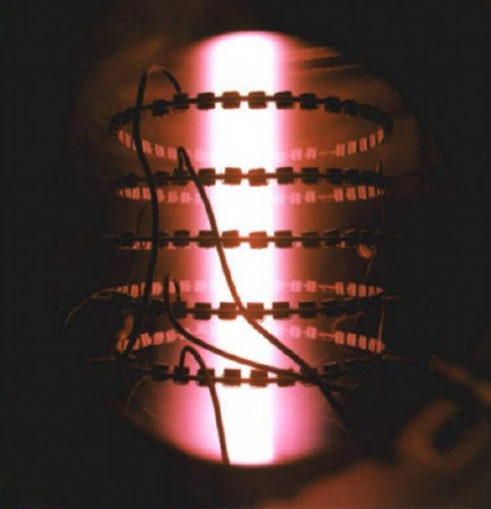{.nostretch style="height:var(--img-height); width:auto; max-width:none; max-height:none; margin:0;"}
:::

::: {style="flex:0 0 auto; margin:0;"}
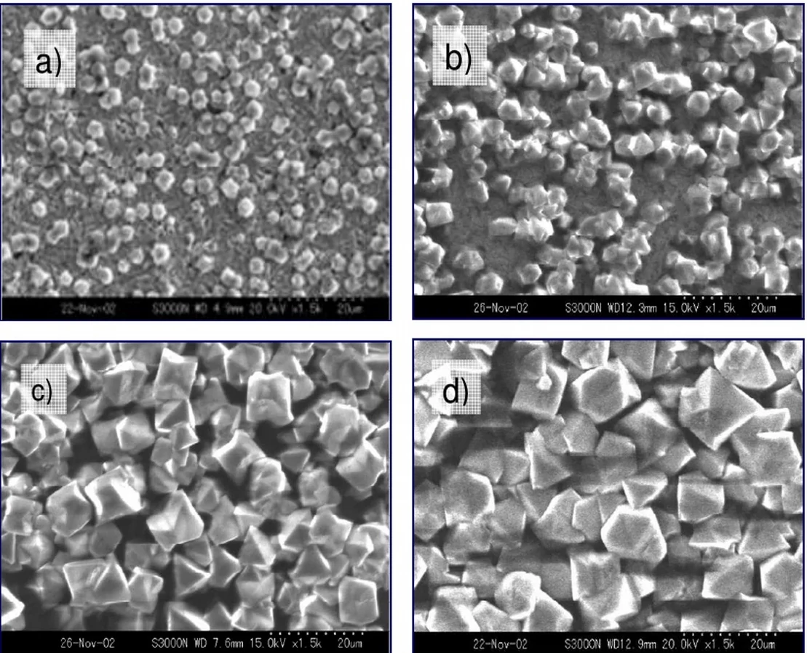{.nostretch style="height:var(--img-height); width:auto; max-width:none; max-height:none; margin:0;"}
:::

::::

::: {.footer}
Balzers, Mitsubishi
:::

<!-- Slajd 18 -->
## [TECHNIKI WYTWARZANIA POWŁOK]{style="display:block; text-align:center;"}

### Powłoki naparowywane

<u>Fizyczne osadzanie z fazy gazowej PVD (Physical Vapor Deposition)</u>

&emsp; <u>Naparowanie próżniowe</u>

- Na pokrywanej powierzchni następuje kondensacja materiału, podgrzanego do temperatury parowania.
- Al 119°C (1000Pa), 660°C/2450°C
- Cu 127°C (1000Pa), 1083°C/2595°C
- Cr 92°C (1000Pa), 1875°C/2665°C
- Au 117°C (1000Pa), 1063°C/2970°C

::: {style="position:absolute; left:1055px; top:378px; width:783px;"}
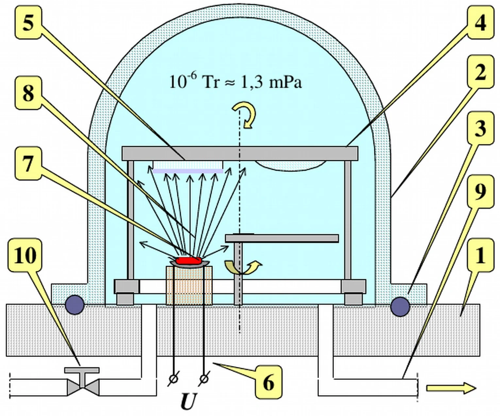{.nostretch width="100%"}
:::

2. klosz, 4. uchwyt elementów, 5. elementy pokrywane,
6. zasilanie elektryczne grzejnika, 7. grzejnik (łódka),
8. ruchoma przesłona, 9. przewód pompy próżniowej,

<!-- Slajd 19 -->
## [TECHNIKI WYTWARZANIA POWŁOK]{style="display:block; text-align:center;"}

### Powłoki naparowywane

<u>Fizyczne osadzanie z fazy gazowej PVD (Physical Vapor Deposition)</u>

&emsp; <u>Rozpylanie katodowe</u>

Zjawisko parowania bądź wytrącania cząstek metalu katody pod wpływem bombardowania jonowego w rozrzedzonej atmosferze gazu szlachetnego (jarzeniowe).  

&emsp; <u>Rozpylanie magnetronowe</u>

Jony gazu obojętnego przyspieszane w polu magnetycznym

::: {style="position:absolute; left:1000px; top:350px; width:917px;"}
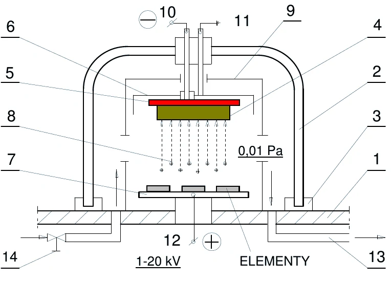{.nostretch width="100%"}
:::

 2. klosz, 4. tarcza (target), 5. katoda,
 7. anoda (element), 10. zasilanie katody,
 12. zasilanie anody, 13. przewód pompy próżniowej

## [TECHNIKI WYTWARZANIA POWŁOK]{style="display:block; text-align:center;"}

### Powłoki naparowywane

<u>Fizyczne osadzanie z fazy gazowej PVD (Physical Vapor Deposition)</u>

<u>Rozpylanie katodowe, Rozpylanie magnetronowe</u>

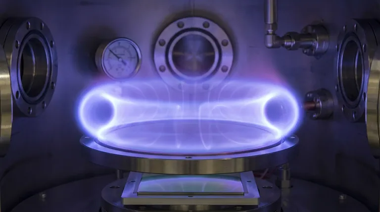{.nostretch height="700px" style="display:block; width:auto; max-width:none; margin:0 auto;"}

::: {.footer}
Kintech
:::

<!-- Slajd 20 -->
## [TECHNIKI WYTWARZANIA POWŁOK]{style="display:block; text-align:center;"}

### Powłoki naparowywane

<u>Fizyczne osadzanie z fazy gazowej PVD (Physical Vapor Deposition)</u>

&emsp; <u>Epitaksja z wiązek molekularnych MBE (Molecular Beam Epitaxy)</u>

::: {style="position:absolute; left:926px; top:250px; width:966px; z-index:-1;"}
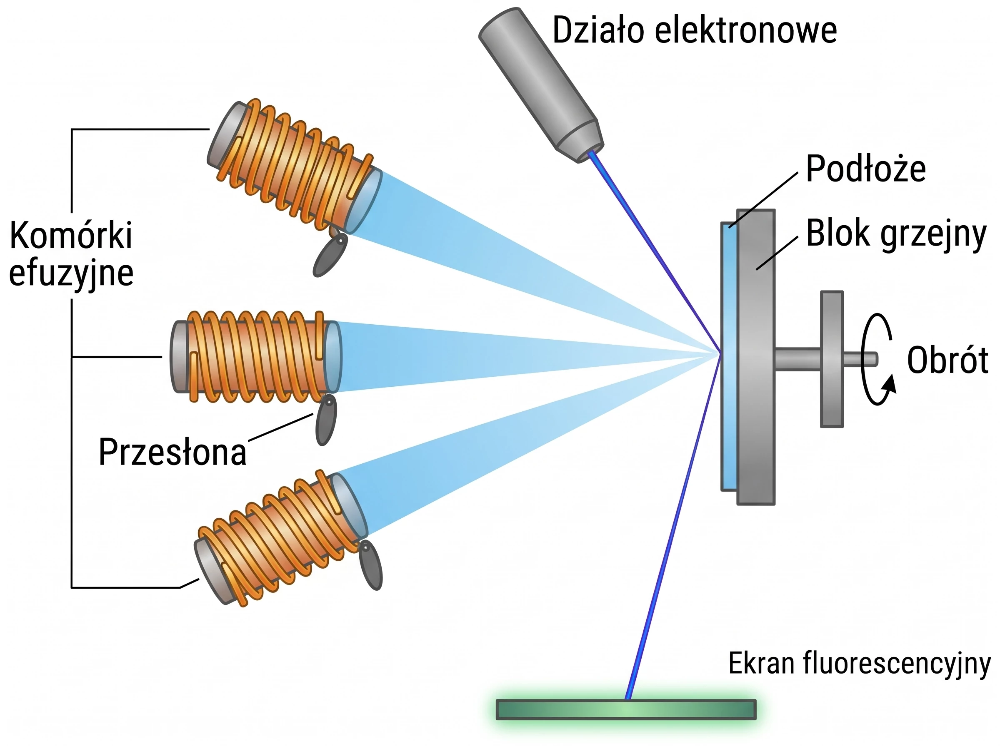{.nostretch width="100%"}
:::

- składniki nakładane oddzielnymi wiązkami molekularnymi  
- osadzanie cienkich powłok (nanometry)  
- ściśle określony skład chemiczny
- precyzyjny rozkład profilu koncentracji domieszki  
- w ultrawysokiej próżni (UHV) ~10Pa.  

<!-- Slajd 21 -->
## [TECHNIKI WYTWARZANIA POWŁOK]{style="display:block; text-align:center;"}

### Powłoki naparowywane (zastosowanie)  

::: {.lista-zwarta}
- w optyce: przeciwodblaskowe (MgF~2~, CaF~2~) i odblaskowe (Al, Cr, Au), filtry,  
- w elektronice: przewodzące, (Al), rezystywne (Ni, Cr), dielektryczne (SiO~2~), magnetyczne (FeNiCo),  
- warstwy ścierne narzędzi (TiN, TiCN),  
:::

:::: {style="display:flex; flex-direction:column; gap:0; width:1800px; margin:-30px auto 0;"}

::: {style="display:flex; gap:0; align-items:stretch;"}

::: {style="--img-height:350px; flex:1; min-width:0; display:flex; gap:0;"}

::: {style="flex:1; min-width:0; display:flex; align-items:center;"}
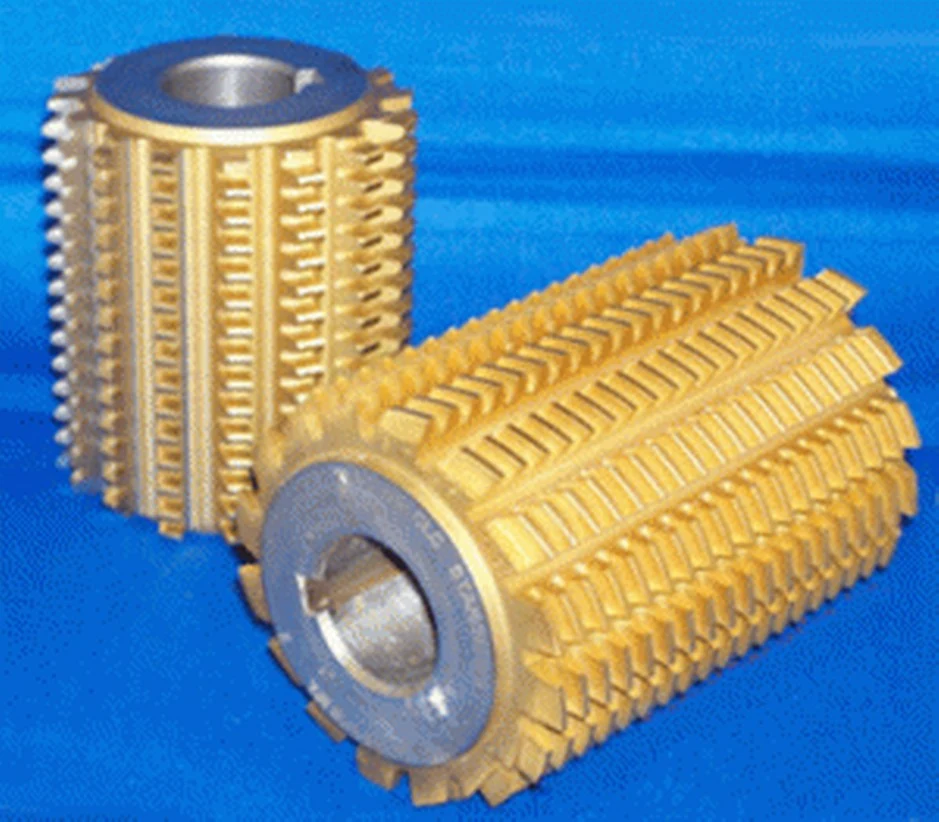{.nostretch style="height:var(--img-height); width:auto; margin:0;"}
:::

::: {style="flex:1; min-width:0; display:flex; align-items:center;"}
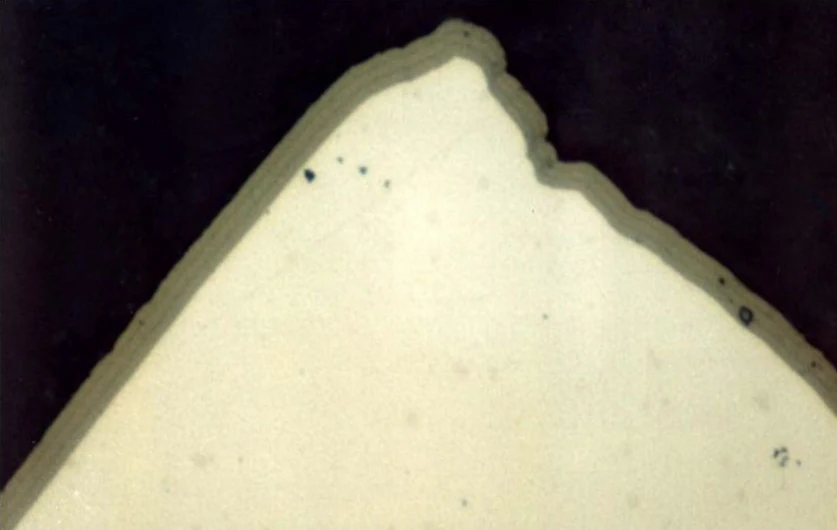{.nostretch style="height:var(--img-height); width:auto; margin:0;"}
:::

:::

::: {style="flex:1; min-width:0;"}
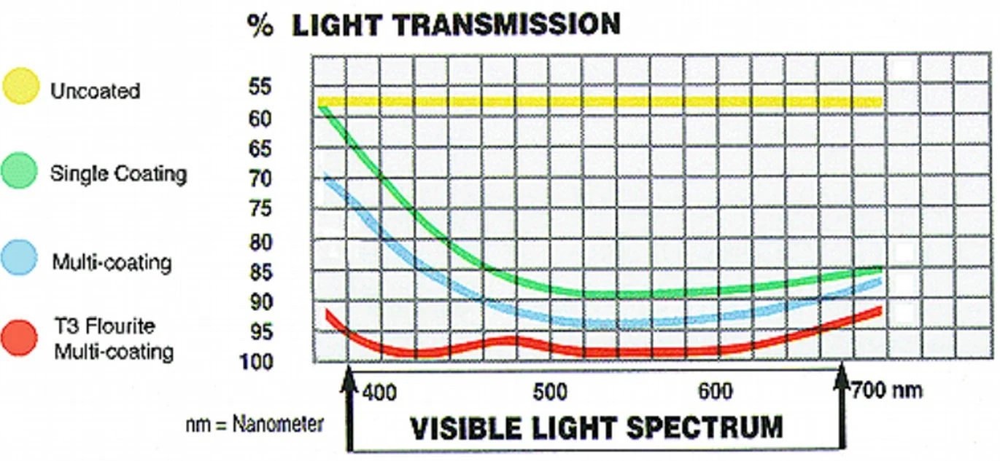{.nostretch width="80%" style="display:block; margin:0 0 0 200px;"}
:::

:::

::: {style="display:flex; gap:0; align-items:stretch;"}

::: {style="flex:1; min-width:0;"}
{.nostretch width="95%" style="display:block; margin:0;"}
:::

::: {style="flex:1; min-width:0;"}
{.nostretch width="98%" style="display:block; margin:0 0 0 50px;"}
:::

:::

::::

::: {.footer}
Vacaero, Templeman Opticians, UTexas
:::

<!-- Slajd 22 -->
## [TECHNIKI WYTWARZANIA POWŁOK]{style="display:block; text-align:center;"}

### Nasycanie dyfuzyjne

- nasycanie warstwy wierzchniej metali pierwiastkami obcymi  
- w ośrodkach stałych, ciekłych lub gazowych  
- zmiany składu chemicznego, struktury i właściwości  

Przykłady procesów: aluminiowanie, chromowanie, tytanowanie, wanadowanie, cynkowanie, nawęglanie, azotowanie, borowanie, chromoaluminiowanie, chromokrzemowanie, borochromowanie, węglotytanowanie, węgloazotowanie, węgloazototytanowanie  

&nbsp;

::: {style="text-align:center;"}

Nasycanie dyfuzyjne w ośrodku ciekłym jest podobne do pokrywania zanurzeniowego – dłuższy czas umożliwia jonom dyfuzję na większą głębokość.  

&nbsp;

Stężenie jonów do 50 % w warstwie o grubości poniżej 1 mm. Im bliżej powierzchni tym stężenie jest większe, aż do pełnego pokrycia metalem powłoki w przypadku stosowania ośrodków ciekłych.  

:::

<!-- Slajd 23 -->
## [TECHNIKI WYTWARZANIA POWŁOK]{style="display:block; text-align:center;"}

### Nasycanie dyfuzyjne (przykłady)  

::: {.lista-zwarta}

- <u>Aluminiowanie</u>  
  - stałe: proszek Al, Al~2~O~3~, żelazoglin, kaolin; 850÷1050°C; azot, wodór; t = 1÷10 h (rozmiar elementów)  
  - ciekłe: 92÷94 % Al i 6÷8 % Fe; 750÷800°C; t = 0,5÷1h,  
  - gazowe: proszek Al, Al~2~O~3~, chlorek amonu; 900÷1050°C; azot, wodór; t = 2 h.  
- <u>Chromowanie</u>  
  - stałe: żelazochrom lub chrom, chlorek amonowy, piasek kwarcowy, kaolin; 950°C,  
  - ciekłe: chlorek chromu, chlorek sodu i żelazochrom; 950÷1000°C,  
  - gazowe: chlorek chromu; 950÷1000°C.  
- <u>Chromoaluminiowanie</u>  
  - stałe: aluminium, żelazochrom; argon, azot lub wodór; 950÷1000°C; 5÷10 h,  
  - gazowe: halogenki chromu i glinu; argon, azot lub wodór; 950÷1000°C; 5÷10 h.  
  - <u>Azotowanie</u>: gazowe (amoniak, 10÷130 h, 550°C); twardość, odporności na korozję; azotki metali (Fe~4~N).  
  - <u>Nawęglanie</u>: dla stali niskowęglowej (<0,25%), <u>zwiększenie twardość zachowując elastyczny rdzeń.</u> Zawartość węgla do 1÷1,3% (0,5÷2 mm); proszkowe, gazowe, ciekłe, 950°C, 10 h, konieczne hartowanie.  

:::

## [TECHNIKI WYTWARZANIA POWŁOK]{style="display:block; text-align:center;"}

### Nasycanie dyfuzyjne (przykłady)  

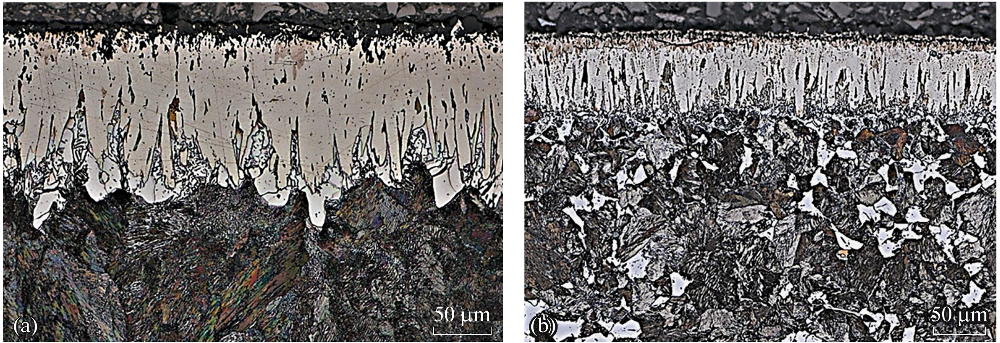{.nostretch width="100%"}

Powłoka dyfuzyjna uzyskana w wyniku kompleksowego nasycania borem, chromem i tytanem: (a) na stali 45, (b) na stali 38Kh2MYuA

::: {.footer}
<small> Guryev, M. A., et al. "Influence of the chemical composition of steel on the structure and properties of diffusion coatings obtained by simultaneous saturation of structural steels with Boron, Chromium, and Titanium." Physics of the Solid State 65.1 (2023): 62-65.</small>
:::

<!-- Slajd 24 -->
## [QUIZ]{style="display:block; text-align:center;"}

::: {.incremental}

- Jak przeprowadza się powlekanie zanurzeniowe (ogniowe) elementów metalowych?
- Jak przeprowadza się powlekanie natryskowe stopionymi proszkami metali?
- W jaki sposób prowadzi się nasycanie dyfuzyjne?
- W jakim celu obniża się ciśnienie atmosferyczne w procesach naparowania?
- W jaki sposób wytwarza się warstwy węglowe, diamentowe, diamentopodobne i grafen na metalach?

:::
