<!-- Slajd 2 -->
## [TECHNOLOGIA POWŁOK]{style="display:block; text-align:center;"}

Powłoka to warstwa materiału <u>wytworzona lub nałożona</u> na powierzchnię elementu w sposób naturalny lub sztuczny. Powłoka jest wykonana <u>z innego materiału niż element</u>. Celem powłoki jest uzyskanie określonych właściwości ochronnych, technicznych lub dekoracyjnych.  

::: {style="position:absolute; left:272px; top:658px; width:367px;"}
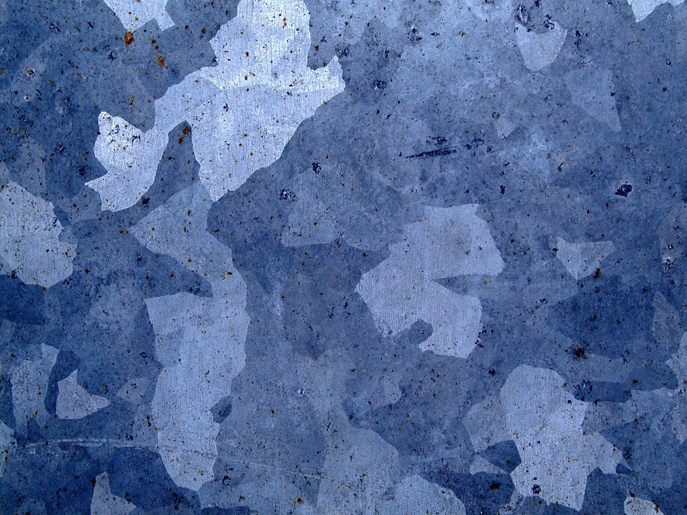{.nostretch width="100%"}
:::

::: {style="position:absolute; left:155px; top:331px; width:413px;"}
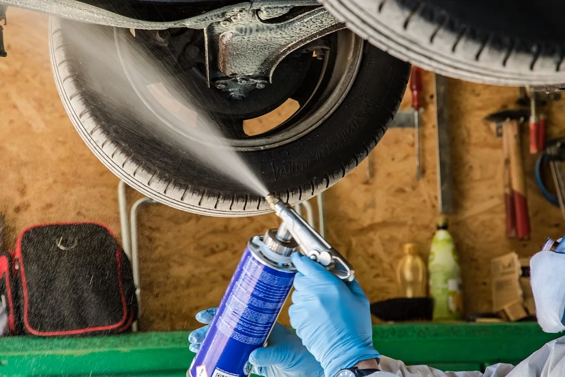{.nostretch width="100%"}
:::

::: {style="position:absolute; left:751px; top:614px; width:426px;"}
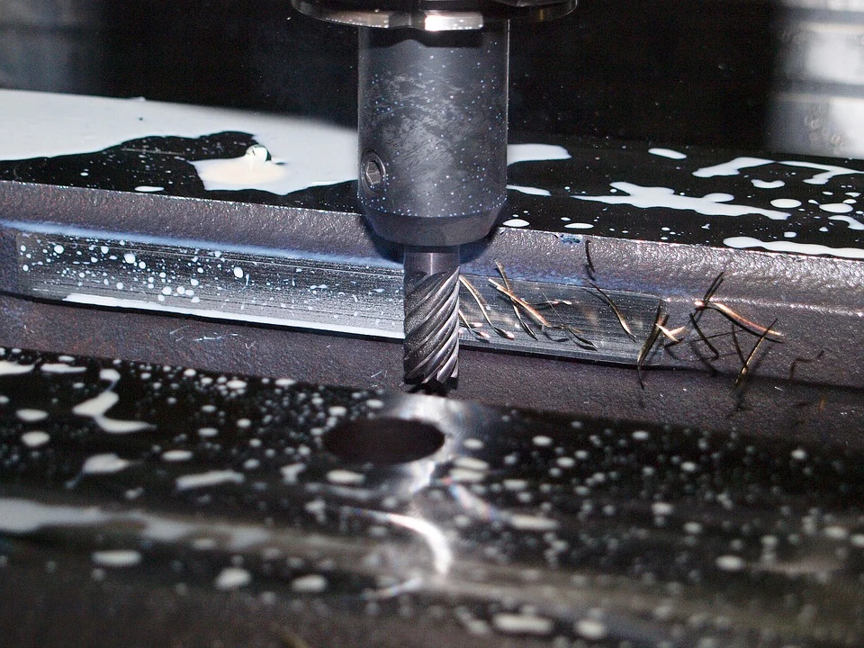{.nostretch width="100%"}
:::

::: {style="position:absolute; left:632px; top:331px; width:367px;"}
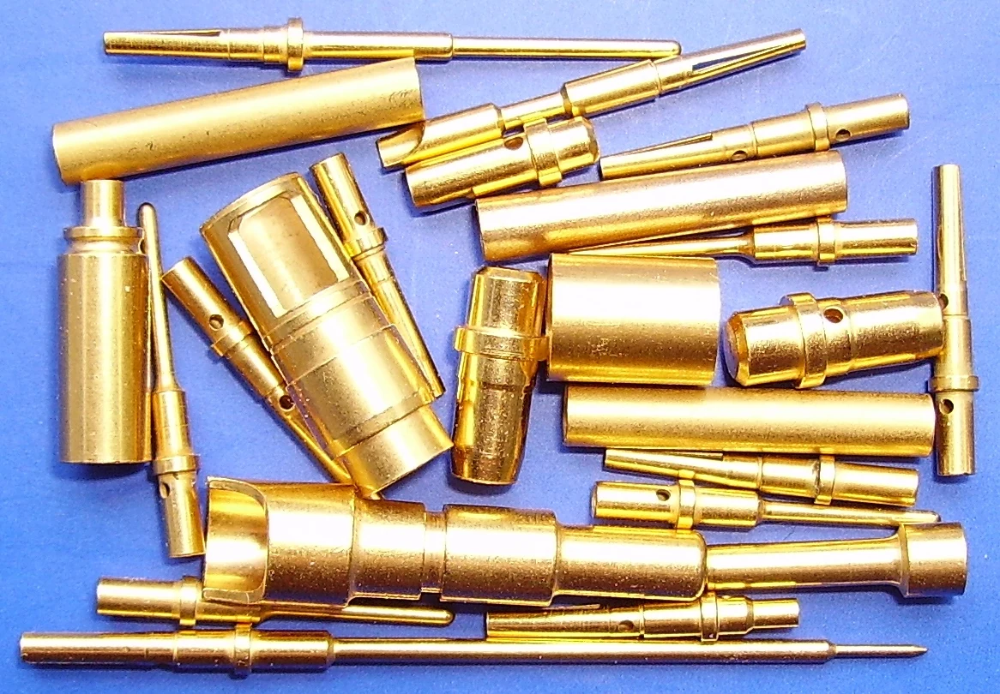{.nostretch width="100%"}
:::

::: {style="position:absolute; left:1111px; top:331px; width:367px;"}
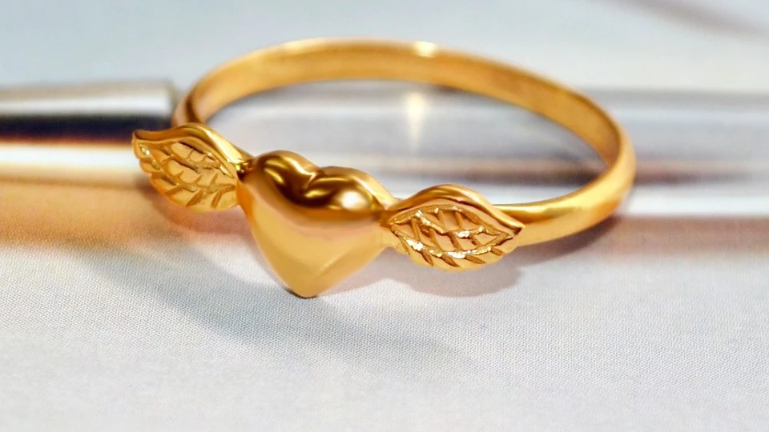{.nostretch width="100%"}
:::

::: {style="position:absolute; left:1300px; top:686px; width:388px;"}
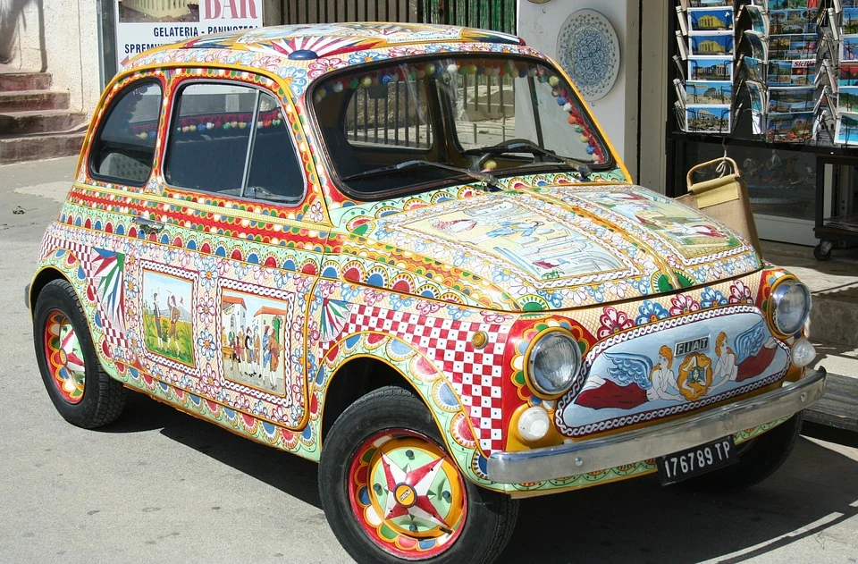{.nostretch width="100%"}
:::

::: {style="position:absolute; left:1536px; top:331px; width:205px;"}
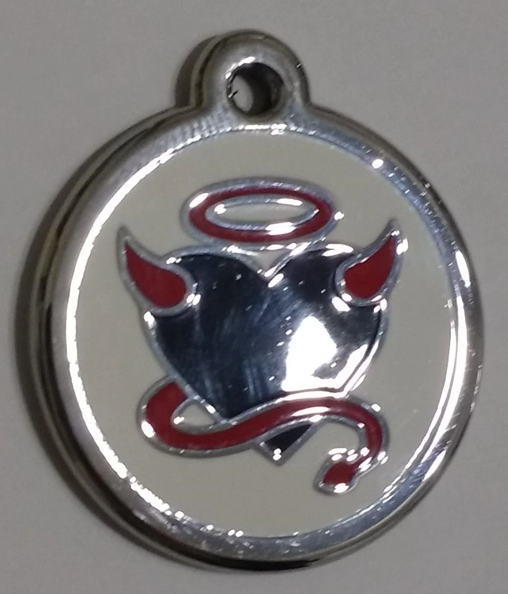{.nostretch width="100%"}
:::

<!-- Slajd 3 -->
## [POWŁOKI ORGANICZNE]{style="display:block; text-align:center;"}

### POWŁOKI MALARSKO-LAKIERNICZE

Są to powłoki z tworzyw sztucznych, nanoszone w stanie ciekłym lub stałym, utwardzane chemicznie, przez odparowanie rozpuszczalników lub termicznie przez przetopienie cząstek.

- farby,
- lakiery,
- (emalie).

::: {style="position:absolute; left:657px; top:586px; width:522px;"}
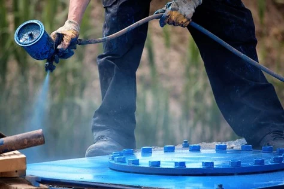{.nostretch width="100%"}
:::

::: {style="position:absolute; left:69px; top:492px; width:614px;"}
{.nostretch width="100%"}
:::

::: {style="position:absolute; left:1052px; top:375px; width:459px;"}
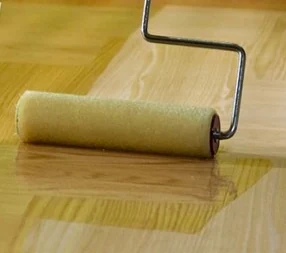{.nostretch width="100%"}
:::

::: {style="position:absolute; left:1385px; top:617px; width:474px;"}
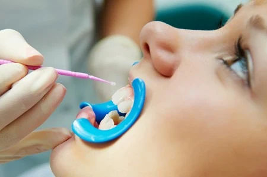{.nostretch width="100%"}
:::

::: {style="position:absolute; left:122px; top:748px; width:487px;"}
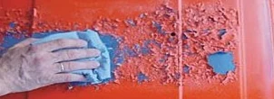{.nostretch width="100%"}
:::

::: {.footer}
Pneumat System, B&P Service, Vidaron, Autobilid.de, Anardi
:::

<!-- Slajd 4 -->
## [POWŁOKI ORGANICZNE]{style="display:block; text-align:center;"}

### POWŁOKI MALARSKO-LAKIERNICZE

SKŁAD

::: {.lista-zwarta}
- Substancje organiczne (spoiwa, substancje błonotwórcze)
- Olejne pokostowe
- Olejno‐żywiczne
- Ftalowe modyfikowane olejami (alkidowe)
- Ftalowo‐aminowe
- Kreodurowe
- Poliwinylowe, chlorokauczukowe
- Epoksydowe
- Nitrocelulozowe
- Akrylowe i metakrylowe
- Ftalowe styrenowane
- Emulsyjne: Poli(octan winylu), kopolimery styrenowo‐akrylowe
- ...
:::

<!-- Slajd 5 -->
## [POWŁOKI ORGANICZNE]{style="display:block; text-align:center;"}

### POWŁOKI MALARSKO-LAKIERNICZE - SKŁAD

### Rozpuszczalniki i rozcieńczalniki

- Produkty ciekłe o możliwie niskiej temperaturze wrzenia i małej wartości ciepła parowania.
- Nie wchodzą one w skład powłok - regulują sposób nanoszenia powłoki i jej jakość.
- Przykłady: aceton, alkohole (izopropylowy, etylowy), benzyna, cyklododekan, ...

Coraz częściej rozpuszczalniki organiczne są eliminowane, na rzecz wody i alkoholi (farby emulsyjne lub wodorozcieńczalne) i farb bezrozpuszczalnikowych (farby proszkowe, fotoutwardzalne).

{.nostretch width="100%"}

<!-- Slajd 6 -->
## [POWŁOKI ORGANICZNE]{style="display:block; text-align:center;"}

### POWŁOKI MALARSKO-LAKIERNICZE - SKŁAD

### Pigment i napełniacze

- dekoracyjne
- nadanie odporności na działanie światła
- ograniczenie pęcznienia w wodzie (wobec pary wodnej) i w rozpuszczalnikach,
- pasywacja powierzchni metalu,
- ochrona elektrochemiczna (pył cynkowy),
- zobojętnianie czynników kwaśnych (pigmenty zasadowe),
- zwiększenie twardości i odporności na zarysowanie,
- właściwości specjalne (przewodnictwo elektryczne i cieplne, luminescencja, właściwości dielektryczne i magnetyczne, ...)
- ...

<!-- Slajd 7 -->
## [POWŁOKI ORGANICZNE]{style="display:block; text-align:center;"}

### POWŁOKI MALARSKO-LAKIERNICZE - SKŁAD

### Składniki modyfikujące i uszlachetniające

- zapobiegające korzuszeniu,
- zwilżające,
- zagęszczające i tiksotropujące,
- poprawiające rozlewność (zapobiegają powstawaniu pęcherzyków powietrza),
- peptyzujące (zapobiegają ścinaniu),
- matujące (zmniejszają połysk),
- przeciwdziałające powstawaniu piany,
- bakterio‐, grzybo‐ i owadobójcze,
- inne (nadające odporność na działanie UV, inhibitujące korozję itp.).

<!-- Slajd 8 -->
## [POWŁOKI ORGANICZNE]{style="display:block; text-align:center;"}

### POWŁOKI MALARSKO-LAKIERNICZE - NANOSZENIE

### Produkcyjne sposoby nanoszenia powłok malarsko-lakierniczych

- zanurzeniowe,
- walcami (blachy, taśmy),
- natryskowe (pneumatyczne, hydrodynamiczne),
- w bębnach (elementy drobne),
- pędzlami, wałkami,
- elektroforetyczne.

- Po nałożeniu warstwy konieczne jest jej wysuszenie.
- Lakiery piecowe wymagają wypalania (utleniania) w celu utwardzenia.
- Temperatury suszenia/wypalania (20°C) 60÷160°C.

::: {style="position:absolute; left:1325px; top:151px; width:490px;"}
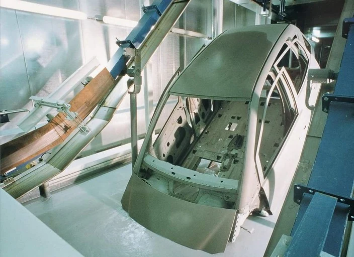{.nostretch width="100%"}
:::

::: {style="position:absolute; left:1016px; top:291px; width:356px;"}
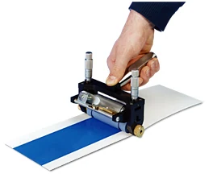{.nostretch width="100%"}
:::

::: {style="position:absolute; left:1459px; top:512px; width:381px;"}
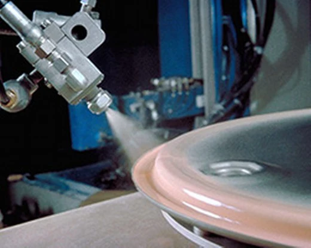{.nostretch width="100%"}
:::

::: {style="position:absolute; left:1188px; top:755px; width:339px;"}
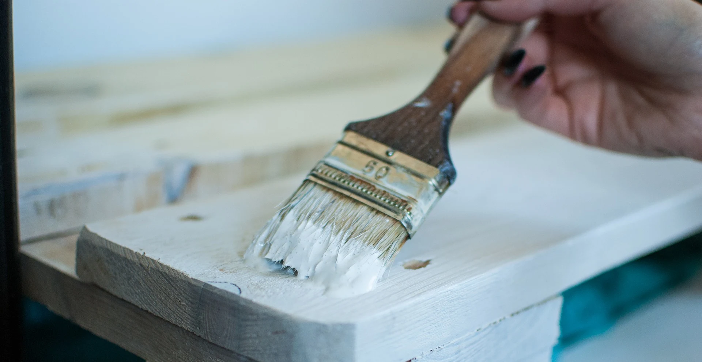{.nostretch width="100%"}
:::

::: {.footer}
BASF, Esiproof, Nordson, Alcor
:::

<!-- Slajd 9 -->
## [POWŁOKI ORGANICZNE]{style="display:block; text-align:center;"}

### POWŁOKI MALARSKO-LAKIERNICZE - NANOSZENIE

### Metody natryskowe

- pneumatyczna
- hydrodynamiczna

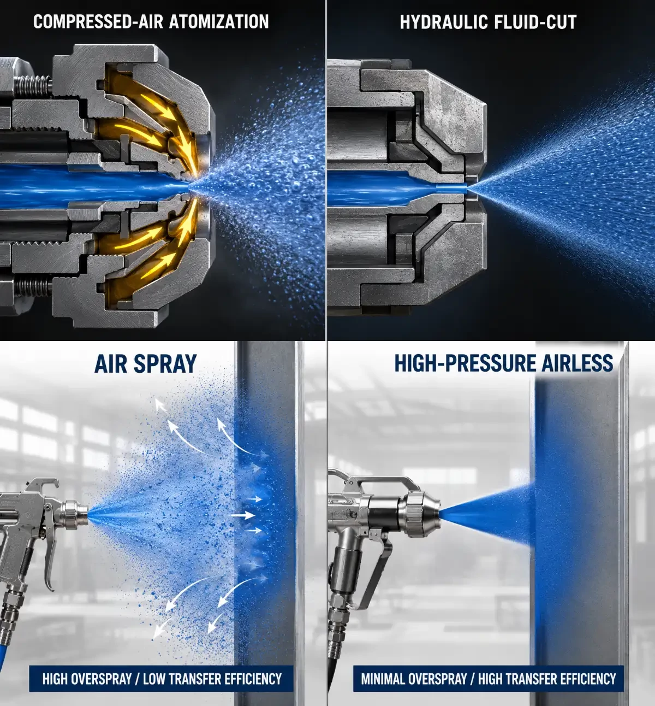{.nostretch width="100%"}

::: {style="position:absolute; left:1225px; top:87px; width:573px;"}
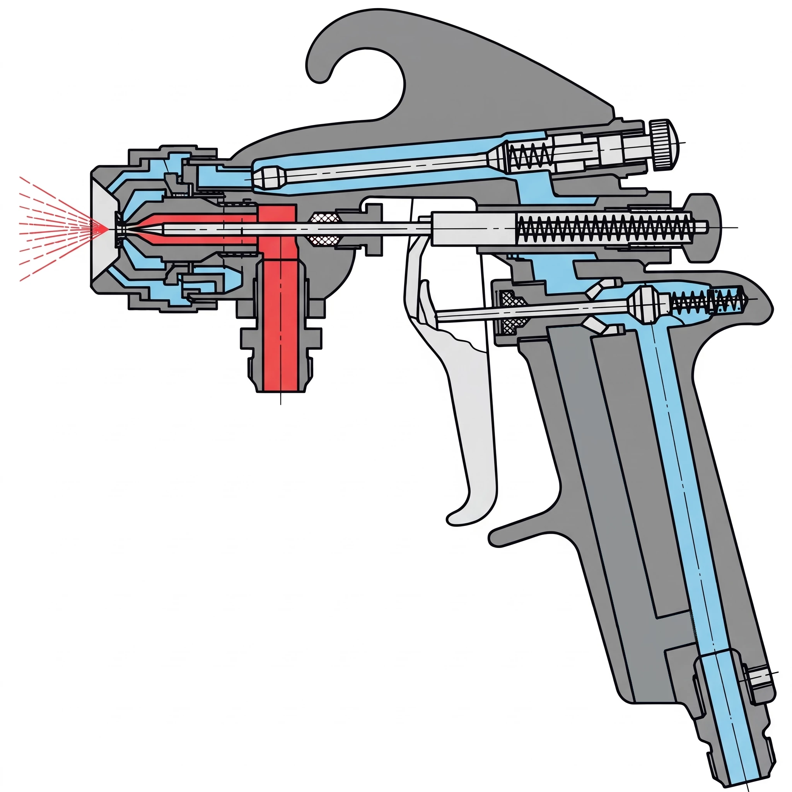{.nostretch width="100%"}
:::

::: {style="position:absolute; left:997px; top:442px; width:486px;"}
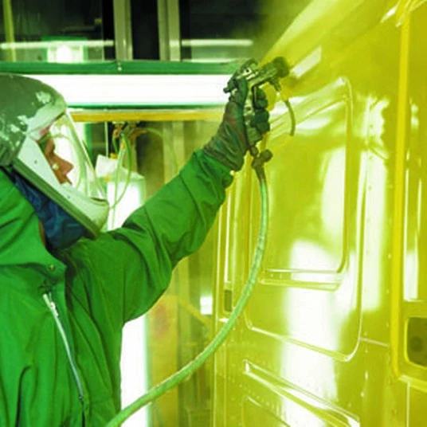{.nostretch width="100%"}
:::

::: {.footer}
AFS, Aquamist, Gutubao
:::

<!-- Slajd 10 -->
## [POWŁOKI ORGANICZNE]{style="display:block; text-align:center;"}

### POWŁOKI MALARSKO-LAKIERNICZE - NANOSZENIE - Metody natryskowe



::: {.footer}
Pneumatico.pl, https://www.youtube.com/watch?v=Vjw3KRXOZW0
:::

<!-- Slajd 11 -->
## [POWŁOKI ORGANICZNE]{style="display:block; text-align:center;"}

### POWŁOKI MALARSKO-LAKIERNICZE - NANOSZENIE - Metody zanurzeniowe



::: {.footer}
Jim Paterson https://www.youtube.com/watch?v=JauUjmXlTPE
:::

<!-- Slajd 12 -->
## [POWŁOKI ORGANICZNE]{style="display:block; text-align:center;"}

### POWŁOKI PROSZKOWE

### Powlekanie elektrostatyczne i fluidyzacyjne

Farby proszkowe: substancje termoplastyczne i termoutwardzalne (żywice epoksydowe, żywice poliestrowe, poliuretany i silikony, mieszanki poliestrowo‐epoksydowe).  
Elementy są powlekane mgłą (aerozolem) proszku w stanie stałym. Proszek o wymiarach ziaren w przedziale µm może być nanoszony technikami:  

- fluidyzacji,  
- elektrostatyczną.  

Po pomalowaniu elementy są nagrzewane (150÷250°C), w rezultacie czego farba proszkowa ulega przetopieniu tworząc jednolitą powłokę polimerową.  

<!-- Slajd 13 -->
## [POWŁOKI ORGANICZNE]{style="display:block; text-align:center;"}

### POWŁOKI PROSZKOWE

### Powlekanie fluidyzacyjne

Fluidyzacja jest procesem, w którym farba w proszku nabiera cech materiałów płynnych (aerozolu) w wyniku przedmuchiwania farby od dołu ku górze za pomocą gazów.

::: {style="position:absolute; left:168px; top:384px; width:667px;"}
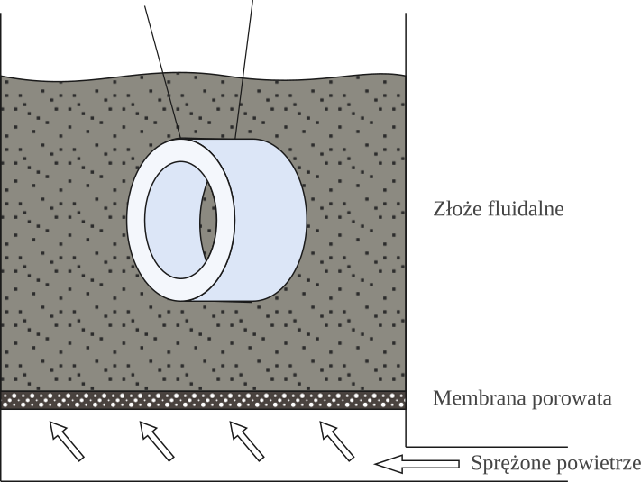{.nostretch width="100%"}
:::

::: {style="position:absolute; left:883px; top:384px; width:814px;"}
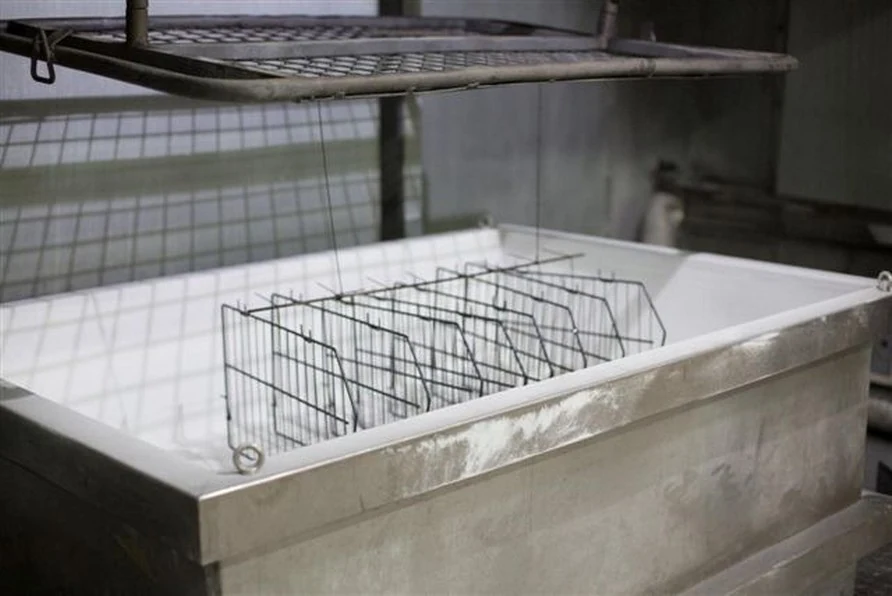{.nostretch width="100%"}
:::

::: {style="position:absolute; bottom:30px; left:0; width:100%; text-align:center;"}
<em>Przykład aerozolu proszkowego?</em>
:::

::: {.fragment style="position:absolute; left:453px; top:378px; width:967px;"}
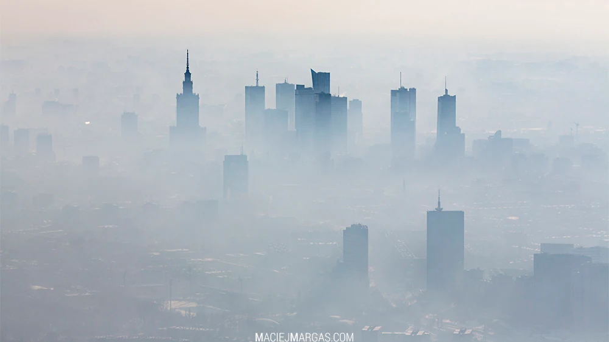{.nostretch width="100%"}
:::

::: {.footer}
Bater, Poldrut
:::

<!-- Slajd 14 -->
## [POWŁOKI ORGANICZNE]{style="display:block; text-align:center;"}

### POWŁOKI PROSZKOWE - NANOSZENIE - Powlekanie fluidyzacyjne



::: {.footer}
BOSTEK - KIGO Scandinavia, Baltic & Poland https://www.youtube.com/watch?v=2C1z0PobLao
:::

<!-- Slajd 15 -->
## [POWŁOKI ORGANICZNE]{style="display:block; text-align:center;"}

### POWŁOKI PROSZKOWE

### Powlekanie elektrostatyczne

Powlekanie elektrostatyczne jest podobne do natrysku pneumatycznego, z tą różnicą że materiał powłoki występuje w postaci proszku (a nie ciekłej). Ziarna proszku uzyskują ładunek elektryczny w dyszy pistoletu, a następnie jest przyspieszany pneumatycznie i osiadają na uziemionych elementach.

::: {style="position:absolute; left:136px; top:443px; width:708px;"}
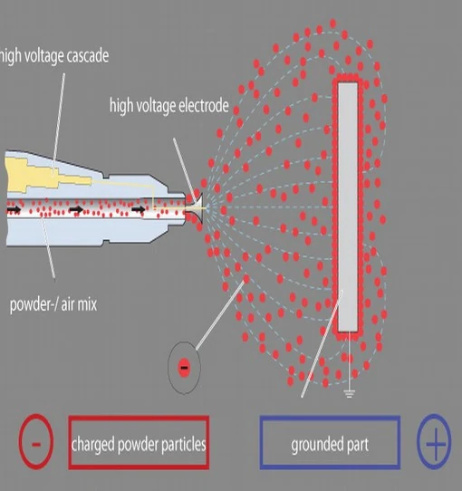{.nostretch width="100%"}
:::

::: {style="position:absolute; left:859px; top:443px; width:940px;"}
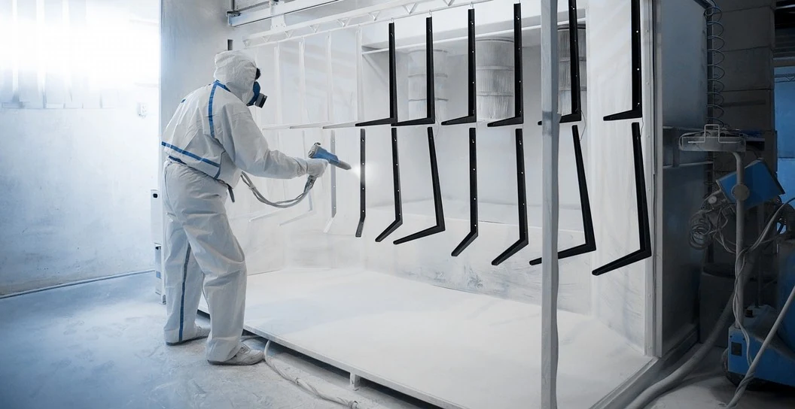{.nostretch width="100%"}
:::

::: {.footer}
Wagner, Rutmal
:::

<!-- Slajd 16 -->
## [POWŁOKI ORGANICZNE]{style="display:block; text-align:center;"}

### POWŁOKI PROSZKOWE - NANOSZENIE - Powlekanie elektrostatyczne



::: {.footer}
AutoshineWheelClinic https://www.youtube.com/watch?v=HJpPM0Zn_hc
:::

<!-- Slajd 17 -->
## [POWŁOKI NIEORGANICZNE]{style="display:block; text-align:center;"}

### EMALIE SZKLISTE

Masy emalierskie składające się z tlenków, fluorków, boranów i krzemianów metali. Są to substancje wyłącznie nieorganiczne i należy je odróżniać od lakierów nazywanych potocznie emaliami.

::: {style="text-align:center;"}
NAKŁADANIE WARSTWY ⇒ SUSZENIE ⇒ WYPALANIE (przetopienie, spiekanie) 500÷1000°C
:::

- Zastosowania ogólne i techniczne:
- Pokrycia naczyń kuchennych i stołowych, zarówno metalowych jak i ceramicznych.
- Ceramika łazienkowa: wanny, umywalki, glazura (kafelki).
- Pokrycia izolatorów ceramicznych i grzejników oporowych.
- Szkliwa do wykonywania układów grubowarstwowych.
- Mozaiki, wyroby jubilerskie: ozdoby, medalierstwo, pamiątki.

<!-- Slajd 18 -->
## [POWŁOKI NIEORGANICZNE]{style="display:block; text-align:center;"}

### EMALIE SZKLISTE

::: {style="display:flex; gap:10px; align-items:flex-start; width:1900px; margin-inline:auto;"}

::: {style="flex:1; min-width:0;"}



::: {style="width:700px; "}
 
:::

:::

::: {style="flex:1; min-width:0;"}



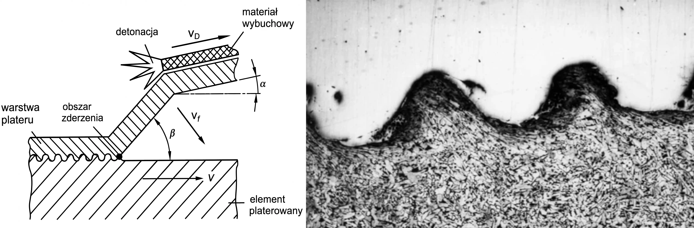{.nostretch width="100%" style="display:block; margin:0 0 0 -100px;"}
:::

:::

::: {style="position:absolute; left:203px; top:216px; width:417px;"}
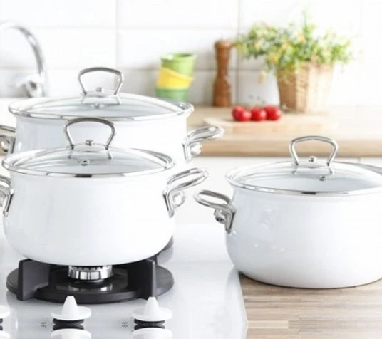{.nostretch width="100%"}
:::

::: {style="position:absolute; left:637px; top:216px; width:493px;"}
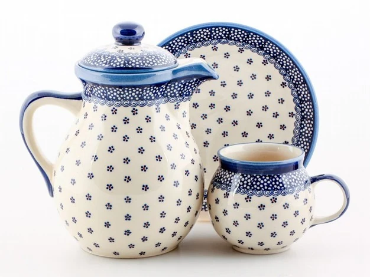{.nostretch width="100%"}
:::

::: {style="position:absolute; left:1130px; top:216px; width:323px;"}
{.nostretch width="100%"}
:::

::: {style="position:absolute; left:1463px; top:216px; width:317px;"}
{.nostretch width="100%"}
:::

::: {style="position:absolute; left:317px; top:600px; width:407px;"}
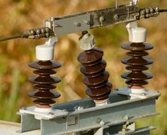{.nostretch width="100%"}
:::

::: {style="position:absolute; left:740px; top:601px; width:460px;"}
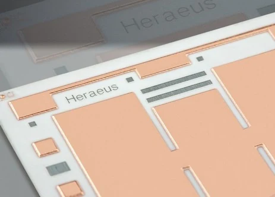{.nostretch width="100%"}
:::

::: {style="position:absolute; left:1214px; top:600px; width:489px;"}
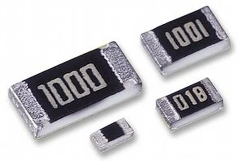{.nostretch width="100%"}
:::

::: {.footer}
Elektroonline, KristoArts, Emalia Olkusz, Bolesławiec, Heraeus, Farnell
:::

<!-- Slajd 19 -->
## [POWŁOKI NIEORGANICZNE]{style="display:block; text-align:center;"}

### EMALIE SZKLISTE

::: {style="position:absolute; left:21px; top:326px; width:1884px;"}
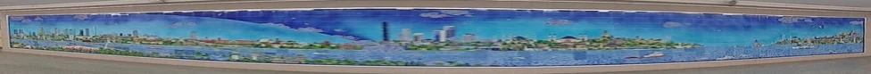{.nostretch width="100%"}
:::

::: {style="position:absolute; left:447px; top:215px; width:404px;"}
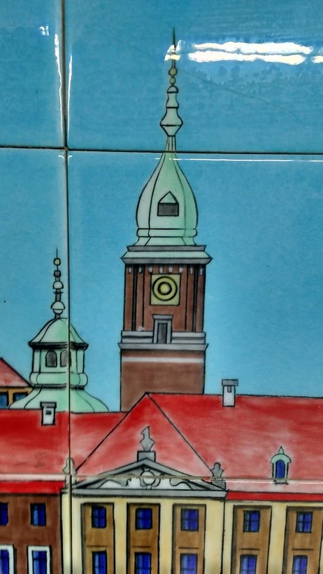{.nostretch width="100%"}
:::

::: {style="position:absolute; left:924px; top:214px; width:404px;"}
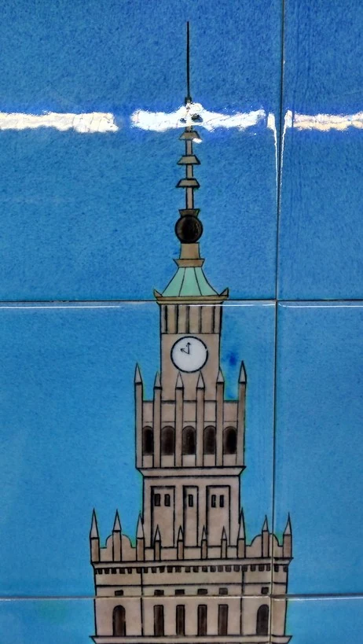{.nostretch width="100%"}
:::

::: {style="position:absolute; left:1454px; top:616px; width:381px;"}
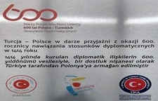{.nostretch width="100%"}
:::

<!-- Slajd 20 -->
## [POWŁOKI NIEORGANICZNE]{style="display:block; text-align:center;"}

### EMALIE SZKLISTE

### Technologia grubowarstwowa

Stosując technikę selektywnego druku sitowego (sitodruku), z wykorzystaniem past zawierających szkliwo i dodatki funkcjonalne (proszki metaliczne, tlenki rezystywne, dielektryczne itp.), możliwe jest wytwarzanie obwodów i elementów elektronicznych, na podłożach ceramicznych (Al2O3) i szklanych, spiekanych w temperaturach ok 850°C (ok 500°C na szkle).

- srebrowe, złote
- platynowe, palladowe
- rutenowe, irydowe
- tytanian baru i stronu, tlenek cyrkonu

::: {style="position:absolute; left:940px; top:484px; width:898px;"}
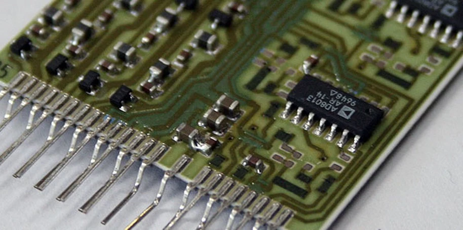{.nostretch width="100%"}
:::

::: {.footer}
Aurel
:::

<!-- Slajd 21 -->
## [QUIZ]{style="display:block; text-align:center;"}

### W jaki sposób i z jakich materiałów wytwarzamy powłoki malarskie i lakiernicze?

::: {.incremental}

- W jaki sposób wytwarzamy odporne chemicznie warstwy szkliwa?
- Czy możliwe jest wytwarzanie elementów i układów elektronicznych z zastosowaniem technik malarskich?

