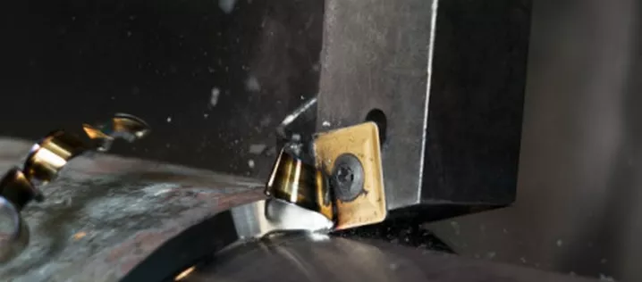
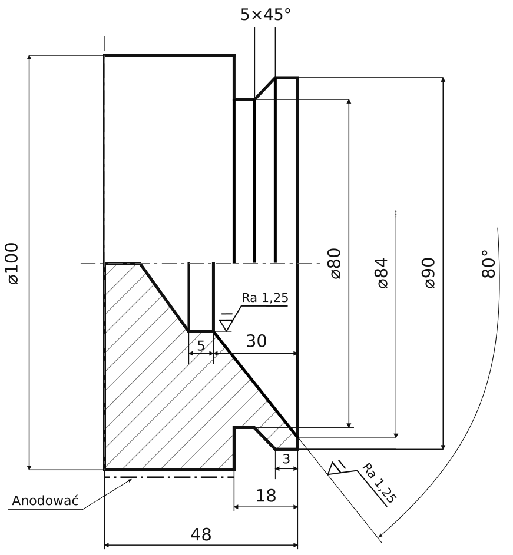

## [WPROWADZENIE]{style="display:block; text-align:center;"}

### FAZY PROCESU WYTWARZANIA ELEMENTÓW PRECYZYJNYCH

:::: {style="position: absolute; left: 50px; top: 150px; width: 1000px;"}
{.nostretch width="100%" height="100%"}

::: {style="position:absolute; left:10px; top:10px; color:white;"}
Obróbka zgrubna (kształtowanie bryły elementu)
:::

::::

::: {.footer}
Sandvik Coromant, Fawor, Schneider Optics
:::

## [WPROWADZENIE]{style="display:block; text-align:center;"}

### OBRÓBKA DOKŁADNOŚCIOWO-GŁADKOŚCIOWA

Szereg procesów stosowanych przy obróbce wykończeniowej

- makrogeometria elementu,

- mikrogeometria powierzchni,

- formowanie warstw wierzchnich i powłok.

:::: {style="position: absolute; left: 1100px; top: 100px; width: 800px; z-index: -1;"}
{.nostretch width="100%" height="100%"}
::::

## [HARTOWANIE POWIERZCHNIOWE]{style="display:block; text-align:center;"}

### Hartowanie płomieniowe



::: {.footer}
Andrzej Maciąg https://www.youtube.com/watch?v=6CKoUsEdy2I
:::
