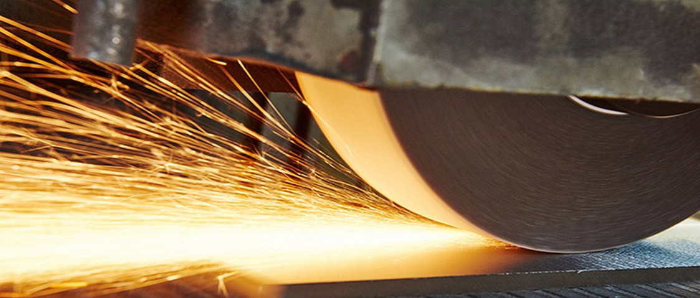
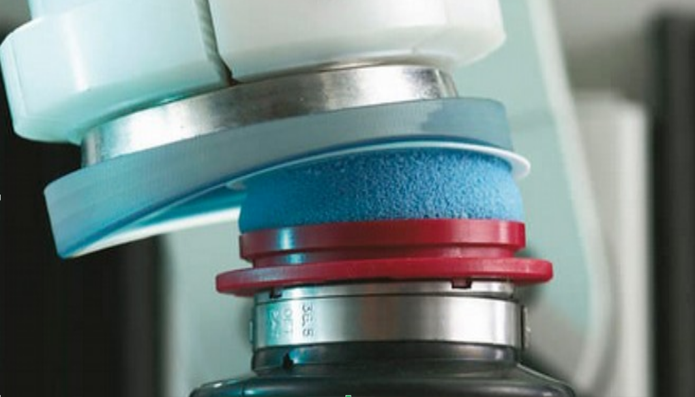
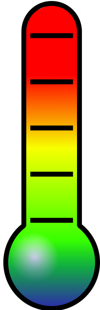
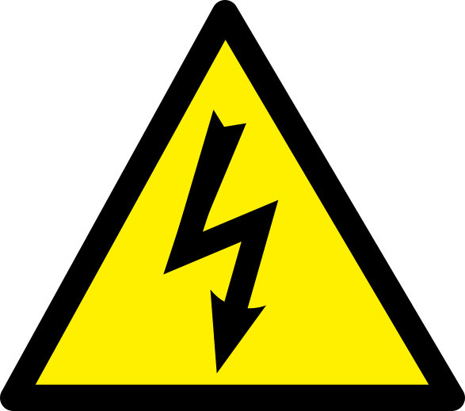

## [WPROWADZENIE]{style="display:block; text-align:center;"}

### FAZY PROCESU WYTWARZANIA ELEMENTÓW PRECYZYJNYCH

:::: {style="position: absolute; left: 50px; top: 150px; width: 1000px;"}
{.nostretch width="100%" height="100%"}

::: {style="position:absolute; left:10px; top:10px; color:white;"}
Obróbka zgrubna (kształtowanie bryły elementu)
:::

::::

:::: {style="position: absolute; left: 950px; top: 450px; width: 1000px;"}
{.nostretch width="100%" height="100%"}

::: {style="position:absolute; left:10px; top:10px; color:white;"}
Obróbka pośrednia (zmniejszanie błędów wymiarowych)
:::

::::

:::: {style="position: absolute; left: 150px; top: 550px; width: 800px;"}
{.nostretch width="100%" height="100%"}

::: {style="position:absolute; left:30px; top:10px; color:black;"}
Obróbka wykończeniowa - finalna
:::

::::

::: {.footer}
Sandvik Coromant, Fawor, Schneider Optics
:::

## [WPROWADZENIE]{style="display:block; text-align:center;"}

### OBRÓBKA DOKŁADNOŚCIOWO-GŁADKOŚCIOWA

Szereg procesów stosowanych przy obróbce wykończeniowej

- makrogeometria elementu,

- mikrogeometria powierzchni,

- formowanie warstw wierzchnich i powierzchni.

<div class="fragment" data-fragment-index="1"
     style="position:absolute; left:0; top:0; width:100%; height:100%; pointer-events:none;">

<svg viewBox="0 0 1920 1080"
     width="100%" height="100%"
     style="overflow:visible;">

  <defs>
    <marker id="arrow-red" markerWidth="12" markerHeight="12"
            refX="10" refY="6" orient="auto"
            markerUnits="strokeWidth">
      <path d="M0,0 L12,6 L0,12 Z" fill="red"/>
    </marker>
  </defs>

  <line x1="610" y1="180" x2="1120" y2="420"
        stroke="red" stroke-width="3"
        marker-end="url(#arrow-red)"/>

</svg>
</div>

<div class="fragment" data-fragment-index="2"
     style="position:absolute; left:0; top:0; width:100%; height:100%; pointer-events:none;">

<svg viewBox="0 0 1920 1080"
     width="100%" height="100%"
     style="overflow:visible;">

  <defs>
    <marker id="arrow-red-2" markerWidth="12" markerHeight="12"
            refX="10" refY="6" orient="auto"
            markerUnits="strokeWidth">
      <path d="M0,0 L12,6 L0,12 Z" fill="red"/>
    </marker>
  </defs>

  <line x1="630" y1="260" x2="1630" y2="790"
        stroke="red" stroke-width="3"
        marker-end="url(#arrow-red-2)"/>

</svg>
</div>

## Obróbka skrawaniem

Treść kolejnego slajdu.

## Pierwszy slajd

To jest prezentacja przygotowana w **Quarto**.

- Obsługuje Markdown

- Obsługuje równania LaTeX

- Pozwala osadzać filmy YouTube

::: {style="position: absolute; left: 50%; top: 20%; width: 40%; background: #e8f0fe; padding: 20px;"}
### Pole 1

Dowolny **tekst Markdown**.
:::

{fig-align="left" width="599" height="419"}

## Równania

Współczynnik efektywności termoelektrycznej:

$$
ZT = \frac{S^2 \sigma T}{\kappa}
$$

## Film YouTube



## Ostatni slajd

**Dziękuję za uwagę!**

## Przykładowy slajd


::: {style="position: absolute; left: 100px; top: 100px; width: 600px; padding: 25px; background-color: rgba(30,144,255,0.5);"}
**Pole tekstowe**

Tekst i **Markdown**.
:::

::: {style="position: absolute; left: 600px; top: 200px; width: 500px; padding: 25px; background-color: rgba(160, 51, 51, 0.59);"}
**Pole z równaniem**

$$
E = mc^2
$$
:::

::: {style="position: absolute; left: 0px; top: 0px; width: 900px; height: 100px;"}
{.nostretch width="100%" height="100%" style="opacity: 0.5;"}
:::


## Przykładowe ikony SVG

<!-- 1. KOLBA CHEMICZNA -->

::: {style="position: absolute; left: 100px; top: 200px; width: 260px; height: 260px;"}
```{=html}
<svg viewBox="0 0 240 260" width="100%" height="100%" xmlns="http://www.w3.org/2000/svg">
  <path d="M75 20H165 M90 20V85L28 193Q15 221 48 225H192Q225 221 212 193L150 85V20"
        fill="white" stroke="black" stroke-width="9"
        stroke-linecap="round" stroke-linejoin="round"/>
  <path d="M82 126L45 198Q38 212 60 212H180Q202 212 195 198L158 126Z"
        fill="#ff6200"/>
  <g fill="white">
    <circle cx="95" cy="165" r="14"/>
    <circle cx="153" cy="187" r="17"/>
    <circle cx="122" cy="140" r="7"/>
    <circle cx="72" cy="196" r="8"/>
    <circle cx="160" cy="145" r="6"/>
    <circle cx="125" cy="200" r="5"/>
  </g>
</svg>
```
:::

<!-- 2. TERMOMETR -->

::: {style="position: absolute; left: 440px; top: 200px; width: 260px; height: 260px;"}
{width="30%"}
:::

<!-- 3. ZAGROŻENIE ELEKTRYCZNE -->

::: {style="position: absolute; left: 800px; top: 400px; width: 300px; height: 300px;"}
{width="100%"}
:::

<!-- 4. ZEGAR -->

::: {style="position: absolute; left: 1120px; top: 200px; width: 260px; height: 260px;"}
```{=html}
<svg viewBox="0 0 260 260" width="100%" height="100%" xmlns="http://www.w3.org/2000/svg">
  <circle cx="130" cy="130" r="108"
          fill="white" stroke="black" stroke-width="24"/>
  <path d="M130 55V137L177 105"
        fill="none" stroke="black" stroke-width="24"
        stroke-linecap="round" stroke-linejoin="round"/>
</svg>
```
:::

## Przykładowe animowane wykresy

```{=html}
<div id="charts-demo" style="display:flex; gap:100px; justify-content:center; align-items:flex-start; margin-top:80px;">

  <!-- WYKRES KOŁOWY -->
  <div style="width:600px; text-align:center;">
    <h3>Udziały procentowe</h3>
    <svg viewBox="0 0 400 400" width="480" height="480">
      <g id="pie-sectors" transform="rotate(-90 200 200)"></g>
    </svg>
    <div style="font-size:28px;">A: 40% &nbsp; B: 35% &nbsp; C: 25%</div>
  </div>

  <!-- WYKRES SŁUPKOWY -->
  <div style="width:700px; text-align:center;">
    <h3>Wartości porównawcze</h3>
    <svg viewBox="0 0 600 400" width="650" height="440">
      <line x1="60" y1="350" x2="580" y2="350"
            stroke="#333" stroke-width="2"/>
      <g id="bar-columns"></g>
    </svg>
  </div>

</div>
```

```{=html}
<script>
(function () {
  const ns = "http://www.w3.org/2000/svg";
  const pieValues = [40, 35, 25];
  const barValues = [30, 65, 45, 85];
  const colors = ["#2563eb", "#10b981", "#f59e0b", "#8b5cf6"];
  const duration = 1400;

  let frame = null;

  function svgEl(tag, attrs) {
    const el = document.createElementNS(ns, tag);
    Object.entries(attrs).forEach(([key, val]) => el.setAttribute(key, val));
    return el;
  }

  function point(angle) {
    const a = angle * Math.PI / 180;
    return [
      200 + 150 * Math.cos(a),
      200 + 150 * Math.sin(a)
    ];
  }

  function sectorPath(start, end) {
    const sweep = end - start;
    if (sweep <= 0.001) return "";

    const [x1, y1] = point(start);
    const [x2, y2] = point(end);

    const large = sweep > 180 ? 1 : 0;

    return `M 200 200 L ${x1} ${y1} A 150 150 0 ${large} 1 ${x2} ${y2} Z`;
  }

  function prepare() {
    const pie = document.getElementById("pie-sectors");
    const bars = document.getElementById("bar-columns");

    if (!pie || !bars) return;

    pie.replaceChildren();
    bars.replaceChildren();

    pieValues.forEach((_, i) => {
      pie.appendChild(svgEl("path", {
        fill: colors[i]
      }));
    });

    barValues.forEach((value, i) => {
      const x = 90 + i * 125;

      bars.appendChild(svgEl("rect", {
        x: x,
        y: 350,
        width: 75,
        height: 0,
        fill: colors[i]
      }));

      const label = svgEl("text", {
        x: x + 37,
        y: 385,
        "text-anchor": "middle",
        "font-size": 24,
        fill: "#333"
      });

      label.textContent = ["A", "B", "C", "D"][i];
      bars.appendChild(label);
    });
  }

  function draw(progress) {
    const pie = document.getElementById("pie-sectors");
    const bars = document.getElementById("bar-columns");

    if (!pie || !bars) return;

    let start = 0;

    pie.querySelectorAll("path").forEach((path, i) => {
      const sweep = pieValues[i] * 3.6;
      const end = start + sweep * progress;

      path.setAttribute("d", sectorPath(start, end));
      start += sweep;
    });

    bars.querySelectorAll("rect").forEach((rect, i) => {
      const height = barValues[i] * 3 * progress;

      rect.setAttribute("y", 350 - height);
      rect.setAttribute("height", height);
    });
  }

  function animate() {
    if (frame !== null) cancelAnimationFrame(frame);

    prepare();

    const startTime = performance.now();

    function tick(now) {
      const t = Math.min((now - startTime) / duration, 1);
      const eased = 1 - Math.pow(1 - t, 3);

      draw(eased);

      if (t < 1) {
        frame = requestAnimationFrame(tick);
      } else {
        frame = null;
      }
    }

    frame = requestAnimationFrame(tick);
  }

  function setup() {
    const container = document.getElementById("charts-demo");
    const slide = container?.closest("section");

    if (!slide || !window.Reveal) return;

    Reveal.on("slidechanged", event => {
      if (event.currentSlide === slide) {
        animate();
      }
    });

    if (Reveal.getCurrentSlide() === slide) {
      animate();
    }
  }

  if (document.readyState === "loading") {
    document.addEventListener("DOMContentLoaded", setup);
  } else {
    setup();
  }
})();
</script>
```

## Symulator rzutu kostkami

```{=html}
<div id="dice-demo">

  <div class="dice-controls">
    <label>
      Liczba ścianek
      <select id="dice-sides">
        <option value="4">D4</option>
        <option value="6" selected>D6</option>
        <option value="8">D8</option>
        <option value="10">D10</option>
        <option value="12">D12</option>
        <option value="20">D20</option>
        <option value="100">D100</option>
      </select>
    </label>

    <label>
      Liczba kostek
      <select id="dice-count">
        <option value="1">1</option>
        <option value="2" selected>2</option>
        <option value="3">3</option>
        <option value="4">4</option>
        <option value="5">5</option>
        <option value="6">6</option>
        <option value="7">7</option>
        <option value="8">8</option>
        <option value="9">9</option>
        <option value="10">10</option>
      </select>
    </label>

    <button id="dice-roll" type="button">Losuj</button>
  </div>

  <div id="dice-stage"></div>
  <div id="dice-result" aria-live="polite"></div>

</div>

<style>
#dice-demo {
  width: 100%;
  text-align: center;
  font-family: Arial, sans-serif;
}

#dice-demo .dice-controls {
  display: flex;
  justify-content: center;
  align-items: end;
  gap: 45px;
  margin: 45px 0 70px;
}

#dice-demo label {
  display: flex;
  flex-direction: column;
  gap: 12px;
  font-size: 30px;
  font-weight: 600;
}

#dice-demo select,
#dice-demo button {
  font: inherit;
  font-size: 32px;
  padding: 14px 25px;
  border: 2px solid #222;
  border-radius: 12px;
  background: white;
  color: black;
  cursor: pointer;
}

#dice-demo button {
  background: #222;
  color: white;
  min-width: 190px;
}

#dice-demo button:disabled {
  opacity: 0.5;
  cursor: wait;
}

#dice-stage {
  display: flex;
  flex-wrap: wrap;
  justify-content: center;
  align-items: center;
  gap: 35px;
  min-height: 230px;
}

#dice-demo .die {
  width: 145px;
  height: 145px;
  flex: 0 0 145px;
  display: flex;
  justify-content: center;
  align-items: center;
  background: white;
  border: 3px solid #111;
  border-radius: 18px;
  box-shadow: 8px 10px 0 #d1d5db;
  color: black;
  font-size: 70px;
  font-weight: 700;
  transform-origin: center;
}

#dice-demo .die.polygon {
  border-radius: 0;
  clip-path: polygon(
    50% 0%, 93% 25%, 93% 75%,
    50% 100%, 7% 75%, 7% 25%
  );
  box-shadow: none;
  outline: none;
  background: #fff;
  filter: drop-shadow(0 3px 2px #777);
}

#dice-demo .die.rolling {
  animation: dice-spin 0.9s ease-in-out;
}

@keyframes dice-spin {
  0%   { transform: rotate(0deg) scale(1); }
  25%  { transform: rotate(110deg) scale(0.85); }
  55%  { transform: rotate(260deg) scale(1.12); }
  80%  { transform: rotate(340deg) scale(0.92); }
  100% { transform: rotate(360deg) scale(1); }
}

#dice-demo .pips {
  width: 105px;
  height: 105px;
  display: grid;
  grid-template-columns: repeat(3, 1fr);
  grid-template-rows: repeat(3, 1fr);
  place-items: center;
}

#dice-demo .pip {
  width: 22px;
  height: 22px;
  background: #111;
  border-radius: 50%;
}

#dice-result {
  margin-top: 55px;
  font-size: 38px;
  font-weight: 600;
  min-height: 55px;
}
</style>

<script>
(function () {
  const root = document.getElementById("dice-demo");
  if (!root || root.dataset.initialized) return;
  root.dataset.initialized = "true";

  const sidesInput = root.querySelector("#dice-sides");
  const countInput = root.querySelector("#dice-count");
  const button = root.querySelector("#dice-roll");
  const stage = root.querySelector("#dice-stage");
  const result = root.querySelector("#dice-result");

  const pipPositions = {
    1: [4],
    2: [0, 8],
    3: [0, 4, 8],
    4: [0, 2, 6, 8],
    5: [0, 2, 4, 6, 8],
    6: [0, 2, 3, 5, 6, 8]
  };

  function randomInt(max) {
    const array = new Uint32Array(1);
    const range = 0x100000000;
    const limit = range - (range % max);
    let n;
    do {
      crypto.getRandomValues(array);
      n = array[0];
    } while (n >= limit);
    return (n % max) + 1;
  }

  function drawDie(die, value, sides) {
    die.replaceChildren();
    die.classList.toggle("polygon", sides !== 6);

    if (sides === 6) {
      const pips = document.createElement("div");
      pips.className = "pips";

      for (let i = 0; i < 9; i++) {
        const cell = document.createElement("div");
        if (pipPositions[value].includes(i)) {
          cell.className = "pip";
        }
        pips.appendChild(cell);
      }

      die.appendChild(pips);
    } else {
      die.textContent = value;
    }
  }

  function roll() {
    const sides = Number(sidesInput.value);
    const count = Number(countInput.value);

    button.disabled = true;
    stage.replaceChildren();
    result.textContent = "";

    const values = [];
    const dice = [];

    for (let i = 0; i < count; i++) {
      const value = randomInt(sides);
      values.push(value);

      const die = document.createElement("div");
      die.className = "die";
      drawDie(die, randomInt(sides), sides);
      stage.appendChild(die);
      dice.push(die);
    }

    // Kilka zmian widocznych wartości podczas animacji
    let step = 0;
    const interval = setInterval(() => {
      dice.forEach(die => {
        drawDie(die, randomInt(sides), sides);
      });
      step++;
      if (step >= 9) clearInterval(interval);
    }, 90);

    dice.forEach(die => {
      die.classList.add("rolling");
    });

    setTimeout(() => {
      clearInterval(interval);

      dice.forEach((die, i) => {
        die.classList.remove("rolling");
        drawDie(die, values[i], sides);
      });

      const sum = values.reduce((a, b) => a + b, 0);

      result.textContent =
        "Wyniki: " + values.join(", ") +
        "    |    Suma: " + sum;

      button.disabled = false;
    }, 900);
  }

  button.addEventListener("click", roll);
  roll();
})();
</script>
```

## Test czcionki Arimo

Zwykły tekst: Zażółć gęślą jaźń.

**Tekst pogrubiony: Zażółć gęślą jaźń.**

*Tekst kursywą: Zażółć gęślą jaźń.*

Symbole greckie: α β γ Δ Ω μ π σ λ κ µ ***Ω***

Przykładowe jednostki: μm, μV/K, Ω, ΔT

**Współczynnik Seebecka:** *S* = 150 μV/K

```{=html}
<style>
/* Ramka 1920 × 1080 */
.reveal .slides {
  outline: 1px solid black;
}

/* Marginesy zawartości slajdu */
.reveal .slides > section:not(#title-slide){
  padding: 20px 60px !important;
  box-sizing: border-box;
  height: 100%;
  top: 0 !important;
}
</style>
```